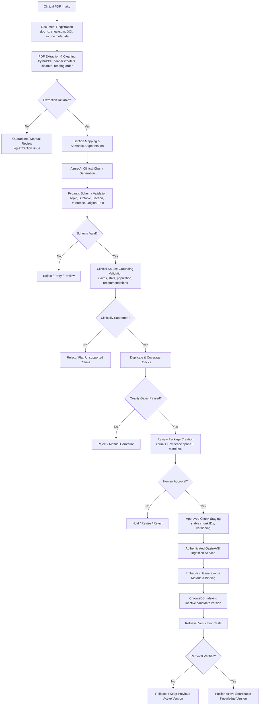
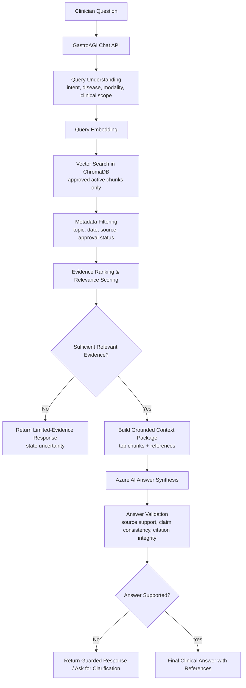
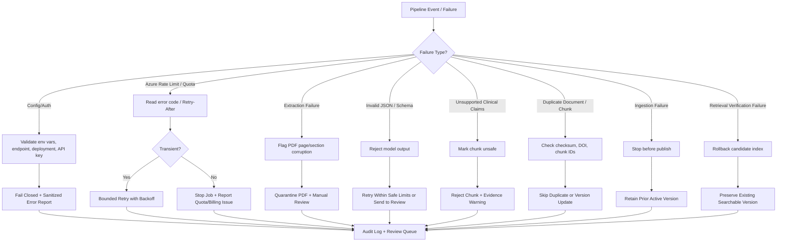
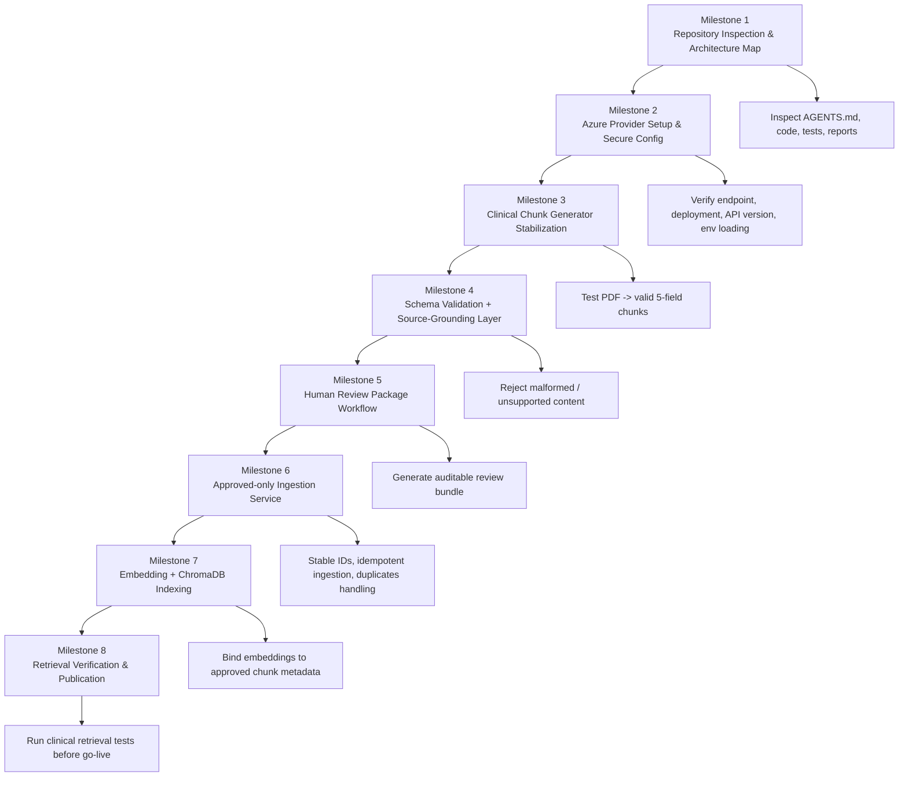
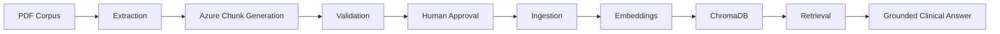

# GastroAGI TASK11 — Flowchart Pipelines

## Pipeline A — PDF to Clinical Knowledge

---

## Pipeline B — Clinical RAG Retrieval

---

## Pipeline C — Error Handling and Recovery

---

## Pipeline D — Codex Implementation Roadmap

---

## Optional High-Level End-to-End View

