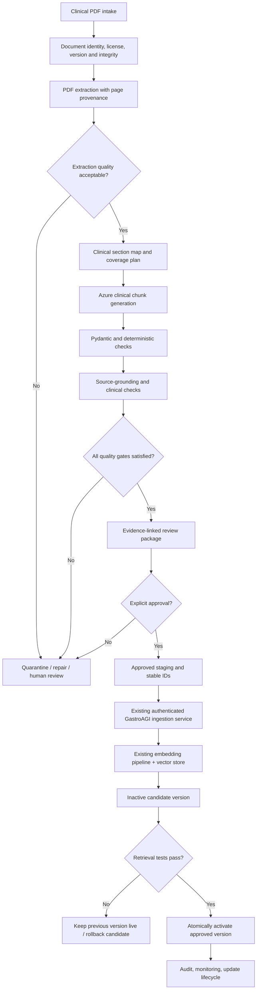
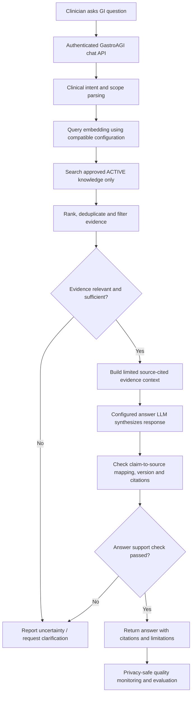

# GastroAGI TASK11 — Step-by-Step Clinical Knowledge Pipelines

**Architecture target:** Azure-powered, source-grounded, review-gated, version-aware, fail-closed PDF ingestion and clinical RAG retrieval.  
**Audience:** GastroAGI engineering team and Codex/TASK11.  
**Document type:** Proposed target-state design and incremental implementation checklist — **not a claim that every service is already implemented**.  
**Scope:** Gastroenterology, hepatology, endoscopy, IBD, GI oncology, and related clinical evidence.  
**Key constraint:** Eliminate repeated manual Admin Panel data entry **without bypassing clinical review or modifying production data prematurely**.

---

## 0. Design Principles and Current Baseline

### Non-negotiable principles

1. **Source fidelity:** Never invent a reference, numerical result, recommendation, or study characteristic.
2. **Fail closed:** Extraction corruption, LLM failure, invalid schema, unsupported claims, missing authorization, or failed retrieval verification must block publication. Never silently replace failed LLM chunking with raw-text chunks.
3. **Evidence traceability:** Each output chunk must have internal links to exact source pages, sections, and/or text spans where feasible.
4. **Clinical review:** Only explicitly approved content is eligible for indexing until benchmarking and governance authorize more automation.
5. **Provider boundaries:** Azure is the only *active* generation provider in TASK11. The existing provider abstraction may be retained for safe migration. Do not activate Swan or uncontrolled fallback.
6. **Separation of concerns:** Text extraction, clinical generation, validation, approval, ingestion, vector search, and answer synthesis must be independently testable.
7. **Versioning and idempotency:** Reprocessing the same unchanged PDF should not create duplicate active knowledge; a revised guideline should be versioned rather than silently overwriting history.
8. **Least privilege:** Secrets stay in local environment/secret management, never in commits, logs, prompts, or shared screenshots.
9. **No assumed infrastructure:** Verify the real GastroAGI API, embedding service, vector schema, and chatbot before writing production integrations.
10. **Clinical AI assists judgment:** Automated tests and LLM-based validation do not establish clinical correctness by themselves.

### Verified / reported current state (from existing TASK11 review)

- Implemented or reported in the current working copy: Python-based PDF extraction, cleaning, clinical chunk-generation seam (`ChunkGeneratorProvider.generate(...)`), generation tests, Pydantic schema checks, local validation, human-review outputs, and a safe no-upload test flow.
- Azure integration is the current migration priority; exact endpoint, service type, deployment name, model capability, and API version must be confirmed against the actual Azure resource.
- Earlier CodeX inspection found that production FastAPI ingestion contracts, ChromaDB collections, embeddings, and chatbot retrieval integration were **not established in this TASK11 working copy**. Recheck against the actual GastroAGI backend before claiming they exist or creating adapters.
- Any existing OpenAI legacy class should be kept unreachable in runtime during controlled Azure-only migration unless separately approved for removal.
- Passing unit tests establishes tested software behavior, **not** clinical quality or live Azure connectivity.

### Five-field Admin Panel output contract

Each reviewed chunk must contain exactly these **user-facing fields**:

| Field | Meaning |
|---|---|
| `Topic` | Principal searchable clinical condition/entity |
| `Subtopic` | Specific aspect of the condition/entity |
| `Section` | Short, precise, searchable chunk title |
| `Reference` | Verified source citation |
| `Original Text` | Typically **150–250 words**, one independent clinical concept, faithful to the source |

**Important:** Internal provenance and workflow metadata belong in a **separate record or envelope**, not as sixth/seventh Admin Panel fields.

---

# PIPELINE A — PDF → Approved, Searchable Clinical Knowledge

## A.0. End-to-end overview



> **Status:** This chart describes a **target-state workflow**. Steps A.9–A.13 depend on discovery of the real GastroAGI backend and index/publish capabilities.

## A.1. Intake and register PDF

**Input:** One or more journal articles, RCTs, reviews, consensus statements, clinical practice guidelines, or approved source documents.

**Process:**

1. Accept PDF from approved directory, upload interface, or future batch intake.
2. Confirm the file exists, can be opened, and is a PDF; record size, page count, and SHA-256 checksum.
3. Capture known source data: document title, journal/society, publication date, DOI, version, document type, original filename, acquisition source, and access/license status.
4. Assign an internal `document_id` independent of its filename; determine whether checksum/DOI/version already exists.
5. Route exact duplicates to **no-op/report**. Route revised editions to a **new source version**, not an uncontrolled replacement.

**Pass:** A valid, uniquely identified source with an auditable manifest.  
**Fail:** Corrupted/unreadable or unauthorized document → quarantine, no LLM request.

## A.2. Extract page-aware clinical content

**Process:**

1. Use PyMuPDF or the verified existing extractor.
2. Preserve page indices and approximate text span/block provenance before cleaning.
3. Detect multi-column pages, broken reading order, broken ligatures, headers/footers, page numbers, reference lists, figure captions, tables, and supplementary references.
4. Remove repeated layout artifacts **without** deleting real clinical statements or measurement units.
5. Flag tables, charts, figures, or scans containing clinically essential evidence that text extraction cannot reliably represent.
6. If OCR or a separate table/figure processing method is later necessary, integrate and validate it as an explicit, auditable branch—not a silent guess.

**Output:** Ordered, cleaned page/section text with provenance and extraction warnings.  
**Pass:** No unreconciled critical corruption or omitted relevant sections.  
**Fail:** Quarantine or manual correction; never send corrupted evidence to generation as if complete.

## A.3. Extraction quality gate

Run automated checks for:

- Empty or unusually short pages / unexpectedly low total word count.
- Missing expected article sections, scrambled columns, or reference/body interleaving.
- Truncated tables or equations; garbled numerators, denominators, percentages, HRs, CIs, P-values, doses, dates, and endpoints.
- Repeated paragraphs or implausible reading order.
- Page-level warning count and unresolved critical evidence.

**Decision:** `PASS`, `NEEDS_REVIEW`, or `BLOCKED` with reasons. Avoid relying on one arbitrary text-length threshold as proof of success.

## A.4. Create source section map and semantic coverage plan

**Process:**

1. Detect meaningful section boundaries (e.g., background, methods, population, outcomes, recommendations, adverse events, limitations).
2. Build a manifest listing clinically relevant concepts and source spans.
3. Design overlapping *context windows* only where needed to preserve meaning; track which source spans have been processed.
4. Plan bounded model requests based on the **verified Azure deployment** context window and output limits.
5. Distinguish primary study findings, secondary analyses, author interpretation, and guideline recommendations.
6. Track coverage explicitly: `planned`, `generated`, `validated`, `excluded-with-reason`.

**Output:** A coverage manifest and source-anchored generation units.  
**Pass:** No silent source truncation; every clinically material section is included or explicitly excluded with a reason.

## A.5. Azure-powered clinical chunk generation

**Prerequisites:** Verify Azure service type, endpoint, deployment ID, API version (if required), supported request parameters, authentication, and structured-output capabilities. A public model name alone may not identify the deployed resource.

**Process:**

1. Select Azure as the **only active** LLM provider; keep generation interface independent of transport.
2. Give the model source-grounded, section-limited text and the exact five-field contract.
3. Ask for one self-contained clinical concept per chunk; usually target 150–250 words.
4. Retain clinical qualifiers, comparator details, timeframes, effect sizes, confidence intervals, and limitations when supported.
5. Require exact source support. Do not produce facts from external model knowledge that the supplied document does not support.
6. Prefer documented provider-native structured output; otherwise parse explicit JSON and apply strict Pydantic validation.
7. Preserve generation metadata: deployment/model identifier, prompt version, relevant source span references, token use where reported, and completion/failure status.
8. Retry **only** transient, retryable request failures, within bounded request/cost limits. Do not silently switch models/providers.

**Output:** Candidate clinical chunks plus separate provenance metadata.  
**Fail:** Authentication, quota, unsupported parameter, truncation, or invalid response → report and stop affected unit. Never raw-text fallback labeled as generated knowledge.

## A.6. Technical validation (Gate 1)

Use deterministic checks and Pydantic for:

- Exactly five required user-facing chunk fields, nonempty correct types, valid content envelope.
- Valid JSON / response structure and complete output (no truncated/unclosed objects).
- Reference format and presence of source-identifying details.
- Target length guidance (exceptions flagged rather than blindly padded).
- Duplicate and near-duplicate detection across and within a document.
- Valid encoding and non-garbled medical terms.
- Coverage manifest reconciliation and expected output counts where measurable.

**Outcome:** `VALID`, `REVIEW`, or `REJECT`. A structurally valid chunk is **not yet clinically verified**.

## A.7. Source-grounding / clinical fidelity validation (Gate 2)

**Process:**

1. Match every substantive clinical claim and numeric finding to source evidence where feasible.
2. Compare populations, arms/comparators, timeframes, intervention names, endpoints, adverse events, guideline recommendation strength, and statistical results against original sections.
3. Flag altered denominators, units, effect directions, CIs, P-values, study design, and unsupported generalizations.
4. Inspect contradictions and overstatements. Preserve uncertainty and observational-study limitations.
5. Flag source-critical information present only in diagrams/tables that extraction could not process.
6. Use optional model-assisted checks only as secondary signals; they are **not independent proof**.
7. Require human adjudication of clinically consequential uncertainty and any rejected/unsupported claims.

**Output:** Claim/evidence matrix or compact warnings with exact source spans, plus clinical review status.

## A.8. Human clinical review / approval gate

Generate a **review package** (JSON/CSV/DOCX/HTML as appropriate, but do not change the five-field chunk contract) containing:

- The five-field chunk payload.
- Title/DOI and source version.
- Source page/section/snippet references.
- Extraction warnings and clinical-fidelity findings.
- Duplicate/conflict markers.
- Reviewer decision, timestamp, revision history, and rationale.

Statuses: `PENDING_REVIEW`, `APPROVED`, `REJECTED`, `NEEDS_CORRECTION`.

**Rule:** An unattended software job must **never** interpret an absence of rejection as approval.

## A.9. Prepare approved ingestion package

**Entry condition:** Explicitly approved and still associated with the exact validated source/prompt/model version.

**Process:**

1. Generate stable `chunk_id` from a documented canonical identity scheme (e.g., document/version + canonical concept/span identity); avoid random IDs on each re-run.
2. Keep the five user-facing fields unchanged; carry internal metadata separately.
3. Build an idempotency key and record source checksum, reviewer approval, and payload version.
4. Validate batch sizes and ensure only approved records are eligible.
5. Queue for **staging**, not immediate live search.

**Outcome:** Deterministic approved payload ready for the real backend contract.

## A.10. Ingest through the **actual existing** GastroAGI service

**Hard dependency:** Inspect the real backend implementation, authorization method, request/response schema, embedding contract, and error handling. **Do not invent** an endpoint such as `/api/admin/knowledge/chunks/bulk` unless it is confirmed or separately approved and implemented.

**Process:**

1. Authenticate as a least-privileged ingestion operator/service.
2. Submit approved chunks via verified service/API, preferably in bounded idempotent batches.
3. Use server-side schema validation and transactional or recoverable processing.
4. Handle partial failures with explicit IDs and retry-safe status tracking.
5. Record actual accepted/rejected counts and ingestion job ID.
6. Never write directly to a live vector collection in ways that bypass existing metadata, embeddings, permissions, or audit rules.

**Fail:** Keep the batch staged; do not mark content searchable or move originals as completed.

## A.11. Embedding and vector storage

**Process:**

1. Use the embedding model and preprocessing configuration **actually used by the GastroAGI retrieval system**; validate dimensions and distance metric compatibility.
2. Embed only reviewed and accepted content.
3. Upsert with stable IDs and metadata: document identity/version, chunk ID, source, approval status, active/candidate version, and citation fields.
4. Write to a candidate/non-live collection or use an equivalent visibility mechanism verified against the backend.
5. Record embedding version, schema version, indexing counts, and checksums.

**Caution:** Azure LLM generation and embedding providers are independent choices. Do not assume the same Azure model or SDK provides suitable embeddings.

## A.12. Retrieval verification (Gate 3)

Before activation, run controlled checks against the candidate index:

1. Exact title/DOI and exact-source lookup.
2. Clinically meaningful synonym/paraphrase queries.
3. Important numbers, comparator questions, and negation-sensitive prompts.
4. Source citation, document version, and chunk metadata integrity.
5. Duplicate/revised-document exclusion checks.
6. Search visibility: unapproved content is absent from live retrieval.
7. Basic latency, ranking, and retrieval regression tests against approved fixtures.

**Pass:** Correct, traceable chunks are retrievable and the earlier active index is unaffected.  
**Fail:** Leave candidate inactive; fix indexing or mapping and re-run checks.

## A.13. Publish, audit, monitor, update

**Process:**

1. Activate the verified candidate version via a controlled alias, active-version flag, or other existing backend-supported mechanism.
2. Keep the previous approved version recoverable for rollback.
3. Record publisher, time, source version, model/prompt/embedding versions, checks, and retrieval results.
4. Monitor ingest failures, stale guidelines, retrieval regressions, duplicate documents, and citation faults.
5. For corrected/retracted/superseded papers, execute a versioned update/deactivation workflow with audit records.
6. Archive or move source PDFs only after the verified end-state and according to explicitly approved retention rules.

**Success:** Approved, versioned knowledge becomes searchable, with a verified rollback route.

---

# PIPELINE B — Clinician Question → Supported Answer

## B.0. End-to-end overview



> **Status:** This is the desired retrieval-side behavior; determine what the production GastroAGI chatbot actually uses before replacing or duplicating it.

## B.1. Receive and scope the clinical question

- Apply actual backend authentication/authorization as appropriate.
- Classify question type: treatment, safety, trial outcome, recommendation, diagnostic strategy, or research summary.
- Identify disease, intervention, population, outcome, date/society/version constraints, and explicit uncertainty.
- Do not log patient identifiers, unredacted PHI, or confidential questions in general debug logs.

## B.2. Construct compatible retrieval query

- Normalize terminology, clinically meaningful synonyms, and exact-study identifiers without changing the meaning.
- Use the active index's verified embedding model and dimension/configuration.
- Apply metadata filters for approved/active content and relevant jurisdiction or guideline version when required.

## B.3. Retrieve, rank, and assemble evidence

- Search the current approved version only.
- Rank by clinical relevance and source fit; avoid outdated/superseded records unless history is requested.
- Deduplicate overlapping chunks; preserve exact source metadata.
- Distinguish guideline recommendations from original studies and commentary.
- Prefer direct supporting passages rather than padding context with loosely related chunks.

## B.4. Sufficiency decision

- Check whether retrieved sources address the actual PICO/clinical question and any requested date/version.
- When evidence is weak, missing, inconsistent, or off-topic, explicitly state limits and **do not fabricate an answer**.
- In uncertain cases, ask for context or present a cautious evidence summary without unsupported recommendations.

## B.5. Evidence-grounded answer generation

- Supply only the selected, citation-labeled evidence and carefully scoped instructions to the configured answer model.
- Demand distinction between source statements and synthesis/inference.
- Present effect sizes, denominators, recommendation strength, study design, and uncertainty accurately.
- Never imply that a chunk is a current society guideline unless source metadata supports it.

## B.6. Verify answer support and citations

- Check key clinical claims against provided retrieved passages.
- Confirm citation-to-document IDs/versions and that cited source actually supports the linked claim.
- Reject or qualify unsupported conclusions, stale recommendations, invented statistics, or mismatched references.
- If verification fails, return a conservative limited answer or evidence-insufficiency message; do not fabricate citations.

## B.7. Return and observe

- Display the answer with source titles/references and uncertainties; link to source content only when licensing and product permissions allow.
- Track deidentified relevance/citation-error rates, latency, and user feedback.
- Feed verified retrieval failures back into evaluation and controlled ingestion updates, not automatic unreviewed database rewriting.

---

# PIPELINE C — Operational Safety and Recovery

This cross-cutting workflow applies to both Pipeline A and B.

| Event | System response | Must not happen |
|---|---|---|
| Invalid Azure key / wrong endpoint / deployment | Stop, report sanitized diagnostics and missing non-secret config | Retry blindly, leak secrets |
| Azure quota/429/503 or timeout | Respect documented retry constraints, bounded backoff; mark affected unit incomplete | Unbounded spending or silent provider switching |
| Corrupted PDF / incorrect reading order | Block and flag pages/sections for repair | Generate authoritative-looking chunks from corrupted evidence |
| Malformed or incomplete JSON | Reject, log sanitized failure, optionally retry within limits | Accept partial chunks |
| Unsupported clinical claims or wrong statistics | Quarantine chunk, link source spans, request review | Index fabricated findings |
| Human review pending/rejected | Keep outside live indexing | Treat pending as approved |
| Partial bulk ingestion failure | Preserve per-chunk status and safe replay | Duplicate active chunks or mark whole batch successful |
| Retrieval verification fails | Keep candidate inactive / preserve prior version | Publish unverified version |
| New revision/retraction | Version and re-evaluate before activation | Silently replace citations without audit |

## Operational states

A proposed high-level job state machine:

`RECEIVED → REGISTERED → EXTRACTED → EXTRACTION_APPROVED → PLANNED → GENERATED → TECHNICALLY_VALID → CLINICALLY_REVIEWED → APPROVED → STAGED → INDEXED_CANDIDATE → VERIFIED → ACTIVE`

Side states: `FAILED`, `BLOCKED`, `NEEDS_REVIEW`, `REJECTED`, `ROLLED_BACK`, `SUPERSEDED`.

Every state transition should have a timestamp, actor/system identity, reason, and input/output version. Use durable storage for state if jobs must survive process restarts.

---

# PIPELINE D — Build Order for Codex / TASK11

**Do not build everything in one unreviewed change.** The following sequence reduces both risk and rework.

## Milestone 1 — Stabilize Azure generation (no database writes)

**Goal:** A controlled PDF test produces valid, source-reviewable chunks through the real Azure deployment.

1. Verify Azure resource/service, endpoint, deployment name, API version requirements, and model features from actual settings.
2. Make Azure the only runtime-selectable provider; preserve nonactive legacy code only under an approved migration plan.
3. Secure configuration loading and run opt-in low-token connectivity test.
4. Preserve the existing five-field output, source prompt, and fail-closed behavior.
5. Run mock tests and a single approved, low-cost PDF test.

**Acceptance:** Connectivity verified, test report complete, no raw fallback, no database/PDF state changes, and reviewed source-grounded chunks.

## Milestone 2 — Extraction quality + provenance

**Goal:** Trust the source entering the model.

1. Capture page/block trace before cleanup.
2. Test on multi-column articles, long guidelines, and documents with tables/figures.
3. Add explicit warnings and extraction quality gate.
4. Build a reproducible source manifest and content checksum.

**Acceptance:** No known critical silently lost evidence in benchmark PDFs; flagged failures routed for review.

## Milestone 3 — Section planner + coverage + generation improvements

**Goal:** Clinically complete yet concise chunking.

1. Build section-to-source mapping and coverage manifest.
2. Use bounded, section-level generation rather than uncontrolled full-PDF context.
3. Preserve one clinical concept per 150–250-word chunk where appropriate.
4. Track coverage, duplication, prompt version, and model output truncation.

**Acceptance:** Reviewers confirm that important evidence is represented without merging unrelated findings or fabricating conclusions.

## Milestone 4 — Source-fidelity QA + reviewer workflow

**Goal:** Reliable approval decisions.

1. Implement deterministic schema/content checks.
2. Add source-evidence comparison and numerical-consistency review flags.
3. Produce evidence-linked review package.
4. Require explicit approval and retain rejection reasons.

**Acceptance:** Unsupported claims and malformed chunks do not pass to approved staging.

## Milestone 5 — Discover *real* backend ingestion contract

**Goal:** Know exactly how GastroAGI stores/retrieves knowledge.

1. Obtain relevant backend repo/API definitions with authorization.
2. Confirm auth, requests/responses, metadata, embedding configuration, vector collections, stable IDs, and published-version behavior.
3. Document mismatches between TASK11 five fields and backend schema.
4. Design adapter before enabling writes.

**Acceptance:** An accurate signed-off API and vector contract; no invented endpoints or production changes.

## Milestone 6 — Safe ingestion adapter and candidate index

**Goal:** Submit only approved chunks idempotently.

1. Implement authenticated, bounded batch submission against the verified backend.
2. Validate IDs, duplicates, source versions, and approval state.
3. Ensure non-live candidate indexing or another proven equivalent.
4. Simulate failures/retries against staging/test resources.

**Acceptance:** Correct counts/metadata, safe replay, recoverable failures, no exposure of unapproved records.

## Milestone 7 — Retrieval verification and controlled activation

**Goal:** Make approved chunks discoverable without damaging live results.

1. Run title/DOI, clinical paraphrase, negation, revision, and citation metadata tests.
2. Verify that the answer context retrieves the correct approved source.
3. Publish via a controlled version/alias switch or verified equivalent.
4. Prove rollback works.

**Acceptance:** Retrieval results meet agreed benchmarks; previous index stays usable when activation fails.

## Milestone 8 — Small batch pilot, monitoring, and rollout

**Goal:** Scale carefully after validated end-to-end behavior.

1. Start with a **10-PDF benchmark** covering RCTs, guidelines, reviews, and difficult layout cases.
2. Record per-document extraction completeness, accuracy of key numbers, source support, duplicate rate, review corrections, retrieval precision, latency, and cost.
3. Investigate failures and set sign-off thresholds **using benchmark results**, not arbitrary invented percentages.
4. Move to small reviewed batches, then larger resumable batches only with explicit approval.
5. Keep human approval in place until the team authorizes a defined alternative governance process.

**Acceptance:** Documented benchmark, repeatable tests, monitored workflow, rollback, and reviewer sign-off.

---

# Repository Layout (Suggested, Not Yet Verified)

Avoid renaming working files without a migration need. This is a conceptual separation, not an instruction to create every file immediately.

```text
D:/gastroagi-chunk-pipeline/
  AGENTS.md
  src/
    pipeline.py                   # Existing orchestration entry point
    chunk_generator.py            # Existing Azure provider seam/generation
    ...                           # Existing extractor and validators
    intake/                       # Future source manifests/versioning
    source_mapping/               # Future page/section coverage metadata
    review/                       # Future explicit approvals and review packs
    ingestion/                    # Future verified backend adapter
    retrieval_tests/              # Future candidate-index smoke checks
  tests/
    ...                           # Unit and integration regression tests
  docs/
    architecture.md               # Verified as-built vs target design
    azure-integration.md          # Actual deployment config without secrets
    clinical-validation.md        # QA rules and review procedures
    ingestion-contract.md         # Actual backend schema and auth
    project-decisions.md          # Approved architecture decisions
```

## Suggested internal metadata envelope (not Admin Panel fields)

```json
{
  "document_id": "<stable-id>",
  "source_version": "<verified-version>",
  "document_sha256": "<checksum>",
  "chunk_id": "<stable-chunk-id>",
  "source_pages": [1, 2],
  "source_spans": ["<source-section-or-span-id>"],
  "prompt_version": "<version>",
  "llm_deployment": "<verified-azure-deployment>",
  "approval_status": "PENDING_REVIEW",
  "index_status": "NOT_INDEXED"
}
```

These are **illustrative field names**, not a known production schema. Use only names compatible with the actual backend after inspection.

---

# Final Codex Instruction: Implementation Discipline

When asked to implement this design:

1. Read `AGENTS.md`, relevant `SKILL.md`, this Markdown plan, and the verified TASK11 code.
2. Report the **as-built** behavior separately from this **target architecture**.
3. Identify the current milestone and dependencies; change only the minimum necessary files.
4. Consult **version-matched** official Python, Azure SDK, FastAPI, PyMuPDF, Pydantic, and vector database docs for affected functionality.
5. Present the proposed changes and tests before major structural work.
6. Preserve the five-field clinical output schema and fail-closed gates.
7. Never claim live Azure connectivity, clinical accuracy, API ingestion, or vector retrieval without actual supporting tests.
8. Never send credentials, protected health information, or unlicensed restricted material to an external endpoint without authorization.
9. Never index, upload, activate, or change production data without explicit permission.
10. End each milestone with actual test results, observed limits, file changes, follow-up decisions, and remaining risks.

**Definition of success:** The system can ultimately process a PDF through verified source extraction, Azure-assisted chunk creation, source review, approved backend indexing, retrieval verification, and controlled activation—**without requiring repeated manual Admin Panel entry** and without converting uncertainty into unsupported clinical statements.
