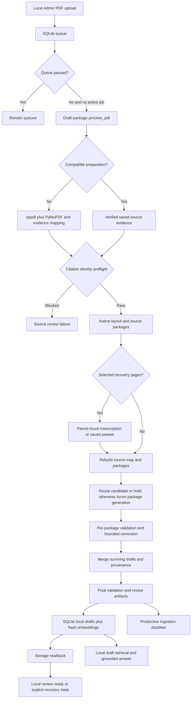
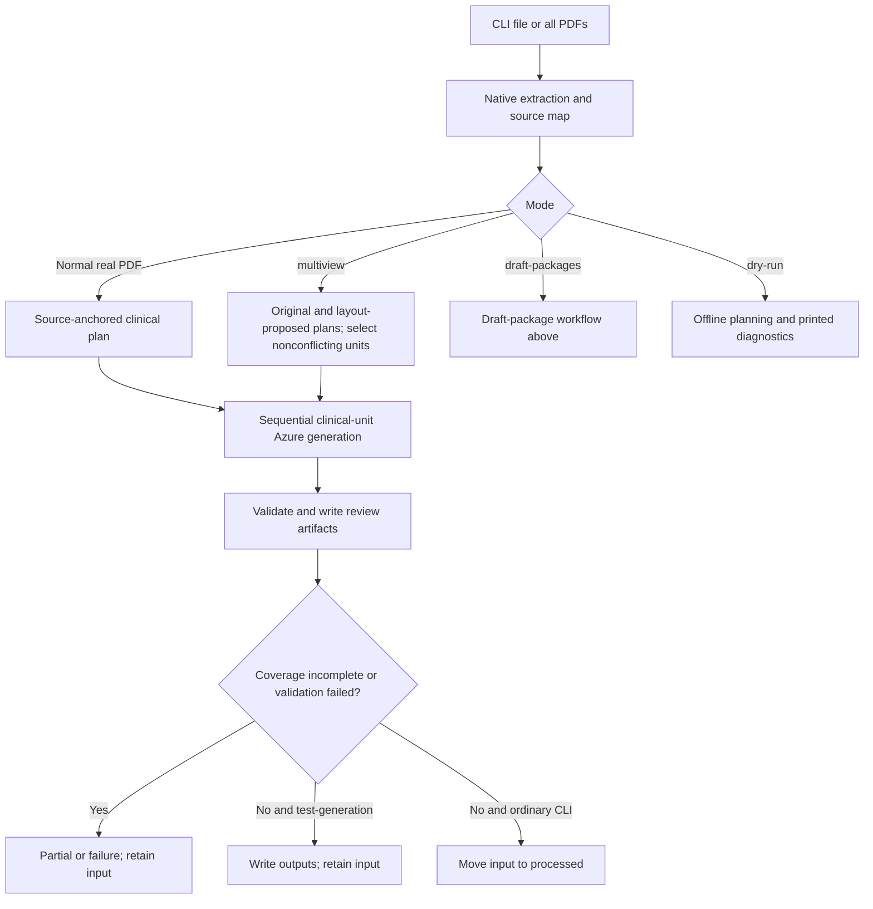

# GastroAGI — Current Pipeline Architecture, Workflow, Status and Performance Audit

Inspection date: **19 October 2026**. Primary database observation: **13:24:24 IST / 07:54:24 UTC**. Repository root: `D:\gastroagi-chunk-pipeline`.

This is an inspection-only report. No source, prompt, database, queue, PDF, checkpoint, saved medical output, dependency or deployment setting was changed. No generation, ingestion, service start, queue resume, paid request or test suite was executed. This new report is the only project file created by the audit. Clinical source text, generated medical passages and credentials are intentionally excluded.

Evidence labels: **VERIFIED** means directly inspected code, local file metadata or read-only SQL; **INFERRED** means an architectural implication without a dedicated experiment; **UNVERIFIED / NOT VERIFIED** means further runtime, backend, clinical or benchmark evidence is required. Existing verification reports are historical evidence, not tests newly executed here. Code references use the line numbers in this working copy; old profiles can contain earlier line numbers.

## 1. Executive Summary

1. **VERIFIED — A substantial local draft/retrieval pipeline exists.** PDF upload, durable queueing, dual native extraction, evidence mapping, source-package planning, Azure generation, deterministic/heuristic validation, resumable candidates, SQLite draft storage, hash embeddings and local answer assembly are implemented. The Admin processing entrypoint explicitly selects `draft_packages=True` and `test_generation=True`. It does not move uploaded PDFs. Evidence: `src/local_rag_chat.py:L263-L303`, `src/pipeline.py:L238-L451`, `src/local_chunk_store.py:L165-L295`.
2. **VERIFIED — Local review readiness is not completed clinical ingestion.** All eleven finished queue jobs are `partial_success` with incomplete source coverage. The package contract fixes `document_complete=False`; the pipeline fixes clinical approval at zero and returns partial success. Evidence: read-only `pdf_processing_queue.result_json`; `src/source_packages.py:L54-L68`, `src/pipeline.py:L538-L556`, `src/pipeline.py:L643-L651`.
3. **VERIFIED — Current durable state is paused and idle.** Thirty jobs comprise eleven `LOCAL_REVIEW_READY` and nineteen `QUEUED`; there are zero active, retry-wait, failed or action-required jobs. SQLite contains 229 chunk rows: 227 review drafts and two source-held rows. All 229 have matching embedding rows. No approved rows were observed. SQL basis and timestamp limits appear in section 9.
4. **VERIFIED — Production ingestion is explicitly disabled.** SQLite hash retrieval exists; production backend ingestion, production embeddings, ChromaDB and production chatbot retrieval are not established by this checkout. `database_upload_status()` returns `BLOCKED_UNVERIFIED_BACKEND`. The human-review gate always emits `approved=False` and `ingestion_allowed=False`. Evidence: `src/local_rag_chat.py:L306-L314`, `src/pipeline.py:L862-L874`, `requirements.txt:L1-L7`.
5. **VERIFIED — Accuracy and speed have separate unresolved issues.** Active package writing requires exact passage selection, not the requested clinician-facing paraphrasing. Clinical planning and validation use lexical/context rules, not a verified clinical relationship model. Requests run in bounded groups of two, so a slow group member delays new work. Recovery checkpoints materially change measured runtime. Evidence: `prompts/gastroagi_source_package_rules.md:L18-L32`, `src/concept_planner.py:L226-L303`, `src/chunk_validator.py:L638-L716`, `src/package_generation.py:L217-L248`.

The largest measured costs differ by workload: a recent 76-page run spent 103.387 seconds in generation versus 21.690 seconds in preparation; an older 70-page extraction profile spent 40.994 cumulative seconds in alignment and 32.505 in pypdf page reading. These are observations from different runs, not a universal performance ranking. No empty-cache end-to-end benchmark or clinical accuracy guarantee was established.

## 2. Repository Inventory

**VERIFIED:** the supplied root is the working project directory. There is no root `pipeline.py`; the CLI implementation is `src/pipeline.py`. `git status` reports that this directory is not a Git repository, so branch, commit, tracked-file and clean-worktree assertions cannot be made.

| Actual component | Responsibility / evidence |
|---|---|
| `src/pipeline.py` | CLI, orchestration, diagnostics, output subsets, review gate, source movement; `main` L54-L113, `process_pdf` L238-L670 |
| `src/local_rag_chat.py` | Primary upload/Admin/BOT server, durable queue, processing/storage bridge; L145-L382, L390-L995, L2095-L2371 |
| `src/local_admin_panel.py` | Separate upload-only server; `main` L44-L70, `create_server` L73-L79; not the generation queue |
| `src/pdf_extractor.py` | Both native libraries, quality selection, cleaning and front-matter citation identity; L66-L194, L297-L398, L479-L626 |
| `src/evidence.py`, `src/evidence_storage.py` | Typed source buffers/spans, mappings, warning provenance, bounded/checksummed source-map persistence; evidence L144-L167, L195-L240, L433-L478; storage L71-L156 |
| `src/source_map.py` | Section mapping and coverage/state; `build_source_map` L149-L206, `build_coverage_report` L315-L376 |
| `src/adaptive_ingestion.py`, `src/concept_planner.py` | Deterministic document routing, concept/context units and budgets; adaptive L72-L205; planner L194-L463 |
| `src/draft_support.py`, `src/native_layout.py`, `src/multiview.py` | Native corroboration, geometry/order proposals and cross-view conflict selection; support L42-L213; native L112-L160; multiview L131-L196 |
| `src/source_packages.py`, `src/package_generation.py` | Witnessed prose/visual packages, holds, isolated candidate attempts, correction, checkpoint reuse and grouped concurrency; packages L121-L297; generation L23-L255 |
| `src/hybrid_routing.py`, `src/visual_source.py` | Selective image recovery and two-pass Azure transcription; routing L18-L50; visual L49-L154 |
| `src/preparation_cache.py`, `src/generation_preflight.py` | Source preparation fingerprints and early citation gate; cache L33-L80; preflight L9-L21 |
| `src/chunk_generator.py`, `src/providers/` | Input assembly, strict output parsing, verified reference binding, Azure transport; generator L76-L316, L328-L564; Azure L46-L128, L228-L304 |
| `src/chunk_validator.py`, `src/numeric_evidence.py`, `src/source_abstention.py` | Technical/editorial/source checks, lexical numeric relationships, typed empty-source hold; validator L231-L315; numeric L25-L88; abstention L22-L31 |
| `src/queue_recovery.py` | Explicit retry/action classification; L7-L39 |
| `src/local_chunk_store.py` | SQLite transactions/readback, IDs, deterministic vectors, retrieval and answer grounding; L97-L413, L1287-L1329, L1580-L1600, L1625-L1713 |
| `src/admin_uploader.py`, `config/` | Optional Playwright population and selector configuration; uploader L49-L82, L140-L215, L243-L280 |
| `prompts/` | Article-level and source-package writing contracts; compared in section 13 |
| `tests/`, root diagnostic | 31 test modules; root `test_azure_connection.py` is a potentially live connectivity diagnostic, not an audit action |
| `tools/` | Evidence/planning/layout checks, replay and storage benchmark utilities; inspected as source, not executed |
| `docs/`, `PipelineGuide/` | Architecture, decisions, historical audits and target diagrams. Target ChromaDB/FastAPI diagrams are not implementation evidence |
| `input_pdfs/`, `processed/`, `output/`, `logs/`, `local_db/`, `tmp/`, `rag_uploads/` | Runtime material. Counts and sanitized diagnostics only are reported here |

Declared dependencies are pypdf, PyMuPDF, openai, Pydantic, python-dotenv, Playwright and pytest (`requirements.txt:L1-L7`). Installed versions observed through distribution metadata: pypdf 6.9.2; PyMuPDF 1.27.2.2; openai 3.26.1; Pydantic 2.13.5; python-dotenv 1.2.3; Playwright 1.62.0; pytest 9.1.1. LangChain, FastAPI and ChromaDB are not declared project dependencies. The older `docs/engineering/repo-baseline.md` dependency list omits the now-declared PyMuPDF and is not the current manifest.

## 3. Architecture and Workflow Diagram

The paths below are intentionally separate. They show code-verified transitions; no production transition is implied.

Evidence: `src/local_rag_chat.py:L711-L751`, `src/local_rag_chat.py:L832-L942`, `src/pipeline.py:L54-L140`, `src/pipeline.py:L273-L451`, `src/pipeline.py:L606-L670`, `src/adaptive_ingestion.py:L72-L205`, `src/multiview.py:L176-L196`. Mermaid rendering was not run; syntax was reviewed as Markdown only.

## 4. Detailed Stage-by-Stage Workflow

| Stage and responsible function | Input → output / method and scheduling | Cache, paid work, checks, recovery and timing |
|---|---|---|
| Upload: `parse_multipart_pdf_upload_batch`, `save_uploaded_pdf`, `enqueue_processing_jobs` (`src/local_rag_chat.py:L161-L232`, L501-L526) | HTTP PDF submissions → sanitized local files and durable jobs; deterministic request handling | Extension/payload checks, collision-safe paths, per-file rejection. No LLM. These mutation endpoints were not called |
| Claim/supervise: `_claim_next_queue_item`, `supervise_processing_queue` (L711-L751, L900-L918) | Queued/due-retry job → one active PDF; transaction protects FIFO ownership | Paused flag checked; one active PDF across queue. Heartbeat/stale recovery and bounded attempts. Queue timestamps persist; no per-stage duration ledger |
| Entry: `process_uploaded_pdf` (L263-L303) | Filename → `process_pdf` result plus storage/readback/counts | Loads environment and selects draft packages. Can incur paid generation/transcription. Result retains recovery signals from saved diagnostics |
| Preparation lookup: `load_preparation` (`src/preparation_cache.py:L33-L64`) | PDF bytes, filename, code/dependency/provider fingerprints → verified extraction/source-map cache or miss | Deterministic; visual cache preferred. Checksums, identity, sizes and reconstructed evidence/plan checks. Corrupt/incompatible cache misses. Included in `preparation_seconds` |
| Native extraction: `extract_pdf` (`src/pdf_extractor.py:L66-L194`) | PDF → raw candidates, cleaned pages/text, citation metadata and evidence | Sequential page extraction. No API. Per-page errors retained as warnings; empty/unsafe routes blocked or retained for explicit draft inspection. No separate extraction timer in current report |
| Identity gate: `require_source_reference` (`src/generation_preflight.py:L9-L21`) | Extraction → verified reference or `REFERENCE_IDENTITY_UNRESOLVED` | Draft route gates before visual requests and again in package generation. No paid call. Does not verify publisher identity externally |
| Native/source planning: `recover_native_layout`, `build_source_map`, `build_ingestion_plan` (`src/native_layout.py:L112-L160`; map L149-L206; adaptive L72-L205) | Native evidence → order proposal, source sections, eligible units/packages and holds | Deterministic, synchronous, several evidence checks/recomputations. Geometry ambiguity retained. Preparation timing aggregates this work |
| Hybrid recovery: `recovery_decisions`, `recover_visual_source` (`src/hybrid_routing.py:L18-L50`; visual L49-L154) | Unresolved selected pages → source PNGs and paired exact-agreement paragraphs | Pages/rendering sequential; at most two transcription requests for a page in parallel. Paid on uncached permitted passes. Pixel budget, PDF/image hashes, strict transcription schema and review flags. Completed individual passes survive another pass failing |
| Generation: `generate_source_packages`, `_generate_single_batch` (`src/package_generation.py:L23-L255`; generator L237-L316) | Materialized source package and prompt → candidate JSON / hold / typed failure | Queue selects concurrency two; groups have a barrier. Candidate/hold fingerprints enable reuse. Paid calls only for missing work/correction. Provider time per unit and generation wall time now recorded |
| Package assessment/correction (`src/package_generation.py:L150-L204`) | Candidate → accepted subset or one corrective regeneration or source hold | Deterministic local validation; one additional paid generation only when zero candidates are allowed. Some valid siblings survive rejection. Failed assessment/correction artifacts retained |
| Merge and final validation (`src/package_generation.py:L206-L255`; `src/pipeline.py:L486-L556`) | Surviving candidates → source-owned merged chunks, report and coverage | Ordered merge and exact five-content-field deduplication; final packet-specific source validation and cross-chunk checks. Package coverage stays incomplete. No separate validation timer |
| File persistence: `save_outputs` (`src/pipeline.py:L703-L749`) | Generated package/report/source state → JSON, Markdown, review/subset/quarantine/source-map/state/coverage files | Source map saved atomically with checksum; the complete multi-file output bundle is not one transaction. IO errors become output-writing failure; draft candidate checkpoints can survive |
| Local DB: `store_generated_chunks_for_result`, `ingest_chunks_file`, `verify_chunks_file_ingested` (`src/local_rag_chat.py:L317-L346`; store L165-L356) | Reviewable output → SQLite chunks/hash vectors and readback | Local transaction/upsert and matching-ID verification. No paid embedding. Failed/unverified status blocked; review drafts explicitly permitted. Persistent approval not granted |
| Queue completion/recovery (`src/local_rag_chat.py:L865-L942`) | Result/readback/recovery signals → review-ready, retry-wait, action/source review or blocked storage | Preserves previous stored count/output access if a later attempt fails earlier. Retry policy in `src/queue_recovery.py:L7-L39` |
| Retrieval/answer (`src/local_chunk_store.py:L359-L413`, L1287-L1329, L1580-L1600) | Question → local ranked draft chunks → extractive or Azure-grounded answer | SQLite full scan, lexical match plus hashed-vector score. Azure answer generation may be paid. Citation/numeric/claim heuristics can reject generated answer and fall back. This is not production retrieval verification |

Mode details:

- **Normal CLI:** real evidence uses source-anchored clinical units, not one unrestricted whole-PDF request. Units are generated sequentially and a later unit failure prevents return of the merged package (`src/chunk_generator.py:L96-L118`, L158-L234). Synthetic/legacy extraction without the real evidence graph can use bounded text batches (L119-L155).
- **`--file` / `--all`:** one selected path versus sorted input directory; CLI documents process sequentially. With no `--file`, the directory scan happens even without explicit `--all`; `--all` is not a separate parallel scheduler (`src/pipeline.py:L71-L96`).
- **`--draft-packages`:** witnessed prose/visual draft path, preserves old attempts by setting `force=False`, prepares source/candidate caches, isolates unit failures, permits partial local review. Both mode flags together select draft-package planning first (`src/pipeline.py:L250-L251`; adaptive L76-L92).
- **`--multiview`:** compares original and native-reconstructed source plans, retains duplicate/conflict decisions; it is not the Azure visual-transcription mode (`src/multiview.py:L131-L196`).
- **`--dry-run`:** skips generation, writes and input movement inside `process_pdf`, and does not create preparation checkpoints. It still performs native extraction/planning; CLI `main` initializes logging before dispatch, so the CLI help's no-write promise does not establish zero log writes (`src/pipeline.py:L61-L68`, L273-L276, L346-L352, L414-L438). It was not run here.
- **`--test-generation`:** real paid LLM generation plus output writes, but no final input move; it is not an offline test (`src/pipeline.py:L135-L138`, L652-L660).
- **`--validate-only`:** a separate validation entrypoint with logging/report implications; not invoked (`src/pipeline.py:L68-L69`, L678-L700).
- **`--check-llm` vs `--check-llm-config`:** the former makes a small paid-capable connectivity request; the latter is static configuration inspection. Neither CLI command was needed for this audit (L143-L235).
- **Review:** source/clinical uncertainty remains in reports, source holds, quarantine and local review storage. Final Admin form submission and clinical approval remain human tasks; see sections 8 and 14.

## 5. PDF Extraction and Evidence Architecture

**VERIFIED — Both libraries process every page on an ordinary uncached extraction when PyMuPDF opens successfully.** pypdf loops all pages first, then `_extract_pymupdf_pages` loops the complete PDF. This is a quality-comparison architecture, not fallback-only PyMuPDF. Import/open failure permits a pypdf-only result; page-count mismatch retains pypdf. Completed preparation reuse bypasses this extraction entirely. Evidence: `src/pdf_extractor.py:L88-L115`, L479-L522; `src/pipeline.py:L281-L285`.

Native text selection prefers pypdf unless the PyMuPDF quality score exceeds it by more than five. Scores penalize spaced letters, encoding/font artifacts, replacement glyphs and extreme padding; citation/DOI matches and bounded length contribute positively. This is text quality scoring, not proof of reading order or semantic correctness (`src/pdf_extractor.py:L555-L626`). Both raw candidates remain in the evidence graph (L175-L178).

pypdf requests layout mode, falls back to plain mode on error, and retries plain mode for output above 200,000 characters. PyMuPDF requests sorted text, can fall back to unsorted text for similarly inflated results, and separately collects unsorted dictionary geometry. Native layout also inventories image regions and all drawings. Consequently one page can undergo several text/geometry passes; sparse visual detection can additionally call image/drawing inventory before geometry does so. These calls are source-integrity work but are candidates for measurement and safe shared inventory, not deletion (`src/pdf_extractor.py:L495-L549`, L762-L780).

**Multi-column handling:** sorted extraction is only the initial view. Native recovery checks geometry, rotation, overlaps, block limits and full block extents, then recursively partitions unambiguous whitespace columns/rows. Ambiguous cuts retain a held route. Original and alternate buffers are preserved, with token comparisons and source mappings (`src/native_layout.py:L14-L46`, L112-L160). Multi-view planning holds overlapping representations with different native ownership/context instead of selecting a convenient interpretation (`src/multiview.py:L131-L169`).

**Tables/figures:** geometry, captions, visual regions and unresolved relationships are represented; there is no verified table-cell/arm/outcome reconstruction engine. Package planning holds structured relationships and the active writing prompt forbids importing table/figure results not stated in prose (`src/native_layout.py:L86-L93`; `src/source_packages.py:L187-L196`; `prompts/gastroagi_source_package_rules.md:L23-L29`).

**Scanned/image-only pages:** ordinary extraction flags or fails missing machine-readable text. Draft mode can retain the failed extraction for inspection, but the citation preflight occurs before image recovery. An entirely scanned document without a machine-readable focal reference can therefore stop before OCR/transcription. General unattended scanned-PDF support is only partial (`src/pdf_extractor.py:L198-L222`; `src/pipeline.py:L286-L302`).

**Visual recovery:** witnessed native pages avoid new image reading; reference-only, empty-without-visual and packaging-review pages can avoid it too. Damaged encoding, sparse visual pages, unresolved native prose or paragraph order can select it (`src/hybrid_routing.py:L18-L50`). The page is rendered at 1.5 scale under a 12-million-pixel bound. Two passes must uniquely agree on a clinical paragraph of at least 90 words; damage, structured evidence and boilerplate exclude paragraphs. Agreement is explicitly not independent medical verification (`src/visual_source.py:L90-L154`). Same-deployment transcription errors may be correlated: **INFERRED**, not measured here.

**Citation metadata:** first two pages/front matter only, cut before reference headings; focal DOI labeling and conflicts matter. Unsupported/conflicting identities clear reference authority. A readable owned DOI can be kept alone when bibliographic glyphs are damaged, with bibliography review retained. Citation spans are bound back to actual retained native candidates (`src/pdf_extractor.py:L297-L398`). No external DOI registry/publisher verification is performed by this path. Metadata beyond page two, atypical journal formats and multiple front-matter DOIs can cause conservative holds.

**Cleaning/bibliography:** repetitive margins, line wrapping and inline boilerplate are handled by `normalize_page_text` and helpers (`src/pdf_extractor.py:L783-L910`); whole-article cleaning stops at a reference heading (L225-L246). Package v2 independently recognizes embedded standalone bibliography headings and holds following material (`src/source_packages.py:L169-L196`). Exact raw text is retained; cleaning transformations are mapped and flagged, not declared clinically equivalent (`src/evidence.py:L195-L240`).

**Incomplete/corrupt evidence detection:** PDF hashes before/after extraction and visual recovery; zero-page/empty-source checks; page extractor errors; encoding/sparse-page blockers; native witness checks; source buffer content hashes; mapping gap/overlap and exact-character checks; source-map size/checksum validation. Evidence: extractor L167-L193; visual L148-L154; `src/evidence.py:L433-L478`; `src/evidence_storage.py:L120-L156`.

**Repeated work:** extraction constructs an initial adaptive plan, then pipeline constructs the source-aware plan; visual recovery rebuilds source mapping/planning. Package validation recomputes its source proof; generation, final source selection, and source-map save/load invoke that validation again. Cache keys hash PDF/module bytes repeatedly. These are verified call paths; their marginal costs on the latest workload are **NOT VERIFIED** (`src/pdf_extractor.py:L182-L186`; `src/pipeline.py:L333-L368`; `src/source_packages.py:L270-L282`; `src/package_generation.py:L36-L38`; `src/evidence_storage.py:L30-L42`; `src/preparation_cache.py:L33-L45`).

## 6. Clinical Concept and Source-Package Planning

**VERIFIED — Planning is deterministic lexical/rule-based.** It does not ask an LLM to build a document-wide clinical model. `_atoms` splits paragraphs and sentence-like boundaries; `_role` classifies headings, captions, notes, clinical propositions and unknown source using regexes. Mentions detect a finite population/intervention/endpoint/group vocabulary (`src/concept_planner.py:L14-L28`, L160-L191, L226-L248).

Clinical context uses heading domains, prior population/intervention/endpoint donors, group-definition matches, adjacent contrast/qualification language, and transitive supporting-context closure. Unknown referents, incompatible populations, structured evidence and warning dependencies block eligibility. Native support can prove source independence from unrelated page warnings; it does not certify clinical relationships (`src/concept_planner.py:L249-L303`, L311-L404). Compatible concepts group by section/domain/eligibility/supporting context under a 20,000-character request limit; changing context can produce small units and repeatedly materialize the same context (L405-L461). This is an architectural risk for request count, not a measured excess in every run.

The active Admin path uses **source packages instead of clinical units**. It starts from native text blocks, requires exact dual-extractor or line-supported witnesses, checks geometry/order, separates headings, boilerplate, bibliography, damage and structured evidence, and merges nearby compatible prose. It retains adjacent qualification holds when the neighboring source cannot be witnessed (`src/source_packages.py:L79-L118`, L121-L216). Native source corroboration establishes text origin; it does not independently establish population/intervention/outcome association.

| Package property | Verified behavior |
|---|---|
| Minimum source | 90 words; shorter coherent units are held (`src/source_packages.py:L129-L155`) |
| Typical grouping | Flush after accumulated pending prose reaches 350 words before the next addition; 350 is not a hard maximum (L199-L205) |
| Hard source size | Default 20,000 characters per package (`src/adaptive_ingestion.py:L22-L29`; packages L153, L219-L220) |
| Observed size | Latest eleven job-linked plans contain 249 packages spanning 90–397 source words; this is observed corpus range, not a universal maximum |
| Request budget | Default 80 units. Active `all_draft_packages=True` rebuilds with the discovered package count if larger; 80 is therefore not the Admin path's fixed cost cap (`src/adaptive_ingestion.py:L77-L82`) |
| Page boundaries | Native pending state flushes per page; visual packages own one page. No cross-page packages in the eleven inspected plans (packages L135-L162, L208, L260-L262) |
| Cross-page context elsewhere | Section mapping can merge cross-page paragraphs; clinical-unit context can span mapped pages. This does not make source packages cross-page (`src/source_map.py:L421-L458`; planner L344-L347) |
| Eligibility | Witnessed complete clinical prose under budget → draft; unresolved evidence → specific source hold; too many units → blocker. No packages → `EXTRACTION_BLOCKED` |
| Coverage | Holds, warning IDs and source ownership retained; package `document_complete` is always false (packages L54-L68). Source text accounted for does not mean clinically covered |

Latest job-linked plans have **18,731 source hold records**, including 8,448 reference-list records, 4,039 native-support-unresolved, 3,729 headings/labels, 1,764 insufficient-length, 320 structured/visual relationship records, 172 boilerplate, 92 incomplete paragraphs, 82 damaged-native-text, 52 unclassified clinical scope and 33 adjacent-qualification holds. These are region/paragraph records, **not 18,731 blocked packages or missing clinical facts**. Basis: each completed queue row's `result_json.output_dir/source_map.json`, decoded and checksum-checked read-only; same information is exposed by `build_coverage_report` (`src/source_map.py:L359-L376`).

Limitations: finite lexical vocabularies; sentence-boundary ambiguity; nearest-context association rather than full study modeling; cross-page package context gaps; exact wording/corroboration sensitivity to line layout; bibliography/reference boundary conservatism; incomplete coverage by construction. No clinical document understanding benchmark was found that resolves these limitations.

## 7. LLM Provider, Prompts and Generation

**VERIFIED static configuration:** `.env` selects `GASTROAGI_LLM_PROVIDER=azure`; Azure deployment identifier is `gpt-5.4`; configured API version is `2024-12-01-preview`. API key and endpoint are present; endpoint parses as HTTPS, an Azure OpenAI hostname and a root path without a query. Values were read through `dotenv_values` without loading application code or printing secrets. Deployment identifier is not proof of the actual underlying model/version/capabilities. Credentials, service acceptance, image support, context limits and deployment health are **NOT VERIFIED live**. The process's already-loaded environment may differ from the file. Registry and config validation: `src/providers/registry.py:L11-L20`; `src/providers/azure.py:L46-L80`, L307-L325.

| Setting / mechanism | Actual implementation |
|---|---|
| Normal/clinical/multiview prompt | `gastroagi_chunk_rules.md`; owned/context instructions appended for clinical units (`src/chunk_generator.py:L19-L20`, L207-L214) |
| Draft-package prompt | Default article prompt path swapped for `gastroagi_source_package_rules.md`; explicitly supplied custom prompt paths retained (`src/package_generation.py:L28-L30`) |
| Visual prompt | Inline strict transcription instruction, separate from chunk-writing prompts (`src/visual_source.py:L15-L19`) |
| User payload | Citation candidates/identity metadata plus materialized source, then provider source-file wrapper; source package budget excludes this additional overhead (`src/chunk_generator.py:L328-L356`; Azure L82-L92) |
| Max output tokens | **No explicit cap for ordinary generation/transcription.** Connectivity-only cap defaults to 16 (`src/providers/azure.py:L20-L26`, L185-L196, L251-L270) |
| Temperature / sampling / reasoning | Not explicitly passed by normal transport; effective provider defaults **NOT VERIFIED** |
| Structured output | Prompt requests strict JSON; no `response_format`/JSON-schema parameter on ordinary calls. Strict local Pydantic validation occurs after response, not server-constrained output (Azure L266-L270; generator L409-L440) |
| Timeout | 120 seconds per client request; not a whole-job deadline (Azure L20-L23, L228-L249) |
| Transport retries | SDK retries disabled; application allows two retries, up to three attempts. Retry-After/backoff capped at 60 seconds (Azure L82-L83, L251-L288, L422-L447) |
| Retryable statuses | 408/409/429 and selected 5xx, connection/timeouts; auth, quota, deployment and invalid requests stop (Azure L368-L413) |
| Parsing | Fenced/outer JSON accepted; duplicate keys rejected; one conservative local outer-object repair. No paid JSON repair call (generator L371-L406, L483-L496) |
| Normalization | Validate raw schema first; normalize key casing/trim strings and fill metadata numbering. Extra fields and count/type errors not silently coerced (generator L409-L440, L499-L520) |
| Reference binding | Fill blank references only from verified extracted authority; reject conflicting DOI/bibliography (generator L523-L564, L581-L631) |
| Provider completion | Missing choices/content/finish, refusal, length truncation, content filter and unexpected completion are typed failures (Azure L336-L357) |

**Scheduling:** ordinary clinical units are sequential (`src/chunk_generator.py:L158-L234`). Package calls default to one worker for direct users; pipeline draft mode explicitly requests two (`src/pipeline.py:L443-L450`). `generate_source_packages` submits only a group of one/two, waits for all group results in source order, then submits the next group. It is **not a rolling worker pool**. One slow request/correction/retry keeps the group from replenishing even if another worker is idle (`src/package_generation.py:L217-L248`). Different PDFs also run serially through queue claiming.

**Thread sharing:** the selected frozen Azure provider is shared across workers, but every `generate()` constructs its own SDK client and local audit dict; worker counters and files are isolated. No shared mutable production SDK client is apparent in this default code path. Injected custom factories/providers are not thereby proven thread-safe. There is also no explicit client connection-pool reuse across package calls (`src/providers/azure.py:L31-L44`, L82-L102, L228-L249`; `src/package_generation.py:L68-L89`).

**Requests per package:** zero for a compatible candidate or permanent hold; ordinarily one generation call; at most one corrective generation when initial assessment allows none. Each generation can make up to three transport attempts, so up to six transport attempts per package in one processing pass, excluding visual recovery and future queue retries. It is not a lifetime cap. Partially allowed candidates are filtered without correcting rejected siblings (`src/package_generation.py:L93-L139`, L157-L204`). A page can independently need two visual transcription calls, each with transport retries.

**Observed request/token accounting:** eleven latest completed-job reports record 107 logical generation requests and 107 successful-response transport attempts in aggregate, plus 156 resumed candidates. Successful-response usage sums to **183,925 prompt + 42,976 completion = 226,901 total tokens**. This sum excludes earlier attempts replaced by later reports, visual transcription, failed requests without usage and chatbot/connectivity requests. It is not a billing reconciliation or total project spend. `requests_started` is logical provider invocation count, not HTTP attempts. Usage/timing provenance: each job's `result_json.output_dir/validation_report.json`, `diagnostics.units[*].response`; recorder `src/chunk_generator.py:L255-L285`, `src/providers/azure.py:L94-L128`.

## 8. Chunk Validation and Clinical Integrity

### A. Deterministic technical validation

Strict Pydantic models reject unknown fields/types; article count must match chunks; duplicate chunk numbers fail. Every content chunk has exactly five required content fields, with optional internal `chunk_number`. Required article metadata, field presence, placeholder references, numbering, content shape and output count are checked (`src/chunk_generator.py:L41-L72`, L409-L481; `src/chunk_validator.py:L181-L212`, L245-L265, L319-L432).

Word targets are **150–250**, hard rejection below **90** or above **300**. Section rules reject >140 characters, generic headings, lowercase starts, apparent author starts and citation numbering. Generic Topic/Subtopic labels fail; cross-chunk classification differences warn. These are editorial rules, not clinical truth tests (`src/chunk_validator.py:L20-L23`, L435-L539, L982-L1008).

Exact/near duplication, repeated reference, affiliation/reference leakage, extraction artifacts, unexplained abbreviations and context-dependent phrasing are checked with rules/thresholds (`src/chunk_validator.py:L542-L611`, L1011-L1086). Some are warnings, not hard rejection. Technical consistency cannot substitute for clinical review.

### B. Heuristic source-fidelity validation

- Per-chunk bounded source ownership is required when selected packets are supplied. Numeric and claim checks run against these packets; visual drafts also compare numerics against native page text and receive explicit review warnings (`src/chunk_validator.py:L266-L279`).
- Numeric tokens retain lexical value, unit, inequality/sign and possible artifact ambiguity. Missing source values or explicit locally aligned sign/unit conflicts can error; endpoint/arm/timeframe uncertainty frequently warns (`src/numeric_evidence.py:L25-L77`). Numeric presence alone does not establish a correct statistical association.
- Claim grounding accepts exact normalized sentences or sufficient lexical overlap; short sentences/few-token sentences can automatically satisfy support. Unsupported recommendation language errors; other weakly supported clinical claims often only warn. Negative-result, endpoint, arm and recommendation-negation checks use finite patterns (`src/chunk_validator.py:L638-L716`, L865-L936`).
- Source evidence records retain request spans and selected provenance separately from canonical spans (L294-L307). This is useful auditability, not a guarantee of clinical equivalence.
- Focal DOI ownership and bibliographic checks occur in generation; standalone `validate_chunks` reference quality is weaker and does not itself re-establish article DOI ownership (`src/chunk_generator.py:L581-L631`; validator L415-L432).

### C. Human clinical judgment

Clinicians must still verify the study population and arm assignments, endpoint/timeframe associations, dose meaning, causal versus associative interpretation, omitted limitations, recommendation strength, visual-source fidelity, complete context and suitability for retrieval. The automated checks do not fully model these relations.

**Valid source-supported material can be rejected:** complete statements under 90 words; correct passages over 300; lowercase but legitimate section labels; unusual but valid bibliographic formats; missing/moved front matter; damaged extractor spacing; unsupported layout witnesses despite readable prose; strict phrase coverage rules. These are potential false-negative mechanisms, not a measured clinical false-rejection rate (`src/chunk_validator.py:L435-L506`; `src/source_packages.py:L79-L118`; `src/concept_planner.py:L607-L616`).

**Unsupported material can plausibly survive as a review draft:** a swapped arm/endpoint with similar vocabulary and existing numbers; an unsupported short/few-token assertion; a qualification lost outside the selected package; an error shared by both visual passes. Many uncertain associations warn and therefore remain locally retrievable. This is **INFERRED from code**, not a newly generated adversarial result (`src/chunk_validator.py:L673-L686`, L865-L875`; `src/numeric_evidence.py:L60-L76`; `src/local_chunk_store.py:L370-L379`).

Report status is FAILED if any error, REVIEW_REQUIRED if warnings only, otherwise PASS; per-chunk rejection/review is separate (`src/chunk_validator.py:L1139-L1187`). Clinical approval is not implied by PASS. Current package packets unconditionally add source-context warnings, consistent with zero PASS/source-supported chunks in latest reports.

## 9. Current Database and Queue Status

**Method:** direct standard-library SQLite connection to the absolute database file URI with `mode=ro&immutable=1`. No application status helper, schema initializer, PRAGMA, writable connection, backup or checkpoint command was called. The directory contained only the main SQLite file; no WAL/SHM/journal sidecars were observed. Immutable mode was chosen to avoid journaling/locking changes; a concurrently changing external writer could still limit snapshot guarantees. At observation no active jobs were recorded. Database size: 1,683,456 bytes; file mtime **2026-10-19 06:10:57.161003 UTC**. The application's convenience status functions are not strictly read-only because they call initialization (`src/local_rag_chat.py:L529-L558`; `src/local_chunk_store.py:L147-L149`).

| Requested status | Latest verifiable value | Authoritative basis / qualification |
|---|---:|---|
| PDFs known as jobs | 30 | `SELECT count(*) FROM pdf_processing_queue` |
| Distinct queued filenames | 30-file input inventory corresponds to thirty durable jobs; exact job totals are authoritative | Directory enumeration; no PDF opened/reprocessed in this audit |
| PDFs pending/waiting | 19 | Operational interpretation of QUEUED, not a separate PENDING state |
| PDFs queued | 19 | `SELECT status,count(*) ... GROUP BY status` |
| Queue paused | true | `SELECT key,value FROM pdf_queue_control`: paused=1 |
| Individually PAUSED jobs | 0 | No such persisted status; global pause governs the nineteen waiting jobs |
| PDFs active / retry-wait | 0 / 0 | Grouped status query |
| Local-review-ready jobs | 11 | `LOCAL_REVIEW_READY`; storage readiness only |
| Fully processed/complete-document jobs | 0 recorded in current queue | All eleven finished result JSON objects say partial_success and source_coverage_complete=false |
| Partially completed PDFs | 11 | `json_extract(result_json,'$.status')='partial_success'` |
| Current FAILED / ACTION_REQUIRED / SOURCE_REVIEW_REQUIRED jobs | 0 / 0 / 0 | Current queue status, not lifetime failure history |
| PDFs needing clinical review | 11 with saved drafts; remaining 19 have not reached readiness | All draft sources unapproved |
| PDFs with stored rows | 11 distinct source_file values | `SELECT count(DISTINCT source_file) FROM chunks` |
| Output package names in DB | 13 | `count(DISTINCT output_dir)`; includes historical/reclassified material |
| Latest-result generated candidates | 267 | Sum of queue generated_chunks; includes corrections and resumed material; not unique lifetime generation |
| Saved rows / usable local review drafts | 229 / 227 | `chunks` grouped by validation_status,review_status |
| Held rows excluded from retrieval | 2 | Both statuses SOURCE_REVIEW_REQUIRED; retrieval filter excludes these |
| Final-report REJECTED chunks in latest ready packages | 0 | Latest final reports; earlier package-level rejects were filtered before final merge |
| Total lifetime rejected candidates | **NOT VERIFIED** | No authoritative unique lifetime ledger; do not compute 267−227 as rejection count |
| Approved chunks | 0 observed | No approved review statuses; approval workflow missing |
| Locally stored/embedded rows | 229 / 229 | Counts in chunks/embeddings; zero missing embedding IDs |
| Production successfully ingested | **NOT VERIFIED externally** | Local integration disabled; historical verification artifact says production_writes=0, not a production DB query |
| Blocked source packages | No single canonical count | Latest ready reports contain 23 failed-unit records: 20 SOURCE_VALIDATION_FAILED and 3 SOURCE_PASSAGE_HELD; these are generation outcomes, not all source holds |
| Source holds | 18,731 across eleven current job-linked plans | Source region records, including nonclinical exclusions; see section 6 |
| Saved preparation checkpoints | 24 manifests: 13 native, 11 visual | `output/.preparation-cache/**/manifest.json`; existence, not proof every checkpoint remains compatible |
| Visual pass JSON / draft-cache JSON | 520 / 1,061 | File inventory; counts include historical/attempt/assessment material, not unique chunks |
| Permanent held-unit checkpoints | 19: 16 validation, 3 passage | `output/.draft-unit-cache/**/*hold-v1.json`; artifact counts, not latest job outcome totals |
| Input / processed / rag_uploads PDFs | 30 / 0 / 0 | Top-level *.pdf enumeration in each directory |

Latest queue update/finish: **2026-10-19 06:10:57.156333 UTC / 11:40:57.156333 IST**. Latest chunk update/audit: **06:09:22.090858 UTC / 11:39:22.090858 IST**. Current `last_error_code` has two REFERENCE_OR_CONTENT_INVALID and one SCHEMA_INVALID values retained on otherwise review-ready historical job rows; these are not three currently failed jobs.

**Server evidence:** `netstat -ano -p tcp` showed `127.0.0.1:8766 LISTENING`, PID 2536. This is the configured `local_rag_chat` port (`src/local_rag_chat.py:L2340-L2358`). Process ownership inspection via Win32_Process was access-denied; no process was restarted. No HTTP status/BOT endpoint was called because some GET paths initialize DB state (L2109-L2125; BOT L1555-L1556). Therefore a listener is **VERIFIED**, application identity/HTTP health are **NOT VERIFIED live**. An older report says Admin/BOT online; that does not supersede the current evidence limits.

## 10. Existing Performance Metrics

Run identifiers below disclose no article titles. `Qnn` means the completed queue rows ordered by page_count, then the observed row order for ties; durable job IDs are listed so each source is reproducible. Metric origin is the row's `result_json.output_dir/validation_report.json`; wall time is queue `finished_at-started_at` unless a named runtime artifact supplies elapsed_seconds. Queue timestamps can span retries because claiming uses `coalesce(started_at, ...)` (`src/local_rag_chat.py:L735-L745`); elapsed artifact times are preferable for an individual recovery.

| Run / job ID | Pages; extracted characters | Completed UTC | Queue span seconds | Prep / generation seconds | Planned packages; requests / resumed | Generated candidates → saved drafts |
|---|---|---|---:|---|---|---|
| Q01 `c0edac2a6ad045cdbbabb913e7e5cdcf` | 11; 54,292 | Oct 17 06:36:02 | 193.294 | unavailable / unavailable | 4; 5 / 0 | 5 → 4 |
| Q02 `299f26e609b54fa6aa17eb9ce821cae9` | 12; 117,577 | Oct 17 06:49:47 | 311.406 | unavailable / unavailable | 6; 7 / 0 | 7 → 5 |
| Q03 `2eb8920de639460395d48a0c9596eb3a` | 15; 274,851 | Oct 17 06:40:08 | 245.817 | unavailable / unavailable | 8; 10 / 0 | 10 → 8 |
| Q04 `d1a4aaef34524100ae4501cfa1909940` | 15; 161,096 | Oct 17 09:37:46 | 7.919 | 2.543 / unavailable | 9; 0 / 9 | 10 → 10 |
| Q05 `0640cf06a23c434288ae20a729dd77c4` | 16; 137,744 | Oct 17 06:32:48 | 246.290 | unavailable / unavailable | 7; 10 / 0 | 10 → 7 |
| Q06 `baaf2ac8a1a64a69919551ef721a5428` | 16; 311,350 | Oct 17 06:44:36 | 268.443 | unavailable / unavailable | 11; 15 / 0 | 15 → 11 |
| Q07 `7e7dffdae2e64874ba53a113f4c15827` | 18; 213,014 | Oct 17 10:21:19 | 240.758 | 155.199 / unavailable | 4; 6 / 0 | 9 → 3 |
| Q08 `3f1447a3c8444101b53939bfbaa8e6bc` | 30; 628,328 | Oct 19 06:00:26 | 62.002 | 30.947 / 27.164 | 32; 3 / 31 | 34 → 32 |
| Q09 `7e8eb6441af243109ccefc8d6bf96852` | 70; 1,190,491 | Oct 17 09:35:11 | 86.125 | 5.819 / unavailable | 65; 9 / 59 | 70 → 63 |
| Q10 `3f1306aff5ab4bb2a95146b0dd8bd257` | 76; 329,834 | Oct 19 06:09:22 | 127.683 | 21.690 / 103.387 | 30; 41 / 0 | 40 → 27 |
| Q11 `c9d30b6af6334a99a9ccf625d4e46ae5` | 124; 783,993 | Oct 19 06:10:57 | 19.492 | 5.334 / 7.797 | 73; 1 / 57 | 57 → 57 |

Extracted character values are exactly `diagnostics.characters_extracted`, not unique clinical words; padding/source representations make character count an imperfect workload proxy. All rows are partial clinical/source outcomes, including the fast ones. Final reports have zero hard-rejected merged chunks, but package-level failures/rejected candidates remain outside the final subset.

### Fresh preparation versus recovery

- Q04/Q09/Q11 reuse native+visual preparation; Q04 needs zero generation requests. Q11's individual recovery artifact reports **19.469 seconds**, one request and 57 resumed candidates (`tmp/latency-2026-10-19/live-retry.json`). These are recovery times.
- Q08/Q10 show preparation-cache flags false, but the historical run report explicitly says prior page transcription caches were reused. Q08 also resumed 31 candidate units. They are not empty-cache first uploads (`docs/engineering/ingestion-latency-review-2026-10-19.md:L40-L50`).
- An earlier 124-page main retest took **408.214 seconds**, 154.58 preparation and 245.75 generation according to the historical summary; later recovery replaced its active report. Origin: `tmp/latency-2026-10-19/live-final.json`, array item for the 124-page result; file mtime Oct 19 06:09:22 UTC; supporting summary L40-L46 of that engineering document.
- The three historical failed report artifacts record 59/73/30 requests, respectively, all failing REFERENCE_OR_CONTENT_INVALID: **162 wasted logical generation calls** before the later source-identity correction. The 124-page failed report has 988.968-second preparation; the 30-page failed report has 99.730 and 76-page 226.328. Original failure report mtimes: Oct 17 10:09:34 / 09:59:47 / 10:17:17 UTC respectively. These failures are historical, not the current implementation's preflight behavior. Reported approximately 1,478/587-second end-to-end values come from the historical engineering account, not a newly reconstructed precise timer (`docs/engineering/ingestion-latency-review-2026-10-19.md:L7-L19`).

### Three directly measured cost centers

| Cost center | Direct evidence | Limit |
|---|---|---|
| Generation/provider plus local generation-stage work | Q10: generation 103.387 s, request duration sum 168.281 s across 41 calls; max 5.367 s per recorded call; total 127.683 s | Parallel cumulative duration is not wall time; stage includes cache/checks/validation too |
| Evidence alignment | `tmp/hybrid-performance/optimized70/profile.txt` (mtime Oct 17 09:16:02 UTC): `align_buffers` 40.994 cumulative s; SequenceMatcher matching blocks 37.644 s | Historical cProfile overhead/build; not an independent benchmark of today's code |
| Native pypdf extraction | Same 70-page profile: page extraction 32.505 cumulative s; 15-page profile 11.333 s (`optimized15/profile.txt`, mtime Oct 17 09:13:14 UTC) | Different workload/cache and profiling conditions; cannot rank universally |

The 70-page profiled `extract_pdf` totals 88.073 seconds, versus 18.156 for the profiled 15-page extraction. Separate unprofiled preparation probes show 11.065 seconds for 15 pages and 51.380 for 70 pages (`tmp/hybrid-performance/native15.json`, mtime Oct 17 09:25:24 UTC; `native70.json`, Oct 17 09:18:29 UTC). They measure different operations and must not be combined into a speedup ratio. Baseline stack samples show earlier warning insertion/model equality bottlenecks; current warning indexes/localized routes already address those (`tmp/hybrid-performance/baseline15/stacks.log`; `docs/engineering/hybrid-performance-review-2026-10-17.md`).

**Output-token dominance:** Q10 records 42,684 prompt / 13,730 completion tokens; Q08 2,948 / 912; Q11 948 / 76. Nonstreaming `provider_seconds` includes transport, queueing, prompt processing and decoding. There is no time-to-first-token/decode split. Thus generation-stage dominance for Q10 is **VERIFIED**; output-token decoding dominating native reading across the corpus is **NOT VERIFIED**.

Missing measurements: separate extraction, geometry, evidence alignment, source-map, package planning, rendering/transcription, checkpoint IO/revalidation, local validation and storage times; per-pass visual tokens/duration; failed-attempt usage; synchronized request start/end and rate-limit idle spans; fresh empty-cache baselines. Add prospective timers around `extract_pdf`, `_native_page_layout`, `align_buffers`, `build_source_map`, `build_source_package_plan`, `recover_visual_source`, `load_preparation`, `validate_source_package_plan`, `validate_chunks`, `save_outputs`, `ingest_chunks_file` and `verify_chunks_file_ingested`. No timer implementation was made.

## 11. Failure Analysis and Root Causes

There are 27 top-level historical validation reports: 24 REVIEW_REQUIRED and 3 FAILED. These are attempts, not unique PDFs. All three FAILED artifacts are generation/reference failures described above. Across 189 saved package validation/repair assessments, hard-error rule occurrences are SOURCE_GROUNDING 88, SOURCE_FIDELITY 72, SECTION_QUALITY 29 and WORD_COUNT 9. One assessment can contain multiple rules and attempts can repeat a candidate. Counts do not measure unique incorrect clinical statements.

| Code / rule | Trigger and actual condition | Diagnostics, retry, paid work and recovery |
|---|---|---|
| REFERENCE_OR_CONTENT_INVALID | `_generate_single_batch`, generator L307-L313: reference binding/content validation raised; historical focal DOI/citation mismatch among causes | Unit outcome/code retained; package failure sidecar usually retains only code/fingerprint/retryable, losing the detailed exception reason. Not automatically a transient queue retry. Reprocessing uncached failed units can pay again |
| REFERENCE_IDENTITY_UNRESOLVED | `require_source_reference`, preflight L9-L21: no reference can pass deterministic source checks | Current draft path stops before paid recovery/generation. Source identity review needed. Failure report records preflight/no requests |
| SOURCE_VALIDATION_FAILED | Package generation L157-L193: no allowed candidate after initial assessment and at most one correction | Assessment/repair JSON preserves rules; latest hold records do not contain medical content. Permanent version-bound hold prevents repeating paid correction under same rules. Successful sibling packages survive |
| SOURCE_PASSAGE_HELD | Generator L294-L299 and `is_source_abstention` (`src/source_abstention.py:L22-L31`): properly typed zero-chunk response for correct source | Permanent source hold checkpoint. No automatic operational retry; source review. Earlier malformed empty replies were instead schema failures |
| EXTRACTION_BLOCKED | Generator L100-L112; package generation L34-L40: unsupported source/plan identity, blockers or no eligible prose | No usable full package; source/evidence and available failures can persist. Source correction/review, not blind paid retries |
| EXTRACTION_FAILED | Extractor empty/unreadable conditions; pipeline L306-L321 wraps extraction exceptions | Original reason logged/reported; input retained. General corrupted/scanned route needs extraction/source review. No automatic clinical reconstruction |
| INVALID_JSON | Generator L274-L293 and parser L371-L406: parsing/duplicate-key failure beyond local repair | Typed retry class at queue boundary. A future retry can incur generation requests; failed package sidecar does not preserve raw malformed reply |
| SCHEMA_INVALID | Generator L300-L305: strict keys/types/counts fail | Queue treats as recoverable up to configured attempts. Could be a persistent prompt/schema mismatch, so repeated paid retries are possible |
| SOURCE_FIDELITY / NUMERIC_RELATION | Validator/numeric module: unsupported numeric value or aligned explicit sign/unit conflict | Deterministic ERROR, rejected candidate; possible single paid package correction; source review after hold |
| SOURCE_GROUNDING | Validator L645-L679: recognized contradiction/unsupported recommendation errors; other unsupported claims warn | Rule-level diagnostics retained in assessments. ERROR triggers filtering/correction; WARNING requires clinical review and can enter local retrieval |
| SECTION_QUALITY / WORD_COUNT | Validator L435-L506: editorial constraints | Observed in saved failed assessments. Correction can consume a paid call; safe clinically meaningful source can still conflict with format rules |
| TRANSPORT_TIMEOUT / TRANSPORT_ERROR | Azure L103-L112, L368-L413 | Transport has bounded retries; queue uses explicit signals/retryable flag. Auth/quota stop remaining groups. Successful immutable work retained |
| AUTHENTICATION_FAILED / QUOTA_EXHAUSTED / CONFIGURATION_ERROR | Azure config/transport and queue recovery L10-L39 | Action required, not blind transient retry. No claim these are currently occurring |
| EMPTY_RESPONSE / MALFORMED_RESPONSE / OUTPUT_TRUNCATED / UNEXPECTED_COMPLETION | Azure L125-L128, L336-L357; transcription schema L107-L111 | Transport may succeed but output is unusable. Queue retry codes include these; paid re-request possible. Refusal/filter codes also exist but are not proven current failures |
| VALIDATION_FAILED / output_writing | Pipeline L503-L524, L590-L598 | Validation exceptions or persistence errors. Candidate checkpoints may survive; output bundle may be incomplete. Readback prevents false ready state |
| STORAGE_READBACK_INCOMPLETE | Queue recovery L23-L25 | Explicit retry signal when inserted rows do not verify. No clinical approval implied |
| PERFORMANCE_VERIFICATION_HOLD | Found in historical unit diagnostics; 32 occurrences across reports | Offline guard/test artifact, not an Azure outage or clinical rejection. Do not count as paid provider failures |

**Broad exception loss is real.** The queue intentionally replaces unexpected exception bodies with a safe generic message (`src/local_rag_chat.py:L845-L853`). This protects secrets but can obscure root cause without a safe exception identifier. `package_generation.attempt` discards detailed ChunkGenerationError messages at L133-L142; reference/content failures are conflated by the generator. BOT answer generation catches broad exceptions and silently returns empty, enabling fallback without exposing the reason (`src/local_chunk_store.py:L1287-L1304`). Logs may retain some detail but are not a structured authoritative failure ledger.

**Historical unnecessary regeneration is proven; future risk is mode-dependent.** Citation preflight, typed abstention and validation holds already fix specific repeated-work mechanisms. Remaining uncached malformed/schema/reference failures lack equivalent successful candidate reuse; rule/config fingerprints can invalidate saved work broadly; normal clinical generation lacks package-level persistent resumption. Do not apply an old failure diagnosis as if the recent fixes were absent.

## 12. Caching, Retry and Concurrency Behavior

| Layer | Identity / reuse | Limits |
|---|---|---|
| Preparation checkpoint | PDF bytes + filename + module hashes + installed extraction/Pydantic versions; visual also binds endpoint/deployment/API version (`src/preparation_cache.py:L33-L64`) | Renaming or broad module changes can invalidate reuse. Manifest count is not compatible-cache count. Corrupt cache rebuilds |
| Source-map storage | Versioned gzip/base64 envelope; uncompressed cap 256 MiB, SHA-256, identity fields, full evidence/plan validation (`src/evidence_storage.py:L25-L42`, L71-L156) | Compression saves storage, not all load/revalidation CPU. Complete extraction metadata cap 64 MiB |
| Visual page passes | PDF/page/rendered-image/prompt/provider fingerprint; individual pass JSON; image checksum (`src/visual_source.py:L93-L114`) | Both passes needed for corroborated paragraph; rendering can still occur before cache existence check. Same provider agreement is not medical approval |
| Generation candidate | Prompt/instruction/provider/reference/source identity, owned unit and source hash (`src/package_generation.py:L53-L89`, L113-L149) | Candidate schema/reference rechecked; current clinical checks reapplied. Successful attempts published exclusively using hard links |
| Source/validation hold | Source passage hold; validation hold additionally binds hash of all src Python implementation (`src/package_generation.py:L16-L20`, L90-L109, L188-L202) | Unrelated code change can invalidate a clinical hold. 19 saved hold checkpoints observed |
| Complete-output skip | Same source content plus reusable validated output (`src/pipeline.py:L382-L394`, L1210-L1278) | Not an unconditional filename skip. Draft packages remain partial; historical attempts retained |
| Section processing state | Document/config-sensitive source records; only PASS-owned/completed concepts process sections (`src/source_map.py:L227-L312`) | Does not replace per-package candidate checkpoints; rejected/review-only material cannot establish complete coverage |

Queue automatic delays are 30, 120, 600 and 1,800 seconds, with action after exhaustion; stale interrupted jobs also have an attempt bound (`src/queue_recovery.py:L7-L39`; `src/local_rag_chat.py:L606-L637`, L875-L892). No queue action occurred during this audit. A job can preserve previously stored drafts while remaining in retry/action state (L865-L874).

Concurrency is layered: one PDF job, at most two generation workers, at most two image passes per current page, no overlap of whole-page extraction/visual preparation with later chunk generation. Generation scheduling waits for each group; rendering/evidence assembly are sequential. Auth/quota breaks later group submission after the current group completes. This is bounded and ordered, but can leave a worker idle; throughput benefit from rolling scheduling is **INFERRED until benchmarked**.

## 13. Clinical Prompt/Validator Consistency

Contract A below is the desired Admin/editorial contract provided with this audit request. No independently authoritative current production Admin instruction document was supplied or found that establishes a different A. The reusable uploader exposes five form fields; it does not encode a full writing rubric.

| Dimension | A: supplied editorial objective | B: article prompt | C: active source-package prompt |
|---|---|---|---|
| Input | Complete article understood clinically | Complete cleaned article plus verified metadata | One bounded passage, explicitly not whole article |
| Count | Independent concepts; no arbitrary count | Content determines count; most papers about 4–8 | One for short evidence, at most three for longer evidence |
| Words | Approx. 100–200, completeness prioritized | Normally 150–250 | 90–250 when supported |
| Writing | Faithful clinician-facing paraphrase | Professional language and clinically useful source-supported interpretation | Exact source wording; no clinical paraphrase or added interpretation |
| Passage selection | Preserve population/intervention/comparator/outcome/limits | Staged concept reasoning; no raw text slices as fallback | Complete independently understandable source passages; whitespace joining allowed |
| Citation | Source-verifiable complete citation | Prefer complete journal/year/volume/pages/DOI | Use supplied authority exactly, including DOI-only |
| Incomplete source | Flag uncertainty; do not invent | Leave unavailable fields empty to be flagged; preserve uncertainty | Empty chunks array if no safe passage; typed hold applies |
| Schema | Exactly five content fields | Article envelope + five fields + metadata numbering | Same envelope and content fields |
| Clinical qualification | Preserve source and permit backed interpretation | Expand abbreviations and explain useful interpretation without external facts | Retain exact qualifiers; do not expand from memory or import table results |

Evidence: `prompts/gastroagi_chunk_rules.md:L13-L47`, L51-L94, L119-L135; `prompts/gastroagi_source_package_rules.md:L3-L32`; `src/package_generation.py:L28-L52`.

**Verified tensions and their consequences:**

1. The active package path intentionally produces extractive evidence drafts. It does not satisfy A's paraphrased editorial objective merely because JSON fields match. Changing this is a product/clinical contract decision, not a safe cosmetic prompt optimization.
2. C permits 90–149-word drafts, but the validator warns below B's 150-word target. Safe short drafts therefore generate word warnings by design (`src/chunk_validator.py:L435-L462`). C's 250-word preference is softer than the validator's 300-word hard ceiling.
3. B asks for interpretation/abbreviation expansion while package correction asks for exact contiguous copying. C resolves that conflict for the active default package path, but custom prompts can reintroduce it (`src/package_generation.py:L166-L174`). Exact copied passages can also retain abbreviations or context-dependent wording that trigger warnings.
4. B describes a complete article and typical paper count while actual normal generation can send one owned clinical unit plus context. It also says not to return raw slices, while clinical coverage reconciliation requires exact normalized ownership/qualification substrings inside a PASS chunk. Faithful paraphrases can fail completeness accounting (`src/chunk_generator.py:L207-L214`; `src/concept_planner.py:L607-L616`).
5. Missing fields are encouraged as an uncertainty signal by B but then rejected by strict required-field validation. This is an explicit stop/review behavior, not a mechanism for saving a partial content chunk (`src/chunk_generator.py:L474-L476`). C's typed abstention provides a narrower safe escape.
6. C's empty-array instruction must agree with the typed source-abstention envelope and zero count; malformed empty replies become schema failures. Existing tests distinguish these (`src/source_abstention.py:L22-L31`; `tests/test_ingestion_latency.py:L107-L126`).

No prompt was changed. The three contracts should be explicitly reconciled before claiming Admin-quality automated clinical writing.

## 14. Backend, Embeddings and ChromaDB Integration

| Explicit question | Evidence-based answer |
|---|---|
| 1. Does a generated draft automatically enter production KB? | **No implemented production path.** It can automatically enter local review SQLite and be retrieved there (`src/local_rag_chat.py:L294-L301`, L306-L346) |
| 2. What prevents unapproved production ingestion? | Hardcoded disabled backend status plus emitted human-review gate (`src/pipeline.py:L862-L874`). Optional uploader stops before Upload; there is no production connector to enable accidentally through these functions |
| 3. Is automatic backend ingestion implemented? | **Local SQLite yes; production no** |
| 4. Is production route verified? | **NOT VERIFIED**; no invented endpoint/collection/auth contract accepted |
| 5. Stable chunk IDs? | **Local yes.** New identity hashes PDF bytes + five content fields; legacy fallback includes file/output/number (`src/local_chunk_store.py:L1668-L1684`). Editing content changes ID; IDs are not a production contract |
| 6. Idempotent ingestion? | Local transactional upsert/content+embedding equality checks and package snapshot replacement exist (L187-L217, L223-L283). A re-import of Q11 reports 57 unchanged rows. Production idempotency **NOT VERIFIED** |
| 7. Existing backend embedding logic? | **No.** Local deterministic SHA-256 token hashing, 256 dimensions, normalized counts; no paid embedding model (`src/local_chunk_store.py:L1692-L1713`) |
| 8. ChromaDB verified? | **No client/declared integration.** ChromaDB is target architecture in planning docs |
| 9. Successful chatbot retrieval tested? | Local unit/browser/acceptance tests exist; historical suite reports passes. No test run here; no production retrieval proof. Readback confirms rows/vectors, not clinically correct retrieval/answers |
| 10. What remains manual? | Source adjudication, clinical editing/approval, real backend discovery, final Admin submission and production retrieval acceptance |

Local retrieval explicitly includes `REVIEW_REQUIRED` rows, joins only the configured hashing algorithm/dimensions, and excludes the two source-held statuses. It uses lexical term matching, vector cosine and lexical boost, then question/context filters. It scans all eligible vectors in SQLite; this is not a ChromaDB approximate-nearest-neighbor index (`src/local_chunk_store.py:L359-L413`, L455-L587`).

**Review gate nuance:** mandatory approval protects intended production scope; it is not enforced as an approved-only local retrieval filter. The local ingestion function trusts a caller-provided PASS/REVIEW_REQUIRED status and performs shape/identity loading, not a cryptographically bound medical approval verification (`src/local_chunk_store.py:L165-L179`, L1625-L1664`). Admin uploader validates without source packets and blocks FAILED only, then fills the form; human final submission remains the guard (`src/admin_uploader.py:L59-L77`, L196-L206, L276-L280`). This is a review tool, not a completed approval system.

No approval decision writer with reviewer identity/timestamp/reason or production activation workflow is implemented in the inspected paths. The older phase-7 architecture document is a proposal and partly predates local SQLite ingestion; its statements about production absence remain consistent, but its absence-of-any-adapter language should not erase the current local store (`docs/engineering/phase7-database-ingestion-architecture.md:L3-L29`). The actual GastroAGI backend repository/access remains required.

## 15. Existing Automated Tests and Coverage Gaps

**VERIFIED by static AST discovery:** 31 `tests/test_*.py` files containing 433 named test functions/methods. Parameterization/subtests expand execution counts, so 433 is not a pytest collected-item count. Root `test_azure_connection.py` is an additional discoverable filename containing a live-capable diagnostic. No pytest configuration file was found at root among pytest.ini, pyproject.toml, setup.cfg or tox.ini.

| Test category | Present modules and representative evidence |
|---|---|
| Extraction/cleaning | `tests/test_pdf_extractor.py` (12 functions); `test_adaptive_ingestion.py` (17) |
| Raw contracts/provider/reference | `test_generator.py` (33), `test_azure_diagnostic.py` (4), `test_p0_raw_schema.py` (10), `test_p0_citation_identity.py` (12) |
| Validator/source/numerics | `test_validator.py` (23), `test_p0_clinical_evidence.py` (16), `test_task11_regression.py` (10) |
| Canonical evidence and efficiency | `test_canonical_evidence.py` (23), `test_evidence_efficiency.py` (15), `test_source_map.py` (9), `test_p0_accounting.py` (10) |
| Concepts, witness/layout and multiview | `test_concept_planning.py` (26), `test_draft_eligibility.py` (11), `test_source_packages.py` (7), `test_native_layout_recovery.py` (9), `test_native_layout_real_source.py` (3), `test_multiview.py` (17) |
| Concurrency/cache/recovery | `test_hybrid_performance.py` (8), `test_ingestion_latency.py` (10), `test_visual_source.py` (6), `test_queue_recovery.py` (11), `test_workflow_stability.py` (20) |
| Persistence/API/UI/local retrieval | `test_local_chunk_store.py` (27), `test_local_rag_chat.py` (37), `test_local_admin_panel.py` (5), `test_admin_uploader.py` (2), `test_chat_browser.py` (3), `test_clinical_assistant_acceptance.py` (13), `test_pipeline_helpers.py` (24) |

Focused source examples: zero-call identity preflight `tests/test_ingestion_latency.py:L49-L62`; two-request limit/resumption L65-L92; auth stopping L95-L104; source hold/schema distinctions L107-L126; reference boundary/legacy proof L129-L154; validation-hold invalidation L157-L170. Hybrid tests cover drawing bounds, cache checksums/provider/source invalidation, cache-only network prohibition, bounded visual parallelism and restart skipping extraction (`tests/test_hybrid_performance.py:L30-L133`). Real-source fixture tests skip when the runtime PDF is absent (`tests/test_native_layout_real_source.py:L16-L20`).

`tests/conftest.py:L12-L44` redirects local database/input/output globals and captured defaults to temporary paths. This is useful protection, but the suite contains server/browser/temporary-persistence tests; running all tests would be outside this inspection-only request. **Tests executed in this audit: zero.** AST parsing and read-only diagnostics are not test passes.

**Historical evidence:** `tmp/latency-2026-10-19/final-verification.json` reports 532 passed, 7 skipped, 9 subtests; `docs/engineering/ingestion-latency-review-2026-10-19.md:L52-L56` reports 47.68 seconds and fixture-dependent skips. The final-verification artifact also records eleven source-map/readback checks. These were read, not rerun. Earlier 518-test reports belong to previous milestones/builds. An earlier six-second FIFO timing failure under concurrent live CPU work is documented; quiet-suite success does not prove a general performance SLA (same document L31, L52).

**Missing/limited verification:** no production API/auth/embedding/ChromaDB integration tests; no production approved-only retrieval exclusion test against real backend; no independent clinician-rated fidelity/coverage benchmark; missing real-source fixtures; no universal fresh-upload latency distribution; no failure-inclusive token/cost ledger; no measured rolling-scheduler comparison. Local simulated integration and successful storage do not close these gaps.

## 16. Current Architecture Versus Target Architecture

Statuses refer to the full stated requirement, with partial/local implementation called out explicitly. IMPLEMENTED AND VERIFIED does not mean clinician-approved.

| # | Requirement | Status | Supporting evidence / limitation |
|---|---|---|---|
| 1 | Fast digital PDF extraction | PARTIALLY IMPLEMENTED | Both libraries and caches work; measured pypdf/alignment costs and no fresh-upload SLA; extractor L66-L194 |
| 2 | Scanned-PDF handling | PARTIALLY IMPLEMENTED | Paired Azure transcription exists; citation preflight can block fully scanned source first; pipeline L286-L302, visual L49-L154 |
| 3 | Source/citation verification | PARTIALLY IMPLEMENTED | Front-matter ownership/spans and preflight; no external publication identity adjudication; extractor L297-L398 |
| 4 | Clinical document understanding | PARTIALLY IMPLEMENTED | Lexical role/context planning and LLM writing, no validated document-wide clinical model; planner L226-L404 |
| 5 | Clinical concept grouping | PARTIALLY IMPLEMENTED | Bounded context grouping; active page-level source packages differ from semantic study grouping; planner L432-L461, packages L135-L208 |
| 6 | Source-grounded chunk writing | PARTIALLY IMPLEMENTED | Exact passage drafts and source heuristics verified; editorial paraphrase/fidelity benchmark absent |
| 7 | Five-field JSON generation | IMPLEMENTED AND VERIFIED | Strict local contracts plus stored outputs; generator L41-L72, L409-L440 |
| 8 | Admin Panel editorial quality | PARTIALLY IMPLEMENTED | Searchable labels/independence rules; active C differs from A; prompts and section 13 |
| 9 | Clinical source-fidelity validation | PARTIALLY IMPLEMENTED | Deterministic and heuristic controls; clinical semantic certainty/human adjudication unresolved; validator L638-L716 |
| 10 | Complete document coverage accounting | PARTIALLY IMPLEMENTED | Ownership/holds/state recorded, but package complete always false and no complete clinical coverage; source_map L315-L376 |
| 11 | Efficient LLM concurrency | PARTIALLY IMPLEMENTED | Two-worker groups implemented/test evidence, barrier leaves potential idle capacity; package generation L217-L248 |
| 12 | Avoid redundant API calls | PARTIALLY IMPLEMENTED | Candidate/pass/hold caches and early reference preflight; failures/mode/fingerprint changes still repeat work |
| 13 | Reliable retries | PARTIALLY IMPLEMENTED | Transport/queue bounds and successful-work preservation; some permanent schema errors treated transient; queue_recovery L7-L39 |
| 14 | Resumable checkpoints | IMPLEMENTED AND VERIFIED for draft path | Compatible preparation/candidate/hold recovery and real saved reuse; ordinary clinical units lack equivalent persistence |
| 15 | Local draft storage | IMPLEMENTED AND VERIFIED | 229 rows/vectors, historical readback and current SQL; local store L165-L356 |
| 16 | Clinical approval | MISSING as durable workflow | Review package/gate exists; no approval writer, approved rows or decision identity/timestamp |
| 17 | Automated production backend ingestion | BLOCKED | Actual backend contract absent; local_rag_chat L306-L314 |
| 18 | Production embeddings | BLOCKED | Only local hashing implemented; production model/config NOT VERIFIED |
| 19 | ChromaDB storage | MISSING in this checkout | No declared dependency/client/verified collection; requirements L1-L7 |
| 20 | Production chatbot retrieval validation | BLOCKED | Local tests only; real backend/retrieval boundary unavailable |
| 21 | End-to-end unattended approved publication | PARTIALLY IMPLEMENTED | Local durable processing exists; review/approval and production boundary unresolved; current queue paused |

## 17. Top 10 Priority Problems

| Rank | Problem | Severity / impact / confidence | Evidence |
|---|---|---|---|
| 1 | No verified production contract or durable approval workflow | High: prevents target approved publication; high confidence | `src/local_rag_chat.py:L306-L314`; `src/pipeline.py:L862-L874` |
| 2 | Review drafts are locally retrievable before clinical approval | High clinical consequence if mistaken for approved knowledge; high confidence | `src/local_chunk_store.py:L370-L379`; 227 eligible review rows |
| 3 | Active exact-excerpt contract differs from requested editorial quality | High product/clinical scope impact; high confidence | C L21-L32 versus B L61-L89 and supplied A |
| 4 | Clinical relationship checks remain lexical and warning-heavy | High residual accuracy risk; high confidence in limitation, unmeasured clinical error rate | `src/chunk_validator.py:L673-L716`, L865-L936; numeric L60-L76 |
| 5 | Whole-document clinical coverage remains unresolved | High completeness impact; high confidence | Eleven partial jobs; package L67, pipeline L542-L545 |
| 6 | Latency/cost evidence cannot isolate all stages or lifetime paid work | High decision/accounting impact; high confidence | Only aggregated preparation/generation and partial unit telemetry; section 10 |
| 7 | Slow group member blocks scheduling of additional packages | Medium throughput impact; high code confidence, unmeasured speed benefit | `src/package_generation.py:L217-L248` |
| 8 | Extraction/alignment and repeated proof work consume local CPU | Medium/high on long/layout-heavy PDFs; measured historical hotspots | Profiles in section 10; evidence L195-L240; package L270-L282 |
| 9 | Failure reason and candidate/rejection counters are not a complete ledger | Medium operational/cost impact; high confidence | Package L133-L142; queue L349-L382; 267 candidates is not 227 plus canonical rejections |
| 10 | Provider output/context controls and fixture coverage are incomplete | Medium reliability/reproducibility impact; high confidence | Azure L266-L270 omits token/schema controls; seven historical skips; tests section 15 |

Historical citation identity/references/empty-abstention failures are significant evidence, but corresponding current preflight, v2 boundaries and holds already exist. They should not be ranked as missing fixes.

## 18. Recommended Optimization Roadmap

All recommendations are analysis only. No safeguard weakening, paid benchmark, service restart or queue resume is authorized by this report. Benefits below are hypotheses unless explicitly identified as already measured.

| Priority / phase | Verified problem and proposed work | Benefit, risk, complexity | Dependencies, required tests, provider check, proof status |
|---|---|---|---|
| 1 — Safe short term | Add content-free timings/outcome accounting around preparation substeps, per-pass visual requests, validation/storage, and request start/end (`pipeline.process_pdf`, visual recovery, package attempts, store/readback) | Makes speed/cost decisions defensible; low accuracy risk; small/medium complexity | Fake clock/provider tests, cached/fresh distinction, failure/redaction/concurrency accounting; no provider check to add offline instrumentation. No speedup promised |
| 2 — Safe short term | Preserve sanitized root-cause subcodes and distinguish total candidates, discarded duplicates, rejected siblings, held units and stored drafts (`_generate_single_batch`, `attempt`, `build_chunk_count_summary`) | Fewer blind retries and misleading counters; low clinical risk; medium complexity | Tests for reference vs schema vs transport, partial success, no source/secret leakage. No live API needed; actual retry savings unmeasured |
| 3 — Measured performance | Replace group barrier with bounded rolling submission while keeping deterministic merge, isolated counters, stop-on-auth/quota and concurrency two | Addresses verified idle-worker mechanism; medium scheduling risk; medium complexity | Slow/fast mock requests, ordering/deduplication, no speculative full-document submission, auth stopping and restart tests; provider throughput/rate-limit check before authorized live comparison. Gain hypothetical |
| 4 — Measured performance | Profile and safely reduce repeated evidence/plan recomputation with identity-bound immutable validation results (`validate_source_package_plan`, evidence save/load and preparation) | Targets repeated call path and historical CPU cost; medium integrity risk; medium/high complexity | Tamper/source/config/version invalidation, warning/ownership retention and source-map compatibility tests. No provider config check for offline work; gain unproven |
| 5 — Measured performance | Share verified extraction/geometry inventories; optimize alignment while retaining raw candidates, transformation uncertainty and exact span proofs (`extract_pdf`, `_native_page_layout`, `align_buffers`) | Targets measured pypdf/SequenceMatcher costs; medium/high provenance risk; high complexity | Multi-column, vector-heavy, scanned, padding, deletion/qualification, numeric and reference fixtures. No removal of dual evidence without a demonstrated equivalent proof. Offline profile first; gain unproven on current build |
| 6 — Contract decision | Reconcile A/B/C and validator/coverage rules; choose explicit evidence-draft versus editorial-review artifact behavior | Prevents wrong output expectations and avoidable format/correction conflicts; high clinical/editorial risk; medium/high complexity | Clinician-reviewed examples, short/long/qualified source, citation, paraphrase, abbreviation, no invented interpretation and coverage tests. Prompt/model acceptance requires separately authorized provider check. Quality gain unmeasured |
| 7 — Measured performance | Explore better page-spanning/context-complete package grouping after profiling (`source_packages._build`, clinical context planner) | May reduce tiny calls and omitted cross-page context; high semantic safety risk; high complexity | Page-boundary qualifiers/arms/populations, structured evidence holds, source ownership and request-budget tests; provider context/output-limit check needed before larger live packets. Fewer requests not yet proven safe |
| 8 — Provider verification | Evaluate supported server-constrained JSON and bounded output/context budgets; retain local validation (`AzureChunkGenerator._create_chat_completion`) | Addresses uncapped/prompt-only output behavior; medium provider/compatibility risk; medium complexity | Fake transport payload tests, truncation/refusal/abstention/strict schema tests; deployment/API-version capabilities must be verified. Provider prompt caching is only an option if actually supported and usage telemetry confirms it; no savings claim |
| 9 — Recovery scope | Extend persistent unit resumption to normal/multiview paths; refine retries for repeated permanent schema failures and broad fingerprint invalidation | Avoids losing earlier successful normal units; medium state/version risk; medium/high complexity | Failure after earlier success, restart/tamper, changed rules/prompt/source, preserved validation and zero-call reuse tests. No API needed for mocks; paid savings hypothetical |
| 10 — Longer term integration | Implement durable clinical adjudication first, then integrate the real approved-only backend and retrieval acceptance through its existing contracts | Required to reach target; high production risk; high complexity | Backend repository/schema/auth/staging, approval identity/time/scope, idempotency, partial failures, embedding/collection agreement, approved-only and negative retrieval tests. Provider/backend verification required; currently blocked |

The compact package prompt, early reference preflight, reference-list v2 correction and permanent source-validation holds are **already implemented**. Optimize them only from new measured evidence; do not re-propose their absence. Separating a fast PDF search interface from full clinical ingestion can be useful product work, but it requires an explicit scope/clinical labeling decision and does not solve reviewed permanent ingestion. Its speed/quality benefit is **NOT VERIFIED** here.

## 19. Exact Files and Functions That Would Need Changes

No implementation is included. Candidate work locations, subject to future authorization:

| Proposed milestone | Existing files/functions |
|---|---|
| Fine timing and workload ledger | `src/pipeline.py:process_pdf` L238-L670, `build_generation_diagnostics` L1031-L1125; `src/chunk_generator.py:_generate_single_batch` L237-L316; `src/visual_source.py:recover_visual_source` L49-L154; `src/providers/azure.py:generate` L82-L128 and `transcribe_image` L168-L184 |
| Counter/root-cause precision | `src/package_generation.py:generate_source_packages.attempt` L68-L204 and `merge_audit` L206-L215; `src/local_rag_chat.py:build_chunk_count_summary` L349-L382, `_process_queue_worker` L832-L862 |
| Rolling bounded scheduler | `src/package_generation.py:generate_source_packages` L217-L248; tests `test_ingestion_latency.py`, `test_workflow_stability.py` |
| Extraction/alignment efficiency | `src/pdf_extractor.py:extract_pdf` L66-L194, `_extract_pymupdf_pages` L479-L522, `_native_page_layout` L525-L552; `src/evidence.py:align_buffers` L195-L240 |
| Proof/cache recomputation | `src/source_packages.py:validate_source_package_plan` L270-L274, `package_validation_sources` L281-L297; `src/evidence_storage.py:_validate_optional_plan` L30-L42, save/load L71-L156; `src/preparation_cache.py:preparation_key/load_preparation` L33-L64 |
| Clinical writing/coverage reconciliation | Both prompt files; `src/chunk_validator.py:_validate_word_count` L435-L462 and grounding L638-L716; `src/concept_planner.py:reconcile_concept_coverage` L592-L619; `src/source_packages.py:_build` L121-L216 |
| Provider controls/retries | `src/providers/azure.py:_create_chat_completion` L251-L289; `src/queue_recovery.py:recovery_decision` L20-L39; no deployment setting changes inferred |
| Unit recovery outside packages | `src/chunk_generator.py:_generate_clinical_units` L158-L234; `src/multiview.py:selected_units` L226-L233 |
| Durable approval / production boundary | `src/pipeline.py:build_human_review_gate` L862-L874; `src/local_rag_chat.py:database_upload_status` L306-L314; `src/local_chunk_store.py` existing local review boundary. New production module/API/schema location must follow the actual backend; none invented here |

## 20. Unknowns and Additional Evidence Needed

1. **Actual production backend:** repository or authoritative API/service specification; authentication/permissions; staging boundary; accepted five-field and metadata contracts; chunk/revision IDs; idempotency/update/delete behavior; existing embedding model/dimensions; ChromaDB tenant/collection/index settings; approval/activation and chatbot retrieval filters. None can be inferred from local hashing or target diagrams.
2. **Clinical editorial authority:** current original Admin writing rubric and clinician-reviewed representative reference chunks, without copying protected source passages into engineering docs. Resolve whether exact excerpts or paraphrased editorial drafts are intended.
3. **Fresh-run timing evidence:** explicitly empty compatible caches in an isolated benchmark, with extraction/layout/map/plan/visual/generation/validation/save/readback timers. This requires separately authorized execution; it was not attempted.
4. **Failure-inclusive provider accounting:** request/attempt IDs, visual and chat usage, rejected/truncated response usage, timestamps, billed usage reconciliation and service-side rate limits. Current token totals are a partial local observation.
5. **Deployment capabilities:** actual served model/version, API-version compatibility, context/output budgets, schema output support, image capability and prompt-cache semantics. Static configuration is syntactically plausible, not a successful health check.
6. **Clinical reliability:** independent blinded source-fidelity review, arm/endpoint/qualification adversarial cases, meaningful complete-document coverage criteria and retrieval/answer evaluation. Existing unit tests do not provide a medical correctness guarantee.
7. **Runtime identity/health:** current process ownership and read-only-safe application health interface. Only a configured-port listener was verified; process inspection was denied. No endpoint initialization side effects were accepted for this audit.
8. **Historical build/test reproducibility:** Git commit history is unavailable in this directory, no audited new test run, historical profiles have earlier line offsets, and missing PDF fixtures prevent a claim of full real-source regression verification.
9. **Canonical lifetime outcomes:** an append-only, content-free ledger relating attempts, unit failures, candidates, deduplication, rejected siblings, holds, stored IDs and review decisions. Current reports/checkpoints overlap and later results can replace counters.

## 21. Recommended Next Engineering Milestone

**First safe milestone: add offline-testable, secret-safe stage timing and outcome accounting without changing clinical decisions.**

Scope: record extraction, mapping, planning/proof, visual pass, cache load/revalidation, generation, validation, output and storage/readback times; label fresh/preparation-cache/visual-pass/candidate/hold reuse separately; preserve sanitized failure subcodes and distinguish logical calls from transport attempts. Do not log source passages, filenames containing sensitive clinical information, credentials or unredacted errors. Keep the existing five content fields and all source/clinical review guards intact.

Acceptance: deterministic fake-clock/provider tests; zero-network cached/held replay tests; counters that reconcile partial/corrected/duplicate outcomes; explicit unknown usage on failed responses; unchanged validation outcomes on fixtures; no use of the user's database/queue/PDF folders in tests. Only after that milestone and separate authorization should an isolated fresh-versus-cached benchmark evaluate rolling concurrency and the measured local hotspots.

This is smaller and safer than changing clinical writing rules or adding an unverified production integration. It establishes the evidence needed to choose the next optimization without claiming unsupported clinical quality or speed gains.
