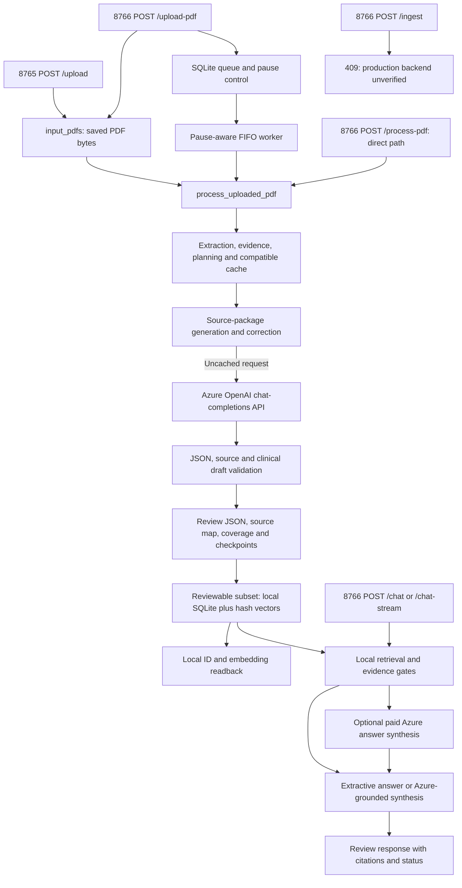

# GastroAGI Milestone 6A — Existing API and Backend Integration Discovery

Date: 20 October 2026. Scope: read-only discovery, with this report as the only new deliverable. No implementation, test execution, server startup, network request, database access, queue action or PDF processing was performed.

**Classification: 3 — Only local/API-provider components are verified.** GastroAGI already has an Azure OpenAI client, two local HTTP servers, a durable local PDF queue, local SQLite ingestion/retrieval, browser clients and an Admin form-population helper. There are **20 implemented local HTTP method/path combinations** across the two servers. The missing contract is the authority for **clinically approved production knowledge ingestion, storage, embedding, activation/revocation and production retrieval**. It is not a missing Azure client or an absence of all backend functionality.

Whether a separate deployed GastroAGI knowledge backend exists elsewhere remains **NOT VERIFIED**. This discovery cannot classify an unseen service as nonexistent or as having an incomplete contract. Milestones 4 and 5 remain PARTIAL; this report does not change their status.

## 1. Evidence terminology and discovery boundary

- **VERIFIED:** observed in current source/configuration, installed package metadata, recorded test artifacts or sanitized historical log counts. Verification scope is stated; implemented source is not proof of a currently healthy deployment.
- **INFERRED:** an architectural conclusion supported by the observed components, not a deployed capability or authorized implementation.
- **NOT VERIFIED:** no authoritative evidence available within this task's authorized scope.

Inspected the requested eight modules, provider contracts/registry, relevant extraction/generation/validation/storage boundaries, configuration, README/architecture/ingestion documents, PipelineGuide target designs, tests and recorded Milestone 5 JUnit results. Safely parsed `.env` without loading it into the process or printing values. Read the standard pipeline log only through a whitelist counter that emitted dates/counts, not raw lines. Reviewed the saved-project inventory; did not open unrelated projects, browser profiles, user PDFs, output packages or the live SQLite database.

The authorized source workspace is `D:\gastroagi-chunk-pipeline`. Its saved `config` project is a subdirectory of the same workspace. No separate backend-labelled project was identified in the saved inventory. Other saved projects, including the documentation-labelled GastroAGI project, were not treated as authorized backend repositories or searched. Source/documentation inventories found no production OpenAPI/Swagger artifact or backend repository locator. Ephemeral pytest caches were inaccessible during broad filename discovery and were excluded; no permissions were changed or escalation attempted.

Historical target diagrams are explicitly conditional: [TASK11 Stepwise Pipelines:23](D:/gastroagi-chunk-pipeline/PipelineGuide/GastroAGI_TASK11_Stepwise_Pipelines.md:23), [Phase 7 architecture:3](D:/gastroagi-chunk-pipeline/docs/engineering/phase7-database-ingestion-architecture.md:3). They do not supply a deployed contract. Earlier documentation saying FastAPI/ChromaDB were not installed is dated evidence; the current installed-package findings below supersede that claim for this Python environment.

## 2. Existing integration inventory

| Category | VERIFIED implementation | Authentication and cost | Boundary / remaining unknowns |
|---|---|---|---|
| **A. Azure clinical generation** | `AzureChunkGenerator.generate`, `.transcribe_image`, `.stream_generate`, `.check_connectivity`; selected through `provider_from_environment`. [azure.py:33](D:/gastroagi-chunk-pipeline/src/providers/azure.py:33), [registry.py:11](D:/gastroagi-chunk-pipeline/src/providers/registry.py:11). | API-key configuration passed to `openai.AzureOpenAI`; model requests can incur Azure charges, including visual reading, eligible chat synthesis and explicit connectivity probes. | External cloud inference. Exact resource/deployment values withheld. Current health, actual served model/version, vision/schema limits and deployment's staging/production classification are not verified. It is not a knowledge-ingestion API. |
| **B. Local Admin/BOT HTTP API** | `LocalRagChatHandler`, browser `fetch` calls and HTML UI. Defaults to `127.0.0.1:8766`. [local_rag_chat.py:2104](D:/gastroagi-chunk-pipeline/src/local_rag_chat.py:2104), [build_arg_parser:2349](D:/gastroagi-chunk-pipeline/src/local_rag_chat.py:2349). | No request authentication/authorization middleware, session permission check or clinical reviewer identity check in these handlers. Local HTTP itself is not paid; generation/chat actions may call Azure. | Local review service, not verified staging/production deployment. Host is configurable; loopback default does not authenticate callers. |
| **B. Basic upload panel** | Separate `LocalAdminHandler`/`create_server`, default `127.0.0.1:8765`. [local_admin_panel.py:73](D:/gastroagi-chunk-pipeline/src/local_admin_panel.py:73). | No application authentication in handler. No model call from its upload path. | Saves PDFs on disk; does not itself create durable processing-queue jobs, generate chunks or store them in SQLite. |
| **C. PDF queue and processing** | HTTP actions dispatch to SQLite-backed queue helpers, worker and supervisor; worker calls existing pipeline. [queue initialization:397](D:/gastroagi-chunk-pipeline/src/local_rag_chat.py:397), [worker:839](D:/gastroagi-chunk-pipeline/src/local_rag_chat.py:839). | Same unauthenticated local HTTP boundary; queue execution can incur Azure cost. Pause and retry are operational controls, not approval permissions. | Queue/control tables share the local review database. Current queue contents/pause value were not queried. |
| **D. Local persistence/retrieval** | Python service functions `ingest_chunks_file`, `verify_chunks_file_ingested`, `retrieve`, chat builders. [local_chunk_store.py:167](D:/gastroagi-chunk-pipeline/src/local_chunk_store.py:167), [retrieve:363](D:/gastroagi-chunk-pipeline/src/local_chunk_store.py:363). | Local filesystem/SQLite access; no separate authenticated storage HTTP service. Local token-hash embedding is free of remote API calls. Answer synthesis may separately use Azure. | SQLite review store with local vectors; not verified production vector retrieval. |
| **E. External GastroAGI knowledge backend** | No working external ingestion client, authenticated knowledge API contract, production readback client or activation adapter found. Existing local `POST /ingest` returns HTTP 409 and `BLOCKED_UNVERIFIED_BACKEND`. [dispatch:2183](D:/gastroagi-chunk-pipeline/src/local_rag_chat.py:2183), [status function:309](D:/gastroagi-chunk-pipeline/src/local_rag_chat.py:309). | No backend auth/permissions contract verified. | This is the Milestone 6 integration gap. A locally implemented blocked route is not evidence of a remote ingestion service. |
| **E. Admin website browser integration** | `populate_admin_form` uses Playwright and configured DOM selectors, optional login and persistent browser profile, verifies five field values, stops before final Upload. [admin_uploader.py:160](D:/gastroagi-chunk-pipeline/src/admin_uploader.py:160). | Optional environment username/password and/or previously authenticated browser session; actual account permissions/session validity unverified. Website requests occur if invoked. | UI automation, not a verified REST ingestion contract. Admin URL is not configured in the inspected `.env`/process environment. No browser/profile was opened. |
| **F. ChromaDB / remote embeddings** | No ChromaDB client/collection or remote embedding call found in project runtime source. Existing vectors use `local_hashing_v1`, 256 dimensions. [constants:30](D:/gastroagi-chunk-pipeline/src/local_chunk_store.py:30), [embed_text:1704](D:/gastroagi-chunk-pipeline/src/local_chunk_store.py:1704). | No remote embedding credentials/client configuration discovered. | Installed ChromaDB does not establish a collection, production service or integration. Production embedding model/dimensions remain unknown. |

An additional implemented client is the standalone, **explicitly invoked** Azure diagnostic in [test_azure_connection.py:207](D:/gastroagi-chunk-pipeline/test_azure_connection.py:207). It uses `http.client.HTTPSConnection`, an `api-key` header and a bounded nonclinical chat request. It was read, not executed. Its name beginning with `test_` must not be confused with a safe live connectivity check automatically authorized by this discovery.

## 3. Provider and configuration findings — no values disclosed

**VERIFIED configuration presence, not credential validity.** `.env` contains five named settings; each is nonempty. None of the ten inspected application settings was nonempty in the inspection command's inherited process environment. Standard application entrypoints call `load_dotenv` without an override flag, so existing process settings would take precedence in a different running process. This task used `dotenv_values(..., interpolate=False)` only; it did not execute application configuration/status entrypoints.

| Variable | `.env` setting nonempty? | Role / actual source |
|---|---|---|
| `GASTROAGI_LLM_PROVIDER` | Yes | Registry selection; the configured selection is Azure. [registry.py:11](D:/gastroagi-chunk-pipeline/src/providers/registry.py:11). |
| `AZURE_OPENAI_API_KEY` | Yes | Azure API-key authentication. [from_environment:48](D:/gastroagi-chunk-pipeline/src/providers/azure.py:48). No key, hash or prefix disclosed. |
| `AZURE_OPENAI_ENDPOINT` | Yes | HTTPS Azure OpenAI resource endpoint category; resource hostname/path/query withheld. Same source. |
| `AZURE_OPENAI_DEPLOYMENT` | Yes | Azure deployment selector, not proof of actual model identity. Same source. |
| `AZURE_OPENAI_API_VERSION` | Yes | Azure API-version setting; compatibility not probed. Same source. |
| `AZURE_OPENAI_CONNECTIVITY_TOKEN_LIMIT_PARAMETER` | No | Optional connectivity-probe setting; code defaults to `max_completion_tokens`. [azure.py:27](D:/gastroagi-chunk-pipeline/src/providers/azure.py:27). |
| `GASTROAGI_ADMIN_URL` | No | Optional browser target, overridable by `--admin-url`. [admin_uploader.py:85](D:/gastroagi-chunk-pipeline/src/admin_uploader.py:85). |
| `GASTROAGI_BROWSER_PROFILE_DIR` | No | Optional browser profile location; code default is the relative `browser_profile` directory. Same source. Existence/session contents not inspected. |
| `GASTROAGI_UPLOADER_USERNAME` | No | Optional browser form login; CLI/session alternatives may still exist. [maybe_login:218](D:/gastroagi-chunk-pipeline/src/admin_uploader.py:218). |
| `GASTROAGI_UPLOADER_PASSWORD` | No | Optional browser form password. Same source. |

Source locations for actual setting definitions are `.env:1,2,3,5,6`; `.env.example:4–8` names the same five settings. Only names/presence were emitted. No production knowledge-backend URL, bearer-token/service account, collection or remote embedding setting was found in these configuration definitions. Missing configuration here does not prove an external service cannot be configured elsewhere.

Other configuration:

- [config/admin_selectors.example.json:1](D:/gastroagi-chunk-pipeline/config/admin_selectors.example.json:1) contains example five-field/Add More/Upload/login selectors and an empty `custom_chunk_url`. These are configurable placeholders, not verified production selectors or an API schema. Runtime CLI overrides are not known.
- Defaults are 120-second Azure request timeout, two manual retries and SDK retries disabled for these requests. Request/prompt/token-limit behavior is defined in [azure.py:229](D:/gastroagi-chunk-pipeline/src/providers/azure.py:229) and [_create_chat_completion:252](D:/gastroagi-chunk-pipeline/src/providers/azure.py:252). Generation does not automatically add `response_format` or an output-token cap. Connectivity probing has its own bounded cap; it is not ordinary clinical generation.
- Declared dependencies are in [requirements.txt:1](D:/gastroagi-chunk-pipeline/requirements.txt:1). Current installed metadata: OpenAI **3.26.1**, Pydantic **2.13.5**, FastAPI **0.143.0**, ChromaDB **1.5.9**. FastAPI/ChromaDB are **installed but neither declared nor used by this project's runtime code**. No inference about production infrastructure follows from their installation.

### Azure request/response contracts

The implemented target template is `POST {configured Azure resource}/openai/deployments/{deployment}/chat/completions?api-version={configured version}`. It is statically evidenced by the installed Azure SDK request-building code and the explicit diagnostic path at [test_azure_connection.py:215](D:/gastroagi-chunk-pipeline/test_azure_connection.py:215). No real resource URL is reproduced or contacted.

| Operation | Actual application request | Consumed response / behavior |
|---|---|---|
| `generate` | SDK `model=deployment`, `messages=[system prompt, user source/input text]`. [azure.py:83](D:/gastroagi-chunk-pipeline/src/providers/azure.py:83). | Reads `choices[0].message.content`, `finish_reason`, optional refusal/id/usage. Returns string-compatible `GenerationResponse` with separate sanitized metadata. [base.py:17](D:/gastroagi-chunk-pipeline/src/providers/base.py:17). Rejects length/refusal/filter/malformed/unexpected completion; JSON/schema/clinical checks occur downstream. |
| `transcribe_image` | Same SDK chat endpoint, system instructions and user multimodal content with PNG data URL and `detail="high"`. [azure.py:169](D:/gastroagi-chunk-pipeline/src/providers/azure.py:169). | Extracts completion content; visual/citation readers independently parse their transcription schemas. Vision support is not verified remotely. |
| `stream_generate` | Same chat endpoint with `stream=True`. [azure.py:132](D:/gastroagi-chunk-pipeline/src/providers/azure.py:132). | Iterates `choices[0].delta.content`; returns a Python iterator. Does not itself constitute a durable ingestion operation or clinical approval. |
| `check_connectivity` | Nonclinical message, explicit supported token-cap selector, no manual retry. [azure.py:186](D:/gastroagi-chunk-pipeline/src/providers/azure.py:186). | Returns configuration/probe/result status dictionary, not stored knowledge. Not called in this task. |
| Standalone diagnostic | Raw HTTPS JSON body with `messages` and bounded cap; `Content-Type` and `api-key` headers. [test_azure_connection.py:207](D:/gastroagi-chunk-pipeline/test_azure_connection.py:207). | Classifies HTTP/auth/quota/compatibility/network outcomes and sanitized usage. Not called in this task. |

`ChunkGeneratorProvider.generate(article_text, source_file, prompt) -> str` is a Python protocol, not a deployed HTTP service: [base.py:28](D:/gastroagi-chunk-pipeline/src/providers/base.py:28). The Azure API returns text; it does not directly insert GastroAGI chunks into any knowledge database. The wrapper uses API-key auth; no configured Microsoft Entra/managed-identity token provider is passed by this code.

## 4. Complete local HTTP route inventory

Routes below are current dispatch branches, not invented endpoints or live health checks. Neither server implements authenticated reviewer/administrator roles in its handlers. Browser `fetch` calls are same-origin clients of these local routes. Unmatched GET/POST paths return 404; no OpenAPI/Swagger, approval/revocation or authenticated production-ingestion route was found. Other HTTP methods are not implemented by these handlers.

### Local review/Admin/BOT server — default port 8766

| Method/path | Actual request | Response / action | Source branch |
|---|---|---|---|
| `GET /` | No body | HTML workspace chooser. | [2109](D:/gastroagi-chunk-pipeline/src/local_rag_chat.py:2109) |
| `GET /admin` | No body | HTML Admin page with local file/storage state and queue UI. | [2112](D:/gastroagi-chunk-pipeline/src/local_rag_chat.py:2112) |
| `GET /bot` | No body | HTML clinical **review** chat; local DB status is obtained during rendering. | [2115](D:/gastroagi-chunk-pipeline/src/local_rag_chat.py:2115) |
| `GET /api/status` | No body | JSON keys `status,pdfs,chunk_count,chunk_files,local_database,production_database_upload,mode`; mode is `pdf_generation_local_review`. | [2118](D:/gastroagi-chunk-pipeline/src/local_rag_chat.py:2118) |
| `GET /api/queue` | No body | `{"queue": QueueStatus}`. | [2133](D:/gastroagi-chunk-pipeline/src/local_rag_chat.py:2133) |
| `GET /api/job-chunks?id=…` | Nonempty queue job ID query | The job's original `chunks.json` document; errors 400, malformed stored JSON 500. This is draft/candidate access, not an approved-content API. | [2136](D:/gastroagi-chunk-pipeline/src/local_rag_chat.py:2136) |
| `POST /upload-pdf` | `multipart/form-data`, repeated file parts named **`pdf_file`**; request limit 80 MiB, at most 30 accepted PDFs | Saves unique input paths, enqueues jobs and calls `start_processing_queue` (pause-aware). 200 keys `status,files,rejected,queued,queue`; single-file response also has `filename,size_bytes`. Invalid requests 400; size/value errors 413. Can lead to paid processing when authorized/unpaused. | [2152](D:/gastroagi-chunk-pipeline/src/local_rag_chat.py:2152), [handler:2188](D:/gastroagi-chunk-pipeline/src/local_rag_chat.py:2188) |
| `POST /process-pdf` | JSON object `filename: str`, optional `force` coerced with Python `bool`; limit 64 KiB | Calls `process_uploaded_pdf` directly and returns its result with local storage/counts/production-block status. 400/413 for handled request errors. This direct path does **not** consult queue pause. Can incur paid generation. | [2155](D:/gastroagi-chunk-pipeline/src/local_rag_chat.py:2155), [handler:2237](D:/gastroagi-chunk-pipeline/src/local_rag_chat.py:2237) |
| `POST /queue/start` | No parsed payload | Starts pause-aware worker or returns `paused`, `already_running`, `no_queued_items`; includes `recovered_stale_jobs,queue`. Can mutate stale-job state and subsequently incur paid processing. | [2158](D:/gastroagi-chunk-pipeline/src/local_rag_chat.py:2158) |
| `POST /queue/pause` | No parsed payload | Persists pause true; `status,queue`. Does not cancel an already running model request. | [2161](D:/gastroagi-chunk-pipeline/src/local_rag_chat.py:2161) |
| `POST /queue/resume` | No parsed payload | Persists pause false, calls start; `status:"resumed",start,queue`. Can incur paid processing. | [2164](D:/gastroagi-chunk-pipeline/src/local_rag_chat.py:2164) |
| `POST /queue/retry` | JSON `id: str`; 64 KiB | Requeues eligible failed/partial job, resets retry counters, calls pause-aware start. `status,queue`; handled errors 400/413. | [2168](D:/gastroagi-chunk-pipeline/src/local_rag_chat.py:2168), [handler:2219](D:/gastroagi-chunk-pipeline/src/local_rag_chat.py:2219) |
| `POST /queue/remove` | JSON `id: str`; 64 KiB | Marks only a QUEUED job REMOVED; preserves PDF on disk. `status,queue`; handled errors 400/413. Not active-job cancellation. | [2171](D:/gastroagi-chunk-pipeline/src/local_rag_chat.py:2171) |
| `POST /sync-local-db` | No parsed payload | Scans local output packages, calls local SQLite ingestion; `status:"SYNC_COMPLETE",packages,database`. No remote embedding call. | [2174](D:/gastroagi-chunk-pipeline/src/local_rag_chat.py:2174) |
| `POST /chat` | Chat JSON described below; 128 KiB | JSON chat result from local retrieval with `use_llm=True`; may call paid Azure synthesis. Gated/static answers do not require a model call. | [2177](D:/gastroagi-chunk-pipeline/src/local_rag_chat.py:2177), [handler:2255](D:/gastroagi-chunk-pipeline/src/local_rag_chat.py:2255) |
| `POST /chat-stream` | Same Chat JSON | `application/x-ndjson`, event types `meta,delta,error,done`; may call paid Azure streaming. It is not SSE. | [2180](D:/gastroagi-chunk-pipeline/src/local_rag_chat.py:2180), [handler:2272](D:/gastroagi-chunk-pipeline/src/local_rag_chat.py:2272) |
| `POST /ingest` | No ingestion payload is parsed | **409** with `status:"BLOCKED_UNVERIFIED_BACKEND",enabled:false,reason`. No remote submission or embedding. | [2183](D:/gastroagi-chunk-pipeline/src/local_rag_chat.py:2183) |

### Basic disk-upload server — default port 8765

| Method/path | Actual request | Response / action | Source |
|---|---|---|---|
| `GET /` | No body | HTML PDF upload panel. | [local_admin_panel.py:90](D:/gastroagi-chunk-pipeline/src/local_admin_panel.py:90) |
| `GET /api/status` | No body | JSON `input_pdfs,processed_pdfs,outputs,safety`; safety flags report generation/DB/Admin upload not triggered by this panel. | [93](D:/gastroagi-chunk-pipeline/src/local_admin_panel.py:93), [local_status:219](D:/gastroagi-chunk-pipeline/src/local_admin_panel.py:219) |
| `POST /upload` | Multipart PDF file parts, parser accepts filename-bearing parts without enforcing the 8766 `pdf_file` name. Default max request 100 MiB, adjustable by CLI. | 200 `ok,saved,status`; each saved item `filename,path,bytes`. 400 for invalid/empty input, 413 for size, 500 for save failure. Unique-path disk saving only. | [98](D:/gastroagi-chunk-pipeline/src/local_admin_panel.py:98), [parser:154](D:/gastroagi-chunk-pipeline/src/local_admin_panel.py:154) |

**Read-only inspection caveat:** apparently read-only local GETs are not guaranteed to be mutation-free. Admin/BOT/status rendering calls `db_status()`, which calls `init_db()` and can create local directories/schema. Queue status likewise initializes queue schema. `load_generated_chunks()` creates its output directory. Therefore this discovery did not probe even localhost status pages or run helper functions. See [db_status:149](D:/gastroagi-chunk-pipeline/src/local_chunk_store.py:149), [render_bot_page:1564](D:/gastroagi-chunk-pipeline/src/local_rag_chat.py:1564), [processing_queue_status:536](D:/gastroagi-chunk-pipeline/src/local_rag_chat.py:536), [load_generated_chunks:1015](D:/gastroagi-chunk-pipeline/src/local_rag_chat.py:1015).

### Supporting response contracts

These are dictionaries assembled by current Python code, not generated OpenAPI/Pydantic HTTP request models:

- **QueueStatus:** `status,running,paused,items,counts,queued_count,active_count,waiting_count,terminal_count`. Item fields include `id,filename,status,submitted_at,started_at,finished_at,updated_at,error,failure_stage,worker_id,progress_message,progress_detail,elapsed_seconds,page_count,generated_chunks,validated_chunks,stored_chunks,attempt_count,next_attempt_at,last_error_code`; optional result-derived fields `result,pipeline_status,validation_status,output_dir,local_database,production_database_upload`. [payload builder:450](D:/gastroagi-chunk-pipeline/src/local_rag_chat.py:450), [status:536](D:/gastroagi-chunk-pipeline/src/local_rag_chat.py:536).
- **Processing result:** existing pipeline variant `status` (`processed`, `partial_success`, `failed`, `skipped`), source/output paths, reason/failure stage/code and validation/count fields where applicable. Wrapper adds `recovery_signals,production_database_upload,local_database,chunk_counts`. HTTP 200 does not imply pipeline success or approval. [process_uploaded_pdf:266](D:/gastroagi-chunk-pipeline/src/local_rag_chat.py:266).
- **Chat input:** required `question: str`; optional `history` list or null. Keeps last 12 eligible `user`/`assistant` entries, converts content to string, trims each to 2,000 characters. Unknown fields are not a strict forbidden-extra schema. [reader:2302](D:/gastroagi-chunk-pipeline/src/local_rag_chat.py:2302).
- **Chat output:** `grounding_status,answer,answer_mode,response_type,presentation,citations,citation_details,retrieved_chunks,database,evidence_scope`. Retrieved items include chunk/source/output identity, validation/review status, content classification/reference, score, matched terms and excerpt. These responses can contain source material and paths and belong inside the protected review boundary. [payload:1201](D:/gastroagi-chunk-pipeline/src/local_chunk_store.py:1201).
- **Stream:** `meta` has grounding/mode/type; `delta` has text; recoverable provider failure may emit `error` then extractive fallback and `done`; `done.result` omits the already delivered answer. Current code buffers provider answer parts, validates citations/source claims, then yields the text deltas. Browser delivery is therefore NDJSON streaming, but not proof that tokens are forwarded immediately as received. [stream_db_rag_response:1116](D:/gastroagi-chunk-pipeline/src/local_chunk_store.py:1116).
- **Local DB ingestion result:** `status,enabled,chunks_seen,inserted,updated,unchanged,removed,output_dir,review_required`. Readback returns `status,verified,expected_chunks,stored_chunks,embedding_rows,missing_chunk_ids,missing_embedding_ids,obsolete_chunk_ids,embedding_algorithm,dimensions,output_dir`. [ingestion:167](D:/gastroagi-chunk-pipeline/src/local_chunk_store.py:167), [readback:301](D:/gastroagi-chunk-pipeline/src/local_chunk_store.py:301).

## 5. Verified current data flow

The model-response arrow abstracts returning through the generator's parsing/validation steps; it does not bypass them. Optional visual recovery also calls the same Azure provider during preparation. The basic 8765 upload server does not directly enqueue jobs; its only shared connection is the input directory. No production storage arrow is implemented.

| Connection | Source → destination / contract | Paid API? Storage and current evidence |
|---|---|---|---|
| Upload → disk/queue | 8766 handler → `parse_multipart_pdf_upload_batch`, `save_uploaded_pdf`, `enqueue_processing_jobs`; `UploadedFile` bytes/name → unique saved PDF and job rows. [parser:163](D:/gastroagi-chunk-pipeline/src/local_rag_chat.py:163), [save:230](D:/gastroagi-chunk-pipeline/src/local_rag_chat.py:230), [enqueue:508](D:/gastroagi-chunk-pipeline/src/local_rag_chat.py:508). | No payment for saving; later execution may be paid. Local input files and queue DB. Historical multipart/FIFO helper tests exist. |
| Queue → processing | `_claim_next_queue_item` → `_process_queue_worker` → `process_uploaded_pdf`; job ID/name/status and progress callback. [claim:718](D:/gastroagi-chunk-pipeline/src/local_rag_chat.py:718), [worker:839](D:/gastroagi-chunk-pipeline/src/local_rag_chat.py:839). | Local queue execution; model work may be paid. One document worker proceeds serially; package requests can be bounded at two. Stale recovery/retry state persists locally. |
| Processing → extraction/preparation | Wrapper calls `pipeline.process_pdf(..., test_generation=True, draft_packages=True)`. Native extraction is `extract_pdf`; layout/evidence/planning and preparation checkpoints follow. [wrapper:266](D:/gastroagi-chunk-pipeline/src/local_rag_chat.py:266), [pipeline:243](D:/gastroagi-chunk-pipeline/src/pipeline.py:243), [extractor:69](D:/gastroagi-chunk-pipeline/src/pdf_extractor.py:69). | Native work is local; unresolved selected pages may use paid visual reading. Inputs stay on disk in this wrapper mode. |
| Preparation/generation → Azure | `recover_visual_source` and `_generate_single_batch` → Azure provider. Default queued route selects source-package prompt/extractive drafts, not M4's opt-in editorial plan. [visual:52](D:/gastroagi-chunk-pipeline/src/visual_source.py:52), [generator:261](D:/gastroagi-chunk-pipeline/src/chunk_generator.py:261), [packages:24](D:/gastroagi-chunk-pipeline/src/package_generation.py:24). | Paid-capable API-key cloud calls, with compatible local pass/candidate checkpoints. Source/candidate data remain internal artifacts. Current live success is not probed. |
| Azure text → clinical draft validation | Strict generated `article/chunks` models, controlled normalization/reference binding, local validation/correction and final document validation. [models:42](D:/gastroagi-chunk-pipeline/src/chunk_generator.py:42), [final validation:522](D:/gastroagi-chunk-pipeline/src/pipeline.py:522). | Validation local; a bounded corrective generation may incur another model call. Logical calls and HTTP retries are distinct. |
| Validation → review JSON | `save_outputs` writes candidate/review/quarantine subsets, report, source map, state and coverage. [pipeline.py:758](D:/gastroagi-chunk-pipeline/src/pipeline.py:758). | Local `output` directory. Incomplete coverage returns partial success; saved drafts do not imply approval. |
| Review JSON → SQLite → readback | `store_generated_chunks_for_result` chooses the appropriate reviewable subset, calls `ingest_chunks_file`, then `verify_chunks_file_ingested`. [wrapper:320](D:/gastroagi-chunk-pipeline/src/local_rag_chat.py:320). | Local SQLite and deterministic CPU vectors. Failed/unverified storage eligibility is blocked. ID/embedding readback is not a full independent proof of clinical text/metadata fidelity. |
| Question → local retrieval → answer | `/chat` and `/chat-stream` → `_prepare_chat_turn` → `retrieve` → extractive/Azure answer → citation/source checks. [prepare:459](D:/gastroagi-chunk-pipeline/src/local_chunk_store.py:459), [validation:1584](D:/gastroagi-chunk-pipeline/src/local_chunk_store.py:1584). | Local retrieval; eligible Azure synthesis is paid-capable. History is request-scoped, not a server-side patient/session knowledge store. No current-literature feed is configured by this path. |

### Stored content and boundaries

Generation uses the existing JSON envelope `{"article": {...}, "chunks": [...]}`. Article fields are `source_file,topic,subtopic,reference,number_of_chunks`. The five clinical fields remain `topic,subtopic,section,reference,original_text`, with `chunk_number` as metadata. Capitalized Admin Panel labels/controlled aliases do not create a new production HTTP schema. See [generated models:42](D:/gastroagi-chunk-pipeline/src/chunk_generator.py:42) and [pipeline outputs:758](D:/gastroagi-chunk-pipeline/src/pipeline.py:758).

Local locations below are inferred defaults from source, not freshly inspected runtime contents:

| Location under `D:\gastroagi-chunk-pipeline` | Existing purpose |
|---|---|
| `input_pdfs` | Uploaded PDF bytes. |
| `output/<review attempt>` | Draft JSON/Markdown, validation report, review package, source map, processing state, coverage and accepted/quarantine subsets. |
| `output/.preparation-cache`, `.visual-evidence`, `.draft-unit-cache` | Source/configuration-bound local preparation, OCR-pass and immutable package candidate recovery. |
| `local_db/gastroagi_chunks.sqlite3` | Local review tables `chunks,embeddings,ingestion_audit` and queue tables `pdf_processing_queue,pdf_queue_control`. [review DDL:99](D:/gastroagi-chunk-pipeline/src/local_chunk_store.py:99), [queue DDL:397](D:/gastroagi-chunk-pipeline/src/local_rag_chat.py:397). |
| `processed` | CLI source destination when its processing/move conditions pass; the local generation wrapper uses no-move test-generation mode. |
| `logs` | Local logs; may contain sensitive historical data and are not a production audit authority. |
| Browser profile / uploader screenshots | Optional Admin browser session and failure diagnostics. Not inspected or created in this task. |

The local store uses transactional package updates/upserts and content hashing. With `pdf-content-v1` source identity, chunk IDs hash the PDF digest plus five content fields; fallback IDs include source filename, output folder and chunk number. These are **local identity rules**, not a discovered production contract. [identity:1672](D:/gastroagi-chunk-pipeline/src/local_chunk_store.py:1672). Vectors are normalized token-hash counts, not a semantic remote embedding service. Source-held/rejected generation units and incomplete coverage must remain visible; a local stored draft is not a completed approved document.

## 6. Authentication, approval and operational findings

**VERIFIED controls:** PDF magic/filename/size checks, queue pause and bounded recovery, source/reference/schema/clinical validation, immutable compatible candidates, review/quarantine output subsets, local transaction/readback checks, review status in retrieval payloads and blocked production upload. `build_human_review_gate` always sets approval required true, approved false and ingestion allowed false: [pipeline.py:925](D:/gastroagi-chunk-pipeline/src/pipeline.py:925).

**VERIFIED gaps relevant to production:**

- Local HTTP handlers have no authenticated administrative/reviewer gate. Loopback defaults, HTTP method choice and absence of CORS headers are not clinical authorization.
- The direct `/process-pdf` handler does not use queue pause. `/chat` and `/chat-stream` may call Azure independently of the PDF queue. Pausing PDF claims does not disable every paid-capable route.
- `start_processing_queue` can recover stale job records before checking pause. The supervisor runs periodically once the server is started. Starting a server is therefore an operational action, not passive discovery. [start:582](D:/gastroagi-chunk-pipeline/src/local_rag_chat.py:582), [supervisor:920](D:/gastroagi-chunk-pipeline/src/local_rag_chat.py:920).
- Local retrieval SQL allows `PASS` and `REVIEW_REQUIRED`; it does not require clinical approval. [retrieve:363](D:/gastroagi-chunk-pipeline/src/local_chunk_store.py:363). Chunk loading assigns review-required status even for technically passing drafts. [loader:1629](D:/gastroagi-chunk-pipeline/src/local_chunk_store.py:1629). This is an internal review experience, not production-approved knowledge.
- The local review schema does not supply an authenticated clinical decision record with approved source revision, reviewer identity, decision time, fidelity/coverage completion and revocation propagation. Generic storage timestamps/audit rows are not those decisions. M5's trusted-caller citation review attestation checks focal identity, not clinical approval.
- The Admin browser helper validates/fills fields and leaves the final Upload action to a human; it does not verify a durable production approval decision or backend persistence/retrieval. Optional login is UI/session authentication, not proof of a production ingestion permission contract. [maybe_login:218](D:/gastroagi-chunk-pipeline/src/admin_uploader.py:218), [never-click final Upload:276](D:/gastroagi-chunk-pipeline/src/admin_uploader.py:276).
- The uploader can log a supplied Section and create browser failure screenshots; localhost responses intentionally expose draft text/path metadata. These existing artifacts require protection and must not be treated as content-free diagnostic output. No uploader/screenshot action or raw log emission occurred here.

**INFERRED:** exposing the current draft retriever as production clinical knowledge would create an approval bypass. A future production adapter needs authorization and source-revision binding at the mutation boundary and enforced approved/active/tenant filtering in the actual retrieval authority. A UI label or a successful local readback cannot substitute for those controls.

## 7. Historical tests and logs: what was actually exercised

No tests were run in Milestone 6A because the user prohibited starting servers, making API calls and processing PDFs. Historical artifacts were read as evidence, not reproduced.

[Milestone 5 final JUnit XML](D:/gastroagi-chunk-pipeline/tmp/milestone5/final-results.xml) contains **703 testcase records, zero failures/errors/skips**. The M5 report records **703 passed, 2 deselected and 9 subtests passed in 48.82 seconds**; XML suite time is 48.528 seconds, a different reporting scope. Relevant recorded testcase groups:

| Historical group | Recorded passed cases | What the inspected tests establish / do not establish |
|---|---:|---|
| `tests.test_generator.GeneratorTests` | 33 | JSON/config/provider adapter behavior using fake clients/mocks. No live Azure health guarantee. |
| `tests.test_azure_diagnostic.AzureConnectionDiagnosticTests` | 4 | Diagnostic HTTP path/header/body/token-limit/error classification with a **FakeConnection**. A test name saying “live probe” does not mean its test contacted Azure. [test:9](D:/gastroagi-chunk-pipeline/tests/test_azure_diagnostic.py:9). |
| `tests.test_local_admin_panel.LocalAdminPanelTests` | 5 | Multipart/name/magic/disk-save helper behavior using temporary files, not a complete authenticated real Admin API integration. [tests:17](D:/gastroagi-chunk-pipeline/tests/test_local_admin_panel.py:17). |
| `tests.test_local_rag_chat` | 37 | Queue FIFO/recovery/pause, storage/pipeline wrapper and UI contract helpers, including blocked production status. Many tests call helpers with mocked processing; not full HTTP coverage of every route. [queue:179](D:/gastroagi-chunk-pipeline/tests/test_local_rag_chat.py:179), [blocked status:758](D:/gastroagi-chunk-pipeline/tests/test_local_rag_chat.py:758). |
| `tests.test_local_chunk_store` | 27 | Temporary SQLite ingestion/idempotency/readback/failed-validation exclusion, retrieval and mocked answer synthesis/streaming. [idempotency:53](D:/gastroagi-chunk-pipeline/tests/test_local_chunk_store.py:53), [readback:93](D:/gastroagi-chunk-pipeline/tests/test_local_chunk_store.py:93), [mock stream:329](D:/gastroagi-chunk-pipeline/tests/test_local_chunk_store.py:329). |
| `tests.test_chat_browser` | 3 | Historically starts an ephemeral localhost server and real Playwright browser, loads BOT HTML, intercepts `/chat-stream` with fabricated responses; tests presentation/history/failure controls. Not a live Azure or production chat integration. [fixture:13](D:/gastroagi-chunk-pipeline/tests/test_chat_browser.py:13), [browser test:29](D:/gastroagi-chunk-pipeline/tests/test_chat_browser.py:29). |
| `tests.test_clinical_assistant_acceptance` | 13 | Controlled local answer/retrieval fixtures; not qualified clinician validation. |
| `tests.test_milestone5_recovery` | 39 | Synthetic PDF-to-review-draft, failure/restart and safety checks with injected providers. No production ingestion. [M5 report:69](D:/gastroagi-chunk-pipeline/docs/engineering/GASTROAGI_MILESTONE_5_REPORT.md:69). |

These groups are subsets of the 703, not additional totals. Other historical tests cover provider retries, redaction and source validation. For example, [M1 diagnostics test:94](D:/gastroagi-chunk-pipeline/tests/test_milestone1_diagnostics.py:94) uses a fake timeout client and verifies three HTTP-attempt observations for one logical call. None of this establishes that all 20 local routes were integration-tested end to end or that production filtering/revocation works.

**Sanitized log evidence:** a read-only scan of the known `logs/pipeline.log` emitted only fixed event counters/dates. The file was 862,609 bytes, below the 2 MiB scan cap; its observed date range was 17–19 October 2026. It contained 64 extraction-message occurrences, 57 validation-status messages, 56 output-saved messages and 3 generation-failure messages. The current Azure token-usage and retry message patterns each occurred zero times. These are **log occurrences, not unique PDFs, successful model calls, reconciled outcomes or approval counts**. Older logging formats/multiple attempts/mock attribution are not independently resolved. No raw message, medical passage, filename, URL, token or exception body was printed or copied into this report.

**NOT VERIFIED:** present server health/ports, current queue state, valid remote credentials, a successful fresh Azure request, production ingestion, production embeddings, staging retrieval or approved/unapproved visibility enforcement. Historical local-stage logs and configured keys are not live service verification.

## 8. The Milestone 6 blocker, answered directly

1. **Which APIs definitely exist? — VERIFIED:** Azure model client/diagnostic; 8766 local Admin/BOT/queue/chat API; 8765 basic upload API; internal local SQLite/retrieval Python services; optional external-website form automation. The local `/ingest` endpoint exists but is deliberately blocked.
2. **Which were historically tested? — VERIFIED to the scopes above:** mocked Azure adapters/diagnostics, local queue/storage/retrieval helpers and ephemeral-server browser presentation with intercepted chat responses. No available evidence verifies a production knowledge-ingestion integration. Current health is not tested here.
3. **Which API is missing for production integration? — NOT VERIFIED contract:** the actual authority accepting approved clinical knowledge, applying existing authenticated ingestion/embedding logic, exposing trustworthy readback/retrieval, and controlling activation/revocation. Azure chat completions does none of that for GastroAGI.
4. **Could this local server support a future authenticated adapter? — INFERRED yes:** current orchestration/storage/provider boundaries could be extended behind explicit authentication, durable approval/revision controls and a verified backend client. It does not require FastAPI merely to be possible. This is future engineering, not an existing capability, and no adapter was added.
5. **Is a separate repository required? — NOT logically required:** the service could be in another repository, in a monorepo or be this local project deliberately promoted through a separately agreed design. To reuse an existing deployed backend, obtain its actual code or authoritative contract wherever it lives. A new repository alone would not resolve permissions, schemas or clinical approval. No proof of a separate deployed repository was found.
6. **What contracts remain missing?** The matrix below. Local schema/prototype identity rules cannot fill these production unknowns.
7. **Can local clinical draft generation continue while production ingestion is blocked? — VERIFIED separation, conditional operational answer:** the current code supports that workflow and historical offline tests exercise it. New authorized runs can produce unapproved review drafts while `/ingest` remains blocked; clinical/source holds must stay visible. This is not a clinical-accuracy guarantee or authorization to resume the queue/make paid requests. This discovery ran nothing. Direct processing/chat can be paid-capable even when the PDF queue is paused.
8. **What must happen before M6 implementation?** Identify the intended production knowledge authority; inspect its versioned ingestion/auth/persistence/embedding/retrieval/staging contracts; resolve the agreed M4/M5 acceptance prerequisites; then implement and test the approved boundary. No automatic publishing follows from this report.

### Missing production contract matrix

| Contract | Evidence needed, not an invented implementation |
|---|---|
| Ingestion methods and schemas | Actual route/service definitions, request/response/error models, allowed five-field/metadata representation, batch limits and per-item results. |
| Authentication and approval permissions | Identity provider/service auth, scopes/roles, reviewer authority, decision audit and permission checks; not optional browser login selectors. |
| Source/revision/content ownership | Authoritative source/chunk IDs, revision/hash binding, approval invalidation, provenance and approved fidelity/coverage semantics. |
| Database/vector ownership | Real persistence schema and whether ChromaDB is actually used; tenant/collection/environment and lifecycle configuration. |
| Embeddings | Actual embedding implementation/model/version/dimensions, preprocessing/normalization/distance metric and where embedding runs. |
| Idempotency and recovery | Duplicate/update/replay/partial acceptance/unknown-timeout outcomes, readback and safe revocation/deactivation propagation. |
| Retrieval | Actual query service, approved/held/revoked/revision/tenant filters, cache invalidation and verifiable text/reference/metadata readback. |
| Deployment/staging | Deployed build and environment definitions, staging parity/isolation and permitted test actions. |

Specific next evidence: a read-only backend repository path at its deployed revision with route handlers/auth dependencies, models/migrations, ingest/embedding/retrieval modules and deployment configuration; **or** a versioned authoritative API specification plus the equivalent persistence/embedding/approval/retrieval documents. Also identify the actual Admin site's owner/target if it is the production knowledge authority. No such repository location/URL was verified, so none is invented here. Secrets should stay in the approved secret mechanism.

## 9. Milestones 4 and 5 — exact remaining clinical prerequisites

Both reports remain **PARTIAL**. Their passing engineering tests are not a silent waiver of clinical acceptance.

| Existing gap | Required review/evidence before an automatic publication path could rely on it |
|---|---|
| **M4: intended editorial examples rejected** | Three of eight intended examples—review, conditional guideline and uncertain dose description—remain `SOURCE_GROUNDING` rejections; five are review-required, none approved. Obtain qualified source-based adjudication, resolve the editorial/grounding compatibility issue within the agreed contract and retain regression cases without weakening safeguards merely to raise pass counts. [M4 evaluation:131](D:/gastroagi-chunk-pipeline/docs/engineering/GASTROAGI_MILESTONE_4_REPORT.md:131). |
| **M4: no clinician-reviewed gold set or clinician quality review** | Eight engineer-authored sources/examples and 15 adversarial variants are not medical gold labels. Qualified review must assess populations, arms/endpoints, time points, numbers/units, negation/significance/noninferiority, safety, certainty and applicability against exact evidence. [M4 status:203](D:/gastroagi-chunk-pipeline/docs/engineering/GASTROAGI_MILESTONE_4_REPORT.md:203). |
| **M4: general paraphrase semantics unproven** | Deterministic consistency is not proof of causality, subgroup applicability, adjusted estimates, procedural sequence safety, rare syntax, absence of harm or nuanced recommendations. Preserve unsupported/ambiguous claims as held; demonstrate an agreed source-fidelity evaluation and clinical review process. No model self-check/similarity score substitutes. [M4 limitations:191](D:/gastroagi-chunk-pipeline/docs/engineering/GASTROAGI_MILESTONE_4_REPORT.md:191). |
| **M4: opt-in prototype, not default queue editorial workflow** | The editorial path has not been evaluated with real model output and is not the queued default. It is serial and lacks the legacy route's equivalent recovery/persistence orchestration. Decide and validate the intended transition before relying on it operationally; no route switch is authorized here. Same M4 limitations. |
| **M5: source-review attestation is trusted-caller only** | Citation confirmation has no authenticated reviewer UI/decision identity authority. Bind genuine source review to exact revision and reviewer before any publishing workflow treats identity as established. OCR agreement alone is insufficient. [M5 citation path:38](D:/gastroagi-chunk-pipeline/docs/engineering/GASTROAGI_MILESTONE_5_REPORT.md:38). |
| **M5: fresh clinical reliability not established broadly** | Existing fixtures are synthetic and layout-limited, with no qualified clinician review. Use an explicitly authorized representative document corpus, source-grounded clinical assessment and controlled question set; measure held/rejected/coverage outcomes rather than only saved chunk counts. [M5 acceptance:69](D:/gastroagi-chunk-pipeline/docs/engineering/GASTROAGI_MILESTONE_5_REPORT.md:69), [limits:174](D:/gastroagi-chunk-pipeline/docs/engineering/GASTROAGI_MILESTONE_5_REPORT.md:174). |
| **M5: provider capabilities unverified** | Obtain authoritative deployed-model/API feature metadata and, only if separately authorized/needed, bounded capability verification. Current source does not prove vision/schema/output-limit support. No paid verification is performed here. [M5 provider assessment:120](D:/gastroagi-chunk-pipeline/docs/engineering/GASTROAGI_MILESTONE_5_REPORT.md:120). |
| **M5: unresolved source/coverage remains held** | Missing/ambiguous DOI identity, unproven table/figure relationships, missing passages and scanned numerical claims without independent proof remain held. Publishing must exclude unresolved material and record what fidelity/coverage review actually completed. Corrupt/ambiguous PDFs need not be forced to produce approved chunks. Same M5 limits. |

M5 also records renamed-upload checkpoint misses, restart required after some unexpected orchestration failures, and no completed coverage inventory after early preflight failure. These are explicit operational/accounting limits, not proof that every particular draft is clinically wrong. They must be handled in the agreed acceptance/operating scope; they are not an excuse to relabel held evidence or waive approval.

Even successful M4/M5 clinical evaluation would not supply M6's durable authenticated approval/revocation and production retrieval filters. Conversely, obtaining an ingestion API does not establish clinical readiness.

## 10. Smallest next step and completion

The smallest next step is to **identify which service is intended to own approved production knowledge**. If that service already exists, obtain its read-only code or authoritative contract and isolated staging definition. If this local review server is intended to become that service, explicitly agree that it is a new authenticated production boundary to be designed—not a discovered existing API—and define its approval/authentication, persistence, embedding and retrieval contracts before implementation. Installing FastAPI/ChromaDB or guessing a bulk-ingestion route would not answer that ownership question.

The earlier [M6 report](D:/gastroagi-chunk-pipeline/docs/engineering/GASTROAGI_MILESTONE_6_REPORT.md:1) correctly blocked production integration; its scope should not be read as saying GastroAGI has no APIs or no local backend. This report supplies the detailed existing-component inventory while preserving the distinct production-contract and clinical-readiness blockers.

Only this Markdown report was added. No source/configuration changes, database mutations, server/worker starts, local/remote HTTP probes, paid calls, queue resume, new PDF processing or automatic publication occurred. Existing 80-file source/test/prompt/configuration hashes were checked against the M6 inspection manifest with no differences. The live database/pause state was not queried and no claim of fresh runtime health is made.

**Discovery complete. Classification 3: only local/API-provider components are verified. Production integration remains blocked; whether another deployed backend exists is unverified. Stop after Milestone 6A.**
