# GastroAGI Milestone 6B — Production Knowledge Integration Plan

Date: 20 October 2026. Scope: architecture and implementation plan only.

**Chosen architecture: B — develop production knowledge services inside this project.** The user explicitly selected: “B — Develop production knowledge services inside this project; prepare the design for review.” A separate external backend repository is therefore not a prerequisite for this design. The existing local review server/database are verified components, not already an authenticated production knowledge authority.

**Status: BLOCKED for Phase 6C implementation; design prepared for review.** Ownership is resolved. The proposed contracts below have not yet been explicitly agreed, and authentication, durable production state, embedding deployment, vector/environment configuration and staging bindings remain unverified/unselected. This is no longer a blocker about locating another repository. Architecture selection authorizes design, not implementation or production activation. Neither 6C nor 6D starts in this task.

## 1. Evidence used and preserved implementation

Reviewed the current audit and Milestone 1–5 reports, M6 prerequisite report and M6A discovery. Reused M6A instead of repeating its complete API inventory. Checked the current shared boundaries and cache identities against source; source remains the implementation authority. Audit line numbers/historical limitations are not treated as proof that subsequent milestone changes are absent.

Relevant current components:

| Existing functionality | Verified source boundary; treatment in this design |
|---|---|
| Extraction/source recovery | `src/pdf_extractor.py`, `src/native_layout.py`, `src/visual_source.py`, `src/citation_recovery.py`; unchanged. No new PDF processing in the production-ingestion boundary. |
| Evidence/concept planning | `src/evidence.py`, `src/source_map.py`, `src/source_packages.py`, `src/concept_planner.py`, [document concept planning:417](D:/gastroagi-chunk-pipeline/src/document_concepts.py:417); unchanged. Existing exact source spans, warnings and holds remain authoritative inputs to review. |
| Clinical writing/generation | [generate_chunks:79](D:/gastroagi-chunk-pipeline/src/chunk_generator.py:79), `src/package_generation.py` and existing prompts; unchanged, including the optional M4 editorial route. |
| Azure generation | [AzureChunkGenerator.generate:83](D:/gastroagi-chunk-pipeline/src/providers/azure.py:83); unchanged. A future embedding adapter must not repurpose clinical generation to manufacture vectors. |
| Bounded concurrency | [run_bounded:48](D:/gastroagi-chunk-pipeline/src/bounded_scheduler.py:48); existing maximum two source-package generation requests unchanged. No production service may secretly invoke generation. |
| Preparation/candidate/hold recovery | [preparation_key:36](D:/gastroagi-chunk-pipeline/src/preparation_cache.py:36), [validation_fingerprint:17](D:/gastroagi-chunk-pipeline/src/package_generation.py:17); identities/formats and existing publication rules unchanged. |
| Validation/five fields | [validate_chunks:231](D:/gastroagi-chunk-pipeline/src/chunk_validator.py:231), source/citation/numeric checks; no prompt, threshold, field, reference or clinical decision changes. |
| Local review storage | [ingest_chunks_file:167](D:/gastroagi-chunk-pipeline/src/local_chunk_store.py:167), [retrieve:363](D:/gastroagi-chunk-pipeline/src/local_chunk_store.py:363); preserved as internal draft review. Never relabel this retriever as production-approved. |
| Queue and retries | `src/local_rag_chat.py`, [recovery_decision:22](D:/gastroagi-chunk-pipeline/src/queue_recovery.py:22); unchanged. No shared queue workers, retries or job tables for production ingestion. |
| Current publication gate | [database_upload_status:309](D:/gastroagi-chunk-pipeline/src/local_rag_chat.py:309), existing `POST /ingest` remains 409/disabled; [build_human_review_gate:925](D:/gastroagi-chunk-pipeline/src/pipeline.py:925) remains unapproved/ingestion-disallowed. |

Current metadata inspection: Python package versions OpenAI 3.26.1, Pydantic 2.13.5, FastAPI 0.143.0, ChromaDB 1.5.9, pypdf 6.9.2, PyMuPDF 1.27.2.2 and pytest 9.1.1. FastAPI/ChromaDB are installed but not declared/used by the current pipeline runtime. Their presence is not a deployed production service or permission contract. Before implementing adapters, verify the selected client/server APIs against installed versions and official version-appropriate documentation; no library API change is implemented here.

## 2. Proposed isolation architecture — not implemented

Use a new production-knowledge package and independently started authenticated service **inside this repository**, separate from the existing localhost review application, SQLite database and generation workers. FastAPI/Pydantic are proposed for that new service boundary. They do not replace the existing handlers or justify exposing them publicly.

**Important cache compatibility finding:** `validation_fingerprint()` hashes every Python file below `src`, not just clinical validators. Adding a supposedly isolated `src/production_*.py` could invalidate existing validation holds on a later authorized run. Preparation identities also include implementation hashes and dependency versions. Therefore the proposed new package is top-level **`production_knowledge/`**, outside `src`. Do not edit the fingerprint to make integration code fit. Use an independent dependency environment and separate proposed dependency manifest; do not upgrade the running pipeline environment.

```mermaid
flowchart LR
    Review["Existing PDF pipeline and internal draft review — unchanged"]
    Export["Registered immutable source/review artifact snapshot"]
    Admin["Authenticated qualified reviewer client"]
    Authority["New approval and revision authority"]
    Staging["Independent staging ingestion and reconciliation"]
    Vector["Configured private semantic vector service"]
    Verify["Stored-content and controlled retrieval verification"]
    Activate["Separately authorized activation decision"]
    Public["Approved-only production retrieval"]
    Review -->|Read-only import| Export
    Export --> Authority
    Admin --> Authority
    Authority -->|Exact approved revision only| Staging
    Staging --> Vector
    Vector --> Verify
    Verify --> Activate
    Activate --> Public
    Authority -->|Current approval and revocation fence| Public
```



Every box after the existing review system is **proposed**. No service, store, route, collection or deployment shown here exists because of this report. Source/review artifacts are untrusted inputs until their identity/integrity and human review are established; merely copying a local approval-looking JSON field is insufficient.

Boundaries:

- Existing review storage remains `local_db/gastroagi_chunks.sqlite3`. No new service opens it through helpers that initialize/migrate schema. `db_status`, `retrieve` and other local helpers call `init_db`; they are not safe read-only production adapters.
- New approval/ingestion state requires a separately configured transactional store. Its engine, physical schema, URI and operational ownership require agreement. Temporary SQLite is proposed only for isolated repository tests, following existing transaction patterns; that does not select SQLite as the production database.
- Vector storage is private, environment-isolated and not the clinical approval authority. No direct public ChromaDB access. The transactional authority decides visibility even if vector metadata is stale.
- No import-time worker/client startup, automatic queue callback, automatic review-database sync or new call into `process_pdf`. The new service starts only through its own future explicit entrypoint.
- Production ingestion and activation are disabled by default in the **new** configuration. Missing auth/storage/vector settings must fail closed. Existing runtime defaults and `.env` remain unchanged. No fallback to the review database, local hashing or unapproved content.

## 3. Proposed knowledge and revision contracts

This section is a **contract proposal requiring agreement**, not verified backend behavior or a created schema. Type/operation names are design locators, not deployed API endpoints. Physical tables, HTTP paths, hostnames, ports, collection names and production model/deployment values are intentionally not assigned.

### Clinical content

Exactly five canonical JSON content fields, matching the current pipeline:

`topic`, `subtopic`, `section`, `reference`, `original_text`.

Their Admin labels remain Topic, Subtopic, Section, Reference and Original Text. Preserve text and citation exactly as approved; no integration-time paraphrasing, whitespace repair, padding, truncation or added medical fields. `chunk_number` may accompany export/display metadata but is neither clinical content nor a stable production identity by itself. Technical provenance/approval/vector metadata is stored separately.

### Logical records and identity rules

| Proposed logical contract | Required meaning / constraints |
|---|---|
| `SourceSnapshot` | Server-registered artifact identity; existing PDF SHA-256, source/evidence/canonical-buffer identities, exact source span references, source-map/validation/coverage artifact digests and their format/policy versions. Source filename is display metadata, not authority. |
| `DocumentIdentity` / `SourceRevision` | Authority-managed logical document ID plus immutable byte/proof-bound revision. Identical PDF bytes can reuse a source revision; DOI alone cannot merge different PDFs. Associating a different PDF with an existing logical article requires an explicit reviewed relationship. Existing generation/cache IDs are not rewritten. |
| `ClinicalContent` | Strict five-field content object. Reject unknown clinical fields; metadata remains outside it. Existing validation thresholds/rules remain unchanged. |
| `ChunkIdentity` / `ChunkRevision` | Stable logical ID assigned by the new authority to a registered review unit, with immutable revision digest binding exact five-field content, source revision and provenance/validation snapshot. Identical registered source/content/provenance imports deduplicate to the same revision. Corrected content/source creates a new revision; it cannot mutate an already approved revision. No automatic dependence on output-folder name or chunk numbering. |
| `ReviewDecision` | Authenticated, authorized reviewer subject and qualification/permission policy reference; server UTC decision time; decision/reason; exact source/chunk revision and content/provenance digests; fidelity/coverage review completion and scope; decision ID and monotonic approval epoch. Client-provided reviewer names/timestamps are not trusted identity. Protected review notes are separate from content-free operational logs. |
| `IngestionJob` / `ItemOutcome` | Durable batch/item identities, request digest, approval epoch, embedding binding, current state, attempts/reconciliation evidence, sanitized failure code/retry eligibility and independently measured request/usage counters. A single current item state supports count reconciliation; stage counters are separate. |
| `EmbeddingBinding` | Verified provider, model/deployment/version, dimensionality, input serialization/preprocessing, normalization, metric and environment fingerprint. Changing it requires a separately reviewed re-embedding migration, not overwriting an existing active vector space. |
| `CandidateManifest` / `ActivationDecision` | Immutable set of source/chunk revisions, approval epochs, embedding binding and readback/retrieval evidence. Activation names this exact set and authorizing subject; it is not inferred from HTTP success or completed vector writes. |

Digest serialization must be versioned and deterministic, preserving content string values. Define domain separation and canonical key ordering explicitly before implementation; do not change existing source, checkpoint or chunk hashes. Deduplication and uniqueness constraints are transactional in the new store. A source-content mismatch rejects instead of silently creating an approval-compatible revision.

### Approval eligibility and revocation

1. A reviewer must authenticate through an agreed identity authority, possess explicit clinical-review permission for the environment/scope and meet the organization's reviewer qualification policy. An arbitrary JWT role string or a model's assertion is not sufficient evidence of qualification.
2. The authenticated review experience must present the exact source evidence, draft revision, validation results, extraction uncertainty, source holds and coverage scope being decided. A batch API must not manufacture a review decision.
3. Proposed default eligibility requires satisfactory existing validation, no unresolved source hold affecting the approved scope, fidelity review complete and coverage review complete for the explicitly approved scope. Whether partial-document publication is permitted requires clinical-owner agreement. Until then, do not infer partial-scope approval or document completeness.
4. Approval binds an immutable revision. Changed content/source/provenance invalidates applicability of the prior decision to the new revision; it does not alter the historical decision. Rejected, unapproved, revoked, superseded or source-held revisions cannot enter the approved staging path or production retrieval.
5. Revocation appends a durable decision and increments the visibility/approval epoch. It blocks new submissions, in-flight job completion/activation and retrieval immediately through the authority. Asynchronous vector removal/deactivation is secondary; it must not be the sole access control.
6. Reapproval is a new authenticated decision/epoch. Replaying a previously successful idempotency key cannot revive revoked content. Historical source/draft/approval records are retained under agreed retention rules; destructive cleanup is a separate authorized operation.

Agree the retrieval/activation consistency contract explicitly: identify the authority transaction/linearization point and guarantee that operations admitted after an acknowledged revocation cannot use the old epoch. Define how an already in-flight response is fenced or terminated before releasing evidence. Content already delivered cannot be recalled. An eventual vector update must not be described as immediate revocation enforcement.

Valid JSON, Azure completion, technical PASS, local `REVIEW_REQUIRED`, SQLite storage or a successful HTTP response never creates approval. M5 citation review confirms focal source identity only and is not clinical review.

## 4. Proposed service/API operations

These are versioned semantic contracts for design review. No HTTP route is created or activated; exact paths/status-code models and authentication transport must be agreed before 6C implementation. The existing local `/ingest` route stays blocked.

| Proposed operation | Input | Output and failure contract |
|---|---|---|
| `register_review_snapshot` | Registered artifact handle plus expected manifest/source digests; actor supplied by authentication context. No caller-supplied arbitrary filesystem path/URL. | Immutable source/chunk revisions or explicit integrity/schema/source mismatch. Read-only import never edits original outputs or checkpoints. |
| `record_review_decision` | Exact source/chunk revisions, expected digests/current epoch, decision, fidelity/coverage scope and completion, reason. | Durable decision ID, authoritative reviewer/time and new epoch; conflict on stale revision/epoch; denial for missing qualifications/permissions/holds. |
| `revoke_review_decision` | Decision/revision scope, expected epoch and reason. | Durable revocation and visibility fence; safe repeat acknowledged without restoring eligibility. |
| `submit_approved_batch` | Strict five-field content plus separate registered source/chunk revision and approval references, declared contract version and idempotency key. | Durable batch ID and per-item states/codes; accepted-for-staging is distinct from stored/readback-verified/activated. Unapproved/mismatched items never reach embedding. |
| `get_batch_status` / `verify_stored_batch` | Authorized batch ID and expected immutable manifest. | Per-item state, disjoint current-state counts, whether accounting is complete, verified text/reference/provenance/vector binding and unresolved outcomes. Missing evidence is explicit, not success. |
| `verify_candidate_retrieval` — 6D | Candidate manifest and controlled question/negative-control set, authorized verification identity. | Evidence-ranked results, exact content/source matches and exclusion tests; an engineering result, not independent clinical approval. |
| `activate_candidate` / `deactivate_candidate` — 6D | Verified manifest, expected visibility epoch and separately authorized activation decision. | Atomic authority visibility change; no activation for stale approvals, partial failures, incompatible embeddings or incomplete acceptance. |
| `query_approved_knowledge` — 6D | Question and bounded retrieval options; effective environment/tenant/scope derived from principal, not trusted request filters. | Authorized approved/active revision evidence only, or an explicit evidence/access/service gap. No fallback to the internal review retriever. |

Request/response limits must be explicit reviewed configuration, not reused clinical word thresholds or invented production quotas. Error categories must distinguish unauthorized/forbidden, malformed contract, stale revision, missing approval, source hold/mismatch, incompatible embedding binding, transient provider/storage failure, unknown write outcome and permanent rejection. Responses/logs must not include secrets, medical source passages or raw provider bodies in diagnostic fields.

### Idempotency and interrupted batches

- Bind an idempotency key to authenticated scope/environment, operation kind, exact request digest, source/chunk revisions, approval epoch and embedding binding. Same key/same request returns the same durable operation; same key/different request conflicts. Concurrent submission requires transactional uniqueness.
- Use a new ingestion journal/outbox, independent of the PDF queue. Persist intent before embedding/vector writes; checkpoint each verified item. Do not claim a distributed transaction across SQL and ChromaDB.
- Proposed progression: received → eligibility verified → embedding pending → vector write pending → readback pending → staged verified. Separate blocked/rejected, retry-wait, outcome-unknown, revoked and superseded outcomes remain explicit. These are proposed states, not changes to current queue statuses.
- Timeout after a possible vector write requires reconciliation by stable revision ID and expected content/binding before any retry. Do not blindly resubmit an entire successful batch or assume failure means no remote side effect.
- Recheck approval/revision epochs before expensive calls, after calls, before checkpoint completion and before activation. A revoked in-flight item cannot become visible even if its remote write finishes later.
- Retry only verified transient failures with independently bounded policy/budget. Auth/permission/schema/source/approval/embedding-identity failures require action rather than blind retries. Record actual attempts and unknown usage separately from logical calls. Do not alter `src/queue_recovery.py` or reuse its mutable job tables.
- Readback must compare exact stored text, all five fields/reference, source/provenance/revision/approval identity, vector ID/dimensions and binding. Existing local readback checks IDs/embedding metadata; do not extend its guarantee or modify it to serve production.

## 5. Authentication and environment design

**Proposed:** independently authenticated service boundary with deny-by-default permissions separating reviewer, ingestion worker, verifier/activator and retrieval consumer responsibilities. Assignment to actual organization roles and any separation-of-duties/MFA rules require explicit security/clinical-owner agreement. Reviewer identity must come from verified credentials, never body fields or the legacy browser session.

The identity issuer, audience, keys/JWKS or other verification mechanism, token lifetimes/revocation, service-to-service credentials, transport/TLS boundary and tenant/source authorization are **not selected**. Do not invent an identity provider, accept unsigned tokens or hardcode shared administrator credentials to unblock development. Offline tests use explicitly isolated fake identities/keys; they cannot authenticate in production.

Independent typed configuration must require environment identity and explicit bindings for identity authority, approval state, protected source artifacts, embedding service and private vector storage. Staging and production need separate credentials, database/vector namespaces, audiences and artifact access; naming a collection “staging” is not sufficient isolation. No default connection to the existing review database or a production host. Do not auto-load or modify the current `.env`.

New ingestion/activation switches remain false by default; enabling a switch alone is insufficient. Verified configuration, authorization, clinical eligibility and environment gates must all hold. The old review UI/server remains an internal review tool; it must not be exposed as the new authenticated authority through a proxy or client routing shortcut.

## 6. Embedding and ChromaDB design

No production embedding service is currently verified. Proposed order of preference: reuse a subsequently verified organization embedding service; otherwise evaluate an explicitly authorized dedicated Azure embedding deployment, consistent with the project's Azure integration convention. The existing clinical generation deployment is not assumed to support embeddings. Provider/model/deployment/dimensions and cost approval remain decisions; `local_hashing_v1` is never a production semantic fallback.

An embedding port takes exact approved content under an agreed, versioned input serialization and an immutable binding; returns vectors plus observed/unknown usage and transport accounting. The source text is never rewritten to improve retrieval. Input composition—Original Text alone versus an agreed inclusion of clinical labels/reference—must be selected, recorded and held fixed across index/query generation. Never silently truncate clinical text to fit an unverified embedding limit.

A vector-store port provides stable revision-ID writes, bounded readback, trusted-filter querying and non-destructive visibility management. ChromaDB 1.5.9 is only an installed candidate client version; selected server/API compatibility and actual tenant/database/collection settings must be verified before adapter implementation. No collection name, endpoint, model deployment, persistence path, metric or production dimension is assigned here.

Required controls:

- Separate private staging/candidate and active environment bindings; no writes to an existing collection selected by guesswork. Reject a preexisting collection with incompatible fingerprint/dimensions/metric.
- Store exact approved text and separately mapped source/reference/revision/provenance/approval epoch/binding metadata, with the authoritative snapshot available for full comparison.
- Metadata filters are constructed from verified principal/environment, never passed through from user input. Revalidate every candidate hit against current authoritative approval/visibility epochs; post-filter stale or unauthorized hits before text enters an answer context.
- The authority's visibility decision is authoritative during revocation or partial synchronization. Stale vector metadata cannot grant access. Fail closed on unavailable approval state.
- Re-embedding requires a new reviewed binding and candidate manifest, complete readback and retrieval evaluation before switching visibility. Preserve old approved history for rollback; no silent in-place production migration or destructive cleanup.
- Synthetic tests use deterministic fake embeddings with explicitly fake binding/dimensions. They are not evidence of real semantic quality, provider cost or production vector compatibility.

## 7. Proposed files and exact scope

**Files modified now: none.** Only this plan is created. No proposed file below exists as a result of this task.

| Proposed new file(s) | Proposed functions/responsibility | Phase |
|---|---|---|
| `production_knowledge/__init__.py`, `contracts.py`, `identity.py` | Inert package initialization; strict content/technical models; `digest_revision`, registered source/chunk identity and immutable request/manifest digests. | 6C |
| `production_knowledge/settings.py`, `auth.py` | Required independent environment bindings; disabled gates; `verify_principal`, `authorize_operation`; no legacy server/session trust. | 6C |
| `production_knowledge/review_artifacts.py` | `register_review_snapshot`, bounded allowlisted artifact access, source/map/validation/coverage integrity checks; no generation, queue or SQLite initialization. | 6C |
| `production_knowledge/approval.py`, `state_store.py` | `record_review_decision`, `revoke_review_decision`, `check_revision_eligibility`; transactional revision/decision/epoch/job/outbox port and selected store adapter after agreement. Physical schema is not assigned by this plan. | 6C |
| `production_knowledge/embeddings.py`, `vector_store.py` | Selected provider/Chroma adapters behind typed ports; `embed_approved_items`, `write_candidate_items`, bounded exact readback. | 6C |
| `production_knowledge/ingestion.py`, `readback.py` | `submit_approved_batch`, `resume_batch`, `reconcile_unknown_outcome`, `verify_stored_batch`; preserve per-item accounting and revocation fences. | 6C |
| `production_knowledge/api.py` | Explicit app factory with independently authenticated administrative/review operations; no import-time server startup, generation callbacks or local route changes. | 6C |
| `production_knowledge/retrieval.py`, `activation.py` | `query_approved_knowledge`, `verify_candidate_retrieval`, `activate_candidate`, `deactivate_candidate`; current approval/visibility checks and immutable manifests. | 6D |
| `tests/production_knowledge/` | Isolated tests/fake identity, state, embedding and vector adapters; no real providers or production configuration. | 6C/6D |
| Separate production dependency/configuration documentation and lock manifest | Version-reviewed independent environment. Exact filenames and dependency changes approved with implementation scope; existing `requirements.txt` untouched. | 6C |

Existing functions to **read/reuse without modifying**: pure five-field validation/model helpers and, where suitable, [load_source_map:120](D:/gastroagi-chunk-pipeline/src/evidence_storage.py:120) for protected exported proof verification. Any reuse must be side-effect audited and pinned to its immutable source/dependency identity. No production service calls `local_chunk_store.init_db`, its draft retriever, `process_uploaded_pdf`, `process_pdf`, queue startup or legacy sync helpers.

Existing shared modules requiring changes in the initial 6C/6D scope: **none proposed**. If implementation discovers a genuine need, stop that dependent change and provide exact diff, cache/hash/API impact, tests and rollback for separate authorization. In particular, do not enable local `/ingest`, add signatures/metadata fields to existing public functions or alter validation fingerprints to hide incompatibility.

## 8. Phase 6C — exact gated implementation sequence

| Step | Sequence / acceptance |
|---|---|
| C0 — contract/security gate | Confirm the agreements listed in section 12: data/API operations and identity rules, identity authority/permissions, clinical review scope, transactional store, embedding/vector bindings and staging isolation. Obtain explicit 6C scope authorization. Architecture B alone does not satisfy this gate. |
| C1 — reproducible regression baseline | Read current reports/code again; create the protected source snapshot/manifest and version record described below; audit safe test entrypoints, run the offline baseline and inspect failures/exclusions before editing. No paid calls, queue resume or historical-state mutation. |
| C2 — isolated contracts and auth | Add only the approved new package/contracts/app factory and offline identity fixtures. Demonstrate disabled-by-default behavior and denied unauthorized/incorrect-scope requests before adding any mutating adapter. Preserve all existing source hashes. |
| C3 — source/revision/approval authority | Implement registered artifact verification and the agreed transactional state adapter; immutable revisions, genuine reviewer decision capture, epoch conflicts, coverage/fidelity eligibility, invalidation and revocation. Use temporary fixtures initially. |
| C4 — idempotent staging ingestion | Implement durable intent/outbox, bounded fake embeddings/vector writes, duplicate/concurrent request protection, per-item checkpointing, unknown-outcome reconciliation and exact stored-content readback. Approval is rechecked across every write boundary. No activation. |
| C5 — selected adapters and staging fixtures | Verify actual selected API signatures/configuration; implement only authorized adapters. Fake/in-memory or disposable local test services first. An actual staging service test requires identified isolated targets and explicit authorization; any paid embedding/API request requires separate cost authorization. |
| C6 — regression and integration comparison | Run prior safe regression selection plus new tests. Compare output bytes/structures, source spans/warnings, counters, ordering, two-request bound, retries and zero-call compatible resume; compare source/dependency/cache fingerprints. Stop on any existing regression; do not weaken tests or validation. |
| C7 — staging acceptance report | Demonstrate all required unit/staging scenarios, full text/reference/provenance readback, no cross-environment access and ingestion still disabled in production. Produce Backward Compatibility and Regression Report and evidence-classified 6C report. Stop; 6D/activation remain unauthorized. |

**6C staging acceptance:** authenticated approved synthetic revisions alone reach candidate storage; invalid/unapproved/held/superseded content is rejected before embedding; same request/retry creates no duplicates; partial failures retain independently verified successful work; every unknown write outcome reconciles; full readback matches; source or approval changes invalidate the right jobs; no legacy data/schema/source/hash/prompt/default changes; no production visibility.

**6C authentication:** reviewer, importer/ingester and status/readback scopes enforced server-side, including tenant/environment/source authorization. Server-derived identity/time; denied self-approval or separation-of-duties policy according to the explicitly agreed clinical/security rules. Offline fake identities must be impossible to enable in a production environment.

## 9. Phase 6D — exact verification/activation sequence

| Step | Sequence / acceptance |
|---|---|
| D0 — prerequisite gate | Accepted 6C evidence, agreed approved-only query/visibility/revocation contracts, selected semantic embedding/vector binding and isolated staging; explicit 6D authorization. For real medical publication, the clinical prerequisites in section 11 and actual revision-level review must also hold. |
| D1 — private candidate retrieval | Add only new retrieval/verification modules and isolated tests. Query the candidate binding using the verified query embedding serialization/model; apply trusted environment filters and current authority checks. Never use legacy draft retrieval as fallback. |
| D2 — independent readback and question set | Verify exact text/all fields/reference/source/provenance/revision/binding, vector shape and returned IDs, then run deterministic positive/negative controlled questions. Deliberately inject wrong text, references, dimensions, model fingerprints, stale approvals and cross-tenant hits. |
| D3 — revocation and failure races | Revoke before submission, during embedding, after vector write, during retrieval and immediately before response/context assembly. Show unapproved/held/revoked/superseded records are never returned. Test cache invalidation and authority/vector unavailability; fail closed. |
| D4 — staging activation simulation | Use authenticated synthetic staging decisions to activate an exact verified manifest and atomically select its visibility generation in the authority. Test partial activation failure, concurrent activation/revocation and rollback to an eligible prior manifest. No production activation or copying of synthetic approvals. |
| D5 — clinical/security review | Qualified reviewers assess controlled retrieval evidence and source/coverage fidelity; security review confirms authorization, private storage access, revocation consistency and audit privacy. Record limitations and unresolved questions explicitly. |
| D6 — regression and release evidence | Repeat relevant prior/new tests and before/after checks; produce retrieval/activation evidence and Backward Compatibility and Regression Report, distinguishing unit, staging and production verification. No production result is claimed from mocks. |
| D7 — separate production decision | Only a separately authorized deployment/activation scope may bind real targets and activate an eligible verified manifest. Require rollback, monitoring, access/cost limits and named operational/clinical owners. Do not resume the PDF queue or enable automatic publishing as a side effect. |

**6D staging acceptance:** correct approved evidence retrieved for the controlled question set, no unapproved/held/revoked/wrong-tenant leakage, correct model/dimensions/reference/source text, no duplicate active revisions after replay, durable revocation fencing during races, candidate/active isolation and tested non-destructive rollback. Retrieval appropriateness needs clinical assessment; HTTP success and similarity scores are insufficient.

**6D production authorization:** explicit target/deployment and activation permission, completed agreed clinical acceptance plus exact revision decisions, security/identity policy signoff, verified embedding/vector environment, monitoring/rollback and independently authorized paid API use. Existing global publication and queue controls remain unchanged unless separately authorized.

## 10. Unit, integration and regression plan

Minimum new isolated scenarios:

- Unauthorized, expired, wrong-issuer/audience/signature/scope/tenant requests; forged body reviewer/time, reviewer lacking clinical permission; fake test identity rejected under production configuration.
- Exact five fields preserved; extra clinical fields, source/content/provenance/validation digest mismatch, stale revision/epoch, unresolved source hold, failed validation and incomplete review scope rejected. No model completion/local status is accepted as approval.
- Concurrent duplicate batches, same key/different body conflict, duplicate item IDs and renamed artifact imports; repeated retries and readback do not create duplicate revisions/vectors.
- Crash/restart before and after durable intent, embedding, remote write and checkpoint; partial success; ambiguous timeout with completed write; source/approval change during recovery. Unknown outcomes are not silently marked successful.
- Transient retry bounds, permanent auth/quota/approval/source failures, unavailable vector/authority store, wrong dimension/fingerprint and incompatible collection; no hidden provider, collection or draft-store fallback.
- Full stored text, citation, five-field content, source/provenance/revision/binding comparisons; deliberately incorrect readback must fail even when IDs and HTTP status match.
- Approval invalidation/revocation and reapproval across every in-flight stage, activation and query/cache race; old idempotency records cannot restore revoked knowledge.
- Controlled positive retrieval plus negative controls for unapproved, held, superseded, revoked and unauthorized sources; metadata filters cannot be supplied as an authorization bypass.
- New service never triggers PDF generation, queue claims, legacy SQLite initialization, `.env` loading or paid clients in unit tests. Production switches remain off by default and no local `/ingest` behavior changes.

Before any implementation, take a new baseline of non-sensitive source/test/prompt/configuration files and declared dependency versions. Without Git, preserve a dedicated source snapshot and SHA-256 manifest; exclude PDFs, historical outputs/checkpoints, live databases, logs, browser sessions and secret file contents from the copied source snapshot. Any separately authorized read-only hash of a secret/runtime file must not copy its contents into source or documentation. Never reset a real database or delete an existing cache to make a baseline “fresh.”

Prior safe regression command to re-audit and rerun as a **future baseline**, not executed in this planning task:

```powershell
python -B -m pytest tests/ --ignore=tests/test_native_layout_real_source.py --ignore=tests/test_task11_regression.py -k 'not both_protected_real_anchors' -q -p no:cacheprovider --tb=short -o junit_family=xunit1 --basetemp=tmp/milestone6c/baseline --junitxml=tmp/milestone6c/baseline-results.xml
```

Use a distinct disposable final test directory/result file after implementation. Recheck `tests/conftest.py` isolation/fake-provider guards first. Excluded real-source modules/cases are not passing evidence; record whether any important invariant is left untested and add synthetic/offline coverage where possible. Explicit source authorization is needed before using real PDFs. New tests go under the proposed isolated test package and may use in-process HTTP clients, temporary stores and fake clocks/providers; no production targets.

Compare, rather than merely count tests: exact five-field output and expected chunk ordering/counts; unchanged spans/warnings/clinical decisions; bounded generation at two; source/config/validation/preparation fingerprints; zero-call compatible resume; cached hold behavior; original source/output/checkpoint bytes where equality is required; local draft storage schema/eligibility and approval barriers. Existing reference/substantive validation tests must not be weakened. Any failing existing regression stops dependent implementation until investigated and reported.

Performance: baseline/final local checks may compare synthetic source preparation/cache reuse and existing generation scheduling with fake slow/fast providers; use identical workload/identities, sample counts, monotonic timings and limits. New embedding/retrieval latency is reported separately. Do not claim Azure/semantic retrieval improvements from mocks or historical cached runs. No performance experiment was run in 6B.

## 11. Clinical prerequisites that remain PARTIAL

| Existing outstanding requirement | Before real automatic clinical publication |
|---|---|
| M4 intended review/guideline/uncertain-dose examples rejected | Three of eight intended paraphrases still fail `SOURCE_GROUNDING`; five are review-required. Obtain qualified source-based adjudication and resolve the agreed editorial compatibility evaluation without weakening safeguards to force a pass. |
| M4 qualified clinician review missing | Engineer-authored sources/examples and mock responses are not clinician-reviewed gold labels. Qualified review must cover population, arms/endpoints, numbers/units/time points, negation/significance/noninferiority, safety, uncertainty, recommendation strength and applicability. |
| General paraphrase fidelity unverified | Existing deterministic consistency checks do not prove arbitrary clinical semantics, causality, procedural sequence or absence of harm. Unsupported/ambiguous claims remain held; real revision-level approval is required. |
| M5 real-PDF fresh-upload evidence incomplete | Synthetic layout/recovery success does not establish broad unseen-medical-PDF reliability. Use a separately authorized representative corpus with genuine fresh/cache distinctions and clinical evidence/coverage assessment. |
| Live provider capabilities unverified | Obtain authoritative selected deployment/model/API facts and, only if separately authorized, bounded capability tests. SDK parameter availability is not deployment support. No such call is authorized or made here. |
| Unresolved source/coverage holds | Ambiguous citations, missing passages, structured relationships and uncorroborated scanned numerical claims remain visible and excluded from eligible production content. No promise that all damaged PDFs can yield approved chunks. |
| Authenticated reviewer authority absent | M5's citation attestation and current report/SQLite states do not provide reviewer authentication, exact clinical approval revision or revocation authority. The new proposed controls require implementation, testing and governance agreement. |

References: [M4 evaluation:131](D:/gastroagi-chunk-pipeline/docs/engineering/GASTROAGI_MILESTONE_4_REPORT.md:131), [M4 limits:191](D:/gastroagi-chunk-pipeline/docs/engineering/GASTROAGI_MILESTONE_4_REPORT.md:191), [M5 acceptance:69](D:/gastroagi-chunk-pipeline/docs/engineering/GASTROAGI_MILESTONE_5_REPORT.md:69), [M5 provider assessment:120](D:/gastroagi-chunk-pipeline/docs/engineering/GASTROAGI_MILESTONE_5_REPORT.md:120), [M5 limits:174](D:/gastroagi-chunk-pipeline/docs/engineering/GASTROAGI_MILESTONE_5_REPORT.md:174).

Synthetic staging development may be scoped independently of publication readiness once its contracts/security prerequisites are agreed. It cannot promote M4/M5 to PASS or turn synthetic test decisions into real clinical approvals. Broader operational gaps—renamed-upload generation-cache misses and final-package publication after some unexpected exceptions—remain documented; this integration does not rewrite their existing semantics.

## 12. Required decisions and 6C readiness

| Decision / evidence | Current status |
|---|---|
| Production knowledge authority belongs in this project | **AGREED by the user: Architecture B.** No external repository search required to establish this choice. |
| Exact proposed content/technical/API/revision/idempotency/error contracts above | **PROPOSED; awaiting explicit agreement.** No implemented or verified production contract exists yet. |
| Identity provider, verification configuration, reviewer qualifications/permissions and separation of duties | **NOT SELECTED / NOT VERIFIED.** Required before authenticated authority implementation. |
| Clinical review scope and whether explicitly scoped partial-document publication is permitted | **NOT AGREED.** Default plan does not infer approval for unresolved coverage. |
| Transactional approval/job state engine and deployment/backup owner | **NOT SELECTED.** No URI, physical tables or migrations invented. |
| Embedding provider/deployment/version/dimensions/input/metric/cost boundary | **NOT VERIFIED / NOT AGREED.** No generation-deployment or local-hash substitution. |
| Private vector service/client-server version and staging/production bindings | **NOT VERIFIED / NOT AGREED.** No collection/tenant/database names invented. |
| Independent staging identity/storage/artifact boundaries and permitted test operations | **NOT PROVIDED.** Offline fake tests can be planned but are not integration proof. |
| Explicit scoped authorization to implement 6C | **NOT GIVEN by this design request.** The task explicitly stops after the plan. |
| Real clinical publication/6D activation/paid calls/queue resume | **NOT AUTHORIZED.** Separate later decisions; M4/M5 remain PARTIAL. |

The smallest next step is a concrete design/security handoff: agree the proposed contract and identify the identity, state-store, embedding/vector and staging bindings with their owners. If desired, authorize only an explicitly narrowed offline 6C contract/approval-core scope with fake adapters; do not describe that as a verified production integration or select missing infrastructure by default. `READY_FOR_6C` can be reported only after the necessary contracts/security prerequisites and scoped implementation authorization are actually established.

## 13. Backward Compatibility and Regression Report — planning task

| Item | Actual outcome / future gate |
|---|---|
| Existing files modified | **None.** No function signature, public contract, source hash input, checkpoint format, schema, prompt, validator threshold, runtime default or dependency changed. |
| New files introduced | Only `docs/engineering/GASTROAGI_MILESTONE_6B_INTEGRATION_PLAN.md`. All production/test modules named above remain proposals. |
| Current source check | **80 existing source/test/prompt/configuration/requirements files match the prior M6 SHA-256 inspection manifest**, with zero changed/missing files. Existing source function locations/cache-hash behavior were inspected. |
| Baseline/final test results this task | **No tests executed.** This is a plan, not implementation. No fresh regression baseline or post-implementation suite is claimed. |
| Prior recorded evidence | M5 final artifact has 703 testcase records, zero failures/errors/skips; its report records 703 passed, 2 deselected, 9 subtests passed. Two real-source modules were excluded before collection. These are historical results, not current 6C evidence or clinical approval. |
| Invariants assessed now | Static existing-source/hash boundaries and unchanged disabled production gate; no dynamic before/after behavior comparison required for this document-only addition. The mandatory dynamic invariant matrix is specified for C1/C6 and D6. |
| Performance comparison | Not executed; no throughput, Azure or retrieval-quality claim. |
| Existing behavior preserved | No execution/implementation changes. Review SQLite/retriever, generation, caches, source validation, retry/queue behavior and source-review restrictions remain intact. |
| Intentional behavior changes | None. Architecture B and the proposed isolated future design are decisions/plans, not runtime behavior. |
| Risks/unverified assumptions | Identity/security/infrastructure/contract agreement outstanding; stale-vector/revocation races require tested authority fencing; clinical readiness remains PARTIAL; baseline test exclusions must remain explicit. |
| Rollback now | No runtime rollback is needed. This added plan can be archived as documentation; existing code/data is unchanged. |
| Rollback for future 6C/6D | Stop only the independently deployed production service; disable its new gates; fence visibility in the authority if ever activated; preserve audit/approval history. Restore protected source/dependency environment from the separately verified baseline if any separately authorized shared change occurs. Never replace/reset the review database or delete existing source/checkpoints. No destructive vector/source cleanup without separate authorization. |

No source/configuration mutation, database open/write, live API request, server/worker startup, new medical draft, queue resume or automatic publishing occurred in this task. `.env`, user PDFs and historical outputs/checkpoints were not changed. Existing local `/ingest` remains blocked. Work stops after this plan.

**BLOCKED for 6C implementation — Architecture B is agreed; production contracts and security/infrastructure bindings are proposed or missing, not yet verified/agreed. Design complete for review. Milestones 4–5 remain PARTIAL.**
