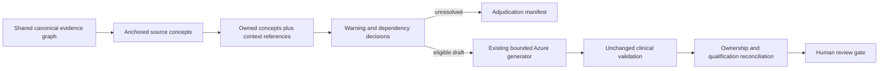

# TASK11 P1-B1 implementation review

2026-10-16. Stopped at the P1-B1 review gate. Source-anchored planning, dependency scoping and coverage reconciliation are implemented and tested. **The real corpus is not generation-ready under this policy: all 6,627 proposed units remain blocked.** Partial eligibility is demonstrated by controlled source fixtures and a real adversarial PDF, not by the 30-PDF corpus. This is a material operational limitation, not a clinical-validation or production-deployment claim.

## 1. Verified architecture and contracts

The root instructions, project engineering skill, current P0/P1-A/P1-A.1 reports, TASK11 flowcharts/stepwise plan, evidence/storage/source-map/planner/generator/validator/pipeline implementation, prompt, dependencies and test consumers were inspected. A test-module inventory and the full offline suite cover the unchanged consumers; focused tests exercise modified boundaries. The [planning contracts](p1b1-planning-contracts.md) were recorded before the first failing regressions.

The PDF extractor and clinical validator remain unchanged. Extraction still builds its existing bounded preflight description. Actual PDF processing then uses its already-built source map to create one clinical plan, passes that same plan to diagnostics and generation, and stores it through the P1-A.1 compressed source-map interface. Direct `generate_chunks` calls with real evidence also construct a source map once; supplying a legacy range plan cannot bypass clinical eligibility. Text-only legacy calls retain the previous path and do not acquire verified PDF identity.



| Contract | Implemented behavior |
|---|---|
| `ClinicalConcept` | Stable source/configuration/version/anchor identity; canonical ownership spans; native evidence IDs; section-overlap candidates and page context; literal mentions; qualification spans; dependencies, unresolved relationships, warning decisions, eligibility and coverage state. |
| `SourceMention` | Exact spans for observable population/intervention/endpoint/group/timeframe phrases. `source_literal_only` explicitly avoids claiming a medical association from co-occurrence. No ontology, inferred disease/drug identity, or outside clinical facts. |
| `EvidenceDependency` | Available source context versus missing/unresolved table, figure or referent evidence. Caption/note records are candidates, not verified table-cell/footnote or figure associations. |
| `WarningDecision` | Confirmed overlap with owned/supporting evidence, or uncertain page/document dependency. “Confirmed affected” confirms source-coordinate overlap, not proven clinical harm or corruption. |
| `ClinicalUnit` | Compatible owned concept IDs, context-only IDs, exact ownership, eligibility/block reasons, dependency decision and actual materialized request size. No article text or full graph in the unit manifest. |
| `ClinicalPlan` | Document/configuration/canonical-buffer identity, complete source partition, all generation/adjudication units, global unresolved warning IDs, budget failures and exact-duplicate occurrence accounting. Planning never declares the document complete. |

Candidate propositions are conservative sentence/structured-paragraph anchors, not a comprehensive clinical-language understanding model. Short abbreviations stay attached to their qualifications. Recognized structural headings are context-only; unknown short text and numeric fragments require adjudication. Exact supported duplicate propositions are merged only under matching source section/domain/context, with every occurrence retained in ownership. Ambiguous repetitions and different contexts remain separate.

`EvidenceIndex` reuses the shared graph and indexes target mapping ends for bounded range lookup. All 30 full-canonical traces match the original tracing helper, including exact/region precision and synthetic spans. Section IDs explicitly carry `raw_overlap_candidates` semantics; they are not asserted as uniquely verified clinical section associations. Missing associations or material nonexact source regions prevent eligibility.

## 2. Dependency and eligibility policy

Explicit group references can use a unique earlier literal intervention definition in the same source domain. Missing/multiple definitions, anaphora and population/context conflicts stay unresolved. Neighboring population/intervention/endpoint context, contrast statements and its known context closure are retained by reference. Context availability is not semantic proof that every nearby clinical statement applies. Table/figure references remain blocked if their material relationships cannot be established, even when a caption or candidate note exists.

Warnings are scoped to the concept's owned evidence and required context. Exact warning-span/native-trace overlap is confirmed affected evidence. A page-scoped visual/order warning without a verified relationship remains an uncertain dependency for units using that page. An unlocalized material warning remains conservatively document-scoped. No graphic is automatically decorative, and no unresolved warning is removed from document completeness merely because a unit is unrelated.

Only eligible draft units are sent to Azure. Requests distinguish **OWNED SOURCE** from **CONTEXT ONLY**. Concept IDs and provenance remain internal metadata, never extra chunk fields. Compatible propositions can share a unit/chunk; no one-concept/150–250-word mandate or padding is introduced. Existing word-count checks remain unchanged and may still reject or require review of a short draft.

All required source/context must fit the existing configured request budget (default 20,000 source-packet characters and 80 eligible requests). Oversized material stays represented and blocked rather than being truncated. Metadata-only adjudication units are retained even when their count exceeds the request limit; they are not Azure requests. Verified citation binding, Azure transport outcomes, schema validation and clinical checks still apply independently and may reject a source-eligible draft.

## 3. Generation, coverage and job lifecycle

`GenerationBatch` remains backward-compatible for legacy callers. Source-anchored batches carry ownership/context/concept IDs and use an empty `text` field; text is materialized from the shared graph only when building a request. Their min/max character bounds are descriptive envelopes; exact ownership is the span list. `IngestionPlan.clinical_plan` and `SourceDocument.clinical_plan` reference the same plan in memory.

Generated chunks retain only the existing five content fields plus operational numbering. Diagnostics record which eligible unit produced each final chunk, including origins retained after exact output deduplication. No per-unit response journal or resume mechanism was added. Later request failure still rejects the returned package under the existing behavior; candidate accounting remains available but is not durable recovery.

Coverage reconciliation requires all of the following before crediting a concept:

1. Its unit was eligible and recorded as the chunk's origin.
2. Existing clinical validation gives the chunk an unambiguous PASS.
3. The full owned proposition and required literal population/intervention/endpoint/group qualifications are present, with whitespace normalization only.

Paraphrases may remain uncredited and require review even if other clinical checks pass. A context quotation cannot complete the context concept's own work, and a single supported concept cannot mark its whole section processed. Heading-only documents cannot become complete. Clinical approval counts remain zero.

Section review status is reconciled against the owned concepts rather than a single fuzzy section link. Any unresolved critical/uncertain document evidence continues to prevent complete source coverage. Incomplete planned documents return `partial_success` when drafts are reviewable and keep their source PDF in place, even if the generated chunks individually pass validation. No eligible units means an extraction/planning block before a provider request, not a fabricated successful draft.

Whole-package reuse remains distinct from per-unit recovery. A planned run cannot treat old P1-A/P1-A.1 output as concept-complete merely because the source hash matches. New planned review directories are fingerprinted and preserve existing valid or failed packages. Reuse requires a matching plan and complete source coverage; incomplete packages are not resumed. Legacy text-only directory/reuse behavior is unchanged. Explicit force semantics are preserved, but no forced processing of historical data was performed in this milestone.

## 4. Actual corpus and performance results

The same 30 PDFs / 350 pages were audited without generating new clinical output. The original baseline had 86 bounded contexts and nine documents with existing extraction blockers; it had no concept-level work/qualification reconciliation.

| Check | Observed P1-B1 result |
|---|---:|
| Canonical characters explicitly owned | 1,411,522 / 1,411,522 |
| Unassigned/overlapping owned characters | 0 / 0 |
| Candidate source concepts, including adjudication material | 20,123 |
| Clinical-proposition candidates | 6,406 |
| Unclassified source fragments | 13,279 |
| Structural headings / table notes / table captions / figure captions | 244 / 26 / 95 / 73 |
| Proposed generation/adjudication units | 6,627 |
| Confirmed-affected / uncertain-dependency units | 2,149 / 4,478 |
| Independently supported / eligible real-corpus units | **0 / 0** |
| Retained unresolved document warnings | 4,167 |
| Named section / citation-candidate slices | 314/314 / 90/90 |
| Original versus indexed full-source trace equality | 30/30 |
| Unmapped canonical spans | 0 |
| Persisted plan/evidence exact model read-back | 30/30 |
| Historical expanded / compressed artifact read-back | 30/30 / 30/30 |
| False complete coverage with all sections marked processed | 0 |
| Changed protected input/processed/output files | 0 / 302 |
| Live requests / new clinical outputs / clinical approvals | 0 / 0 / 0 |

Zero unmapped spans does not mean every character has a unique, clinically verified native origin. Synthetic separators/insertions and region mappings remain distinguished. Concepts without usable native support or with ambiguous material transformations are held. There were no eligible exact duplicate occurrences to merge in this corpus; controlled tests verify duplicate handling without deleting their source occurrences.

The zero-eligibility result is substantive. The prior 2,474 unclassified visual signals, 1,176 clinical-unresolved and 517 possible-corruption warnings remain present. Page/document uncertainty and context propagation prevent generation; section/native-source ambiguity and the conservative role/scope rules add adjudication work. Counts of concept-level reasons overlap: 20,073 concepts carry an evidence-warning reason, 3,945 a nonexact-region reason, 2,823 an unresolved section association, and 1,607 a missing usable native projection. These are not independent counts of proven clinical extraction errors. **The implementation does not yet demonstrate useful real-corpus draft throughput and must not be described as doing so.**

Observed performance on this corpus:

| Measurement | Result |
|---|---:|
| Extract/build source maps, total | 82.41 s |
| Additional unprofiled source-anchored planning, total | 25.38 s |
| Planning median / maximum per PDF | 0.77 s / 3.47 s |
| Maximum incremental traced planning allocation | 32.22 MB |
| Expanded plan manifests, total / largest | 78.51 MB / 6.94 MB |
| Compressed evidence plus plans, total / largest artifact | 25.20 MB / 1.24 MB |
| P1-A.1 compressed evidence baseline, total | 20.12 MB |
| Artifact write / validating read-back, total | 11.06 s / 14.54 s |
| Complete audit wall time, including profiling and cross-checks | 410.75 s |

The persisted increase is about 5.08 MB (25.3%); source buffers are not copied into unit manifests. Manifest size is still substantial because warning/context IDs repeat. Compression and the existing storage interface are reused; no second storage framework is introduced.

Planning allocation was measured using a repeated deterministic build on the already-shared graph, with `tracemalloc` started for that build. It excludes the resident evidence graph and is not total process RAM. Unprofiled timing is the initial build; audit wall time includes profiling, legacy preflight, full trace comparisons, serialization and read-back. These local observations are not latency guarantees or a concurrent/very-large-document memory bound. No per-generation-unit graph deserialize/copy is performed.

## 5. Exact files and functions changed

| File | Change |
|---|---|
| `src/concept_planner.py` (new) | `SourceMention`, `EvidenceDependency`, `WarningDecision`, `ClinicalConcept`, `ClinicalUnit`, `ClinicalPlan`; `EvidenceIndex.__init__/trace/pages`; `_atoms`, `_role`, `_overlap`; `build_clinical_plan`, `validate_clinical_plan`, `materialize_unit`, `required_qualification_spans`, `reconcile_concept_coverage`. |
| `src/source_map.py` | Optional `SourceDocument.clinical_plan`; `mark_processed_sections_from_validation` optionally requires complete owned concept coverage; `build_coverage_report` carries reconciliation and refuses unreconciled/partial plan completeness. Existing section extraction is unchanged. |
| `src/adaptive_ingestion.py` | Additive concept/context fields on `GenerationBatch`, optional plan on `IngestionPlan`; `build_ingestion_plan` accepts a source map; `_source_anchored_plan`; factored `_document_type` preserves routing hints. Legacy range planning remains available for extraction preflight/text-only callers. |
| `src/chunk_generator.py` | `generate_chunks` automatically gates real evidence and accepts the shared plan/map; `_generate_clinical_units` reuses `_generate_single_batch`, records chunk origins and preserves schema/reference checks. No provider implementation change. |
| `src/pipeline.py` | `process_pdf` builds one plan before reuse checks, passes it to generation, reconciles coverage and retains incomplete source PDFs; `build_generation_diagnostics` separates owned/context/document/request counts; `find_reusable_output_for_source`, `reusable_output_matches_source`, `select_output_dir_for_processing`, new `planned_output_dir` protect historical packages and prevent legacy/partial completion reuse. |
| `src/evidence_storage.py` | `_validate_optional_plan` called at save/load boundaries, retaining the existing format and legacy read support. No new persistence framework or response checkpoint files. |
| `tests/test_concept_planning.py` (new) | 27 regression cases, including typed span/qualification/dependency integrity, real-PDF isolation and pipeline lifecycle/reuse boundaries. Existing tests and expected NEJM references were not relaxed. |
| `tools/check_concept_planning.py` (new) | `check`, `main`: source/text/hash/range comparison, full indexed trace equivalence, plan validation, coverage checks, profiling, compressed persistence/read-back and protected-file audit. |
| Documentation | This review, `p1b1-planning-contracts.md`, and the design-only `p1b2-recovery-design.md`. Historical reports are preserved. |

`src/pdf_extractor.py`, `src/evidence.py`, `src/chunk_validator.py`, provider configuration/implementations, prompts and dependencies were not changed in P1-B1. The five-field Admin Panel contract remains intact.

## 6. Test-first verification and limits

The initial ten new cases failed before the new module/contracts existed. Subsequent failing tests exposed unresolved context promotion, abbreviation/qualification splitting, assumed group/population links, unknown short data hidden as headings, exact duplicate proposals, invalid qualification offsets, whole-section overcredit, heading-only completion, missing context qualifications, legacy-output reuse/overwrite, default-generator bypass, and incomplete source movement. Those cases were corrected before final verification.

Final targeted run: **152 passed, 9 subtests passed** (2.53 s). Final full run:

```powershell
python -m pytest -q -p no:cacheprovider --tb=short
```

**407 passed, 2 skipped, 9 subtests passed** (21.27 s). Existing 380-pass P1-A.1 coverage is retained and 27 new cases pass. The two skips are still the original five-NEJM fixture test and the fixture-dependent ABC-02 assertion. **The five original NEJM PDFs remain unavailable mandatory release requirements and were not reported as passed.**

Adversarial tests use controlled extracted evidence and a separate native two-page PDF with figure/visual material on one page and independently scoped text on the other. Provider calls and PASS reports in reconciliation/lifecycle tests are mocked; those tests establish bookkeeping/gating, not clinical validity. No live generation was run.

The corpus audit writes only to the new temporary audit directory `C:/Users/Admin/AppData/Local/Temp/gastroagi-p1b1-bc_rr5pz/`. It contains `corpus/metrics.json`, new compressed review maps, `protected.json` and `legacy-readback.json`. No PDF or medical source text is embedded in this report or committed in the verification tool. All 30 saved plans were subsequently read and validated with the final span-validation guards, and all 302 historical files were rechecked unchanged after the full tests.

Reproduction, with a new audit destination:

```powershell
python -m tools.check_concept_planning --baseline <original-before.json> --protected <protected-hashes.json> --directory <new-audit-directory> --profile
```

The indexed lookup follows the documented [Python bisect](https://docs.python.org/3.13/library/bisect.html) contract. Contracts use the existing installed Pydantic serialization API; its [official serialization documentation](https://docs.pydantic.dev/latest/concepts/serialization/) was consulted. Existing APIs were exercised locally; no dependency or SDK upgrade was needed.

## 7. Review decision needed before further implementation

Structural ownership, integrity, compatibility and offline regression criteria are verified. Actual clinical fidelity, draft quality and useful real-corpus generation remain unverified. The high block rate is explained and visible, not repaired by relaxing clinical checks.

False-positive risks include page-level graphics/order warnings, conservative source-role tagging, abbreviation boundaries, strict literal population/group matching, inherited context uncertainty, ambiguous native/section projections, bibliography/boilerplate transformations, and exact-quote reconciliation that cannot credit many legitimate paraphrases. Caption-adjacent notes remain candidate associations only. No drawing is automatically decorative, no entity aliases are assumed, and incomplete figures/tables remain blocked.

The next empirical need is independently reviewed source/dependency adjudication and targeted extraction/mapping corrections on representative corpus pages, with new regressions before changing eligibility. Moving directly to recovery would preserve blocked or unverified work more durably without resolving the current throughput limitation.

The [P1-B2 design](p1b2-recovery-design.md) is provided as a conditional proposal based on validated P1-B1 identities and accounting. **No durable generation-unit recovery has been implemented. Stopped at the P1-B1 review gate.**
